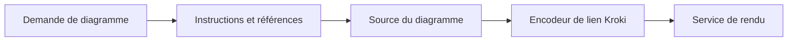

# uml-skill : Des instructions et un petit encodeur de secours

> uml-skill regroupe des instructions de rédaction de diagrammes et un petit outil Python. C’est un ensemble d’instructions, sans serveur MCP ni modèle de…

- Page HTML: https://antoineboucher.info/CV/blog/fr/projects/notes/uml-skill/
- Langue: fr
- Traduction (en): https://antoineboucher.info/CV/blog/projects/notes/uml-skill/index.md
- Publié: 2026-10-23
- Mis à jour: 2026-10-23
- Auteur: Antoine Boucher (https://antoineboucher.info/CV/index-en.html)

- Dépôt: https://github.com/antoinebou12/uml-skill
- Licence: MIT
- Révision inspectée: 05b27cdbe68ea3a9543b8ce8f66586b62194892a

## Résumé

uml-skill regroupe des instructions de rédaction de diagrammes et un petit outil Python. C’est un ensemble d’instructions, sans serveur MCP ni modèle de génération d’images. L’outil peut produire un lien Kroki depuis la source.

**Pourquoi il existe:** Bundle de compétences IA fournissant définitions d'outils et guides pour générer des diagrammes.

**Cas d’usage:** Intégration directe de génération UML dans des agents autonomes.

## Cas d’utilisation

Skill d'agent (diagramming-uml) qui guide les agents IA pour écrire une source de diagramme et la rendre via uml-mcp ou Kroki.

- **Installer le skill** (Développeur, Agent IA de code): Le README propose npx @smithery/cli@latest skill add antoinebou12/uml, ou la copie du dossier dans .cursor/skills/diagramming-uml/ pour que l'agent charge SKILL.md.
- **Planifier et écrire le code** (Agent IA de code): SKILL.md fait passer l'agent par le but, le type de diagramme, le plan et les règles de lisibilité (environ 25 nœuds Mermaid ou 30 PlantUML, transitions étiquetées) avant d'écrire la source.
- **Choisir un diagram_type** (Agent IA de code): references/DIAGRAM-TYPES.md associe des intentions (séquence, couloirs, ER, architecture…) à un diagram_type Kroki et à une forme Mermaid ou PlantUML, à confirmer avec uml://types.
- **Rendre via uml-mcp** (Agent IA de code, uml-mcp / Kroki): Quand uml-mcp est branché, le skill demande à l'agent d'appeler validate_uml puis generate_uml ou generate_uml_batch, et de rendre l'URL Kroki et le lien du terrain de jeu.
- **Créer une URL Kroki sans MCP** (Développeur, uml-mcp / Kroki): Sans MCP, scripts/kroki_url.py compresse la source avec zlib, l'encode en base64url et affiche une URL https://kroki.io/<backend>/<format>/…

### Scénario : Obtenir un lien partageable vers une séquence

1. Installer le skill avec npx @smithery/cli@latest skill add antoinebou12/uml.
2. Demander à l'agent un diagramme de séquence d'un paiement ; le skill s'active sur la demande de diagramme.
3. L'agent choisit sequence ou le sequenceDiagram de Mermaid dans la table d'intentions et écrit la source.
4. Avec uml-mcp branché, il appelle validate_uml et generate_uml, puis répond avec l'URL, le lien du terrain de jeu et une copie du code.
5. Sans uml-mcp, lancer python scripts/kroki_url.py -t mermaid diagram.mmd pour obtenir le lien.

## Langages (octets GitHub Linguist)

| Langage | % |
| --- | ---: |
| Python | 100 |

## Démarrage (commandes du dépôt, non exécutées ici)

### scripts/README.md · Usage

```bash
python kroki_url.py --help
```

### scripts/README.md · Usage

```bash
python kroki_url.py -t mermaid diagram.mmd
python kroki_url.py -t plantuml -f png diagram.puml
```

### scripts/README.md · Usage

```bash
Get-Content diagram.puml -Raw | python kroki_url.py -t plantuml
```

### scripts/README.md · Usage

```bash
cat diagram.puml | python kroki_url.py -t plantuml
```


## Fonctions et composants

- **Couche d’instructions** — SKILL.md décrit le parcours et renvoie vers des références. Un agent peut suivre ces instructions avec les outils disponibles. Les références donnent des indications de syntaxe, sans constituer un environnement applicatif.
- **Outil d’encodage** — scripts/kroki_url.py utilise la compression et l’encodage de la bibliothèque standard pour construire un lien de rendu. Produire ce lien et récupérer l’image sont deux opérations distinctes.

## Architecture

Composants et connexions vérifiés dans le dépôt.

- Demande de diagramme → Instructions et références
- Instructions et références → Source du diagramme
- Source du diagramme → Encodeur de lien Kroki
- Encodeur de lien Kroki → Service de rendu



**Un parcours dans le code:** Lisez l’encodeur pour suivre la source vers une charge compatible avec un lien. L’outil transporte la source; la validité et la qualité visuelle dépendent encore du langage et du moteur.

## Limites et points à vérifier

La charge du lien est récupérable, sans chiffrement. Les instructions ne garantissent pas la disponibilité du moteur externe choisi.

## Fichiers à lire

- [scripts/kroki_url.py](https://github.com/antoinebou12/uml-skill/blob/main/scripts/kroki_url.py)
- [README.md](https://github.com/antoinebou12/uml-skill/blob/main/README.md)


