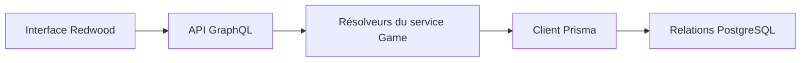

# WordsEnigma : Un jeu de mots entre Redwood et Prisma

> WordsEnigma est un fork avec deux espaces Redwood, web et API. Son modèle relie utilisateurs, langues, banques de mots, parties et essais. Les services…

- Page HTML: https://antoineboucher.info/CV/blog/fr/projects/notes/wordsenigma/
- Langue: fr
- Traduction (en): https://antoineboucher.info/CV/blog/projects/notes/wordsenigma/index.md
- Publié: 2026-10-23
- Mis à jour: 2026-10-23
- Auteur: Antoine Boucher (https://antoineboucher.info/CV/index-en.html)

- Dépôt: https://github.com/antoinebou12/WordsEnigma
- Licence: Unlicense
- Révision inspectée: a6564499a87c1442c51ea57e5b01f954654e2180

## Résumé

WordsEnigma est un fork avec deux espaces Redwood, web et API. Son modèle relie utilisateurs, langues, banques de mots, parties et essais. Les services GraphQL traduisent les opérations en appels Prisma.

**Pourquoi il existe:** Moteur de jeu et validateur de dictionnaires en TypeScript supportant plusieurs langues et longueurs de mots.

**Cas d’usage:** Logique de jeu de lettres algorithmique et heuristiques de résolution.

## Cas d’utilisation

Prototype RedwoodJS d'un Wordle multilingue, avec grille de mots en français, API GraphQL et gestion admin sur PostgreSQL.

- **Deviner un mot de 5 lettres** (Joueur): La page /phil (MotDuJourPhilPage/App.tsx) donne six essais sur une grille 6×5, refuse les mots absents de la liste française de data/fr.ts et colore les lettres et les touches ; la solution est codée en dur (GRAND).
- **Créer un compte** (Joueur): /signup, /login, /forgot-password et /reset-password passent par dbAuth de Redwood (api/src/functions/auth.ts) sur le modèle User, avec mot de passe haché et sel.
- **Gérer mots et banques** (Administrateur): Les routes sous /admin, protégées par Private roles="admin", offrent des pages CRUD générées pour utilisateurs, langues, mots, banques de mots, parties, essais, lettres et statistiques via les services GraphQL.
- **Charger les mots français** (Administrateur, Dictionnaires en ligne): yarn seed lance scripts/seed.ts, qui crée les langues et la banque de mots fr, puis récupère les définitions sur fr.wiktionary.org ou le-dictionnaire.com avec le robot cheerio avant d'insérer les mots.
- **Suivre parties et séries** (Joueur): Le schéma Prisma enregistre chaque Game avec ses TryRow et Letter, et une ligne Statistic par utilisateur (parties jouées, gagnées, perdues, série, moyenne) ; le modèle existe, mais les pages de jeu ne l'alimentent pas encore.

### Scénario : Lancer la grille française en local

1. Démarrer PostgreSQL avec docker run --name=db -e POSTGRES_USER=admin -e POSTGRES_PASSWORD=admin -p 5432:5432 -d postgres, comme dans le README racine.
2. Dans WordsEnigma/, lancer yarn install, puis yarn rw prisma migrate dev pour appliquer api/db/migrations.
3. Lancer yarn seed pour charger les langues, la banque fr et les mots.
4. Démarrer yarn redwood dev et ouvrir http://localhost:8910/phil.
5. Taper cinq lettres, valider et lire les couleurs jusqu'à trouver le mot ou épuiser les six lignes.

## Langages (octets GitHub Linguist)

| Langage | % |
| --- | ---: |
| TypeScript | 97.12 |
| CSS | 2.22 |
| JavaScript | 0.4 |
| Dockerfile | 0.16 |
| HTML | 0.07 |
| Shell | 0.02 |

## Fonctions et composants

- **Relations des données** — schema.prisma utilise PostgreSQL. Une Game appartient à un utilisateur et à un mot, référence une banque et possède des essais. Les langues relient mots et préférences; le multilinguisme possède donc un modèle persistant.
- **Services et persistance** — games.ts expose les opérations de liste, lecture, création, modification et suppression avec db.game. Les résolveurs de relations chargent utilisateur, mot, banque et essais. Cette couche relie les opérations GraphQL au modèle de données.

## Architecture

Composants et connexions vérifiés dans le dépôt.

- Interface Redwood → API GraphQL
- API GraphQL → Résolveurs du service Game
- Résolveurs du service Game → Client Prisma
- Client Prisma → Relations PostgreSQL

**Un parcours dans le code:** Suivez le résolveur game vers findUnique, puis ses relations. Ces méthodes CRUD ne décrivent pas à elles seules la validation des essais et ne prouvent pas qu’un utilisateur accède seulement à ses propres parties.

## Limites et points à vérifier

Le manifeste vise une ancienne chaîne Redwood et Node. Autorisations et règles du jeu doivent être examinées au-delà de la forme des services avant redéploiement.

## Fichiers à lire

- [WordsEnigma/package.json](https://github.com/antoinebou12/WordsEnigma/blob/main/WordsEnigma/package.json)
- [WordsEnigma/api/db/schema.prisma](https://github.com/antoinebou12/WordsEnigma/blob/main/WordsEnigma/api/db/schema.prisma)
- [WordsEnigma/api/src/services/games/games.ts](https://github.com/antoinebou12/WordsEnigma/blob/main/WordsEnigma/api/src/services/games/games.ts)

