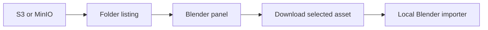

# My bloc fork: browsing S3 and MinIO from Blender

> A code tour of my Blender cloud-storage fork: multiple connections, folder browsing, fuzzy search and mesh imports.

- HTML page: https://antoineboucher.info/CV/blog/posts/bloc-blender-cloud-storage/
- Language: en
- Translation (fr): https://antoineboucher.info/CV/blog/fr/posts/bloc-blender-cloud-storage/index.md
- Published: 2026-10-23
- Updated: 2026-10-23
- Tags: Blender, Python, S3, MinIO, Open Source
- Author: Antoine Boucher (https://antoineboucher.info/CV/index-en.html)My [`bloc` repository](https://github.com/antoinebou12/bloc) is a fork of [MrKuros/Blender-Cloud-Storage](https://github.com/MrKuros/Blender-Cloud-Storage). It keeps the upstream author credit and explores a Blender panel for browsing assets in AWS S3 and MinIO.

## The browsing and import paths

Listing creates the panel’s folder view; loading an asset downloads its bytes and invokes a local importer. A listing refresh can therefore succeed while an import fails on an unsupported format. The background refresh hands UI updates back through Blender timers instead of treating the storage request as a UI operation.

[Read the architecture note with the connection and import boundaries](https://antoineboucher.info/CV/blog/projects/notes/bloc/).

## Make the connection explicit

[`addon.py`](https://github.com/antoinebou12/bloc/blob/main/addon.py) defines a `CloudConnection` property group with a provider, endpoint, bucket and region. Preferences hold multiple connections and an active connection index. The client setup chooses the S3 or MinIO path from that selection.

This is the part that interests me as both graphics and platform work: the artist works inside Blender, while the add-on translates those actions into object-storage operations.

## Turn object names into folders

Object storage uses keys. The refresh operator splits those keys on `/` and builds a nested dictionary for the panel. Folder expansion is tracked separately, so the UI can browse a hierarchy without pretending it is a local filesystem.

`CloudSearchManager` adds fuzzy matching with RapidFuzz. It scores filenames and path segments, gives direct substring matches priority and supports filters for scenes, meshes, images and materials.

## Downloading and importing are different actions

The download helper saves an object to a temporary local path. The load operator then selects a Blender importer for STL, OBJ, PLY or USD variants. Other extensions are rejected with a message. A successful transfer alone does not mean Blender has imported a usable object.

The upload-current-file operator sends the saved `.blend` file. Although the README discusses dependencies, I would verify texture packaging and relative paths before relying on this path to move a complete scene.

## Keep the fork’s scope visible

The public [upstream comparison](https://github.com/antoinebou12/bloc/compare/MrKuros:main...main) showed 10 commits ahead and 5 behind on October 23, 2026. The changed files include the add-on, packaging metadata and README. That describes repository history; it does not establish that upstream accepted those changes.

The source also uses a single S3 `list_objects_v2` request, so buckets beyond one response need pagination work. These are the kinds of small workflow boundaries I want to keep visible when revisiting the project.
