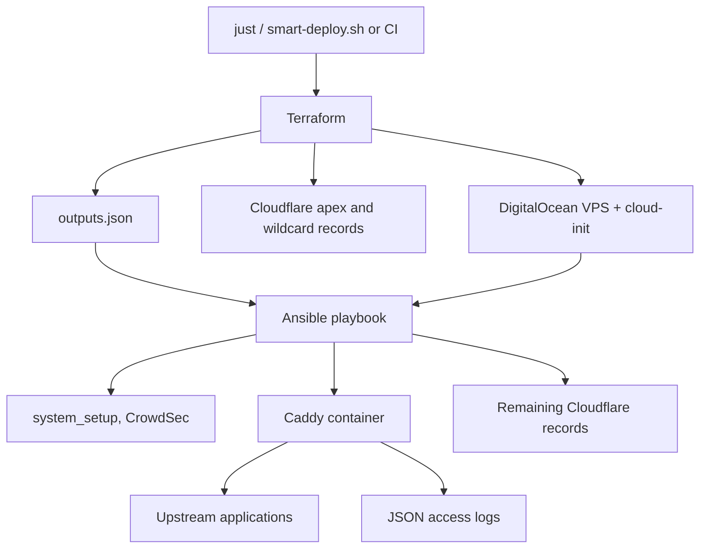

# My reverse proxy: separating provisioning, configuration and health checks

> A code-based look at my Caddy infrastructure: Terraform for the VPS and DNS, Ansible for configuration, the order a deployment really runs in, and why its health checks and CI do not gate anything yet.

- HTML page: https://antoineboucher.info/CV/blog/posts/reverse-proxy-infrastructure/
- Language: en
- Translation (fr): https://antoineboucher.info/CV/blog/fr/posts/reverse-proxy-infrastructure/index.md
- Published: 2026-10-22
- Updated: 2026-11-05
- Tags: Caddy, Terraform, Ansible, Cloudflare, DevOps
- Author: Antoine Boucher (https://antoineboucher.info/CV/index-en.html)My reverse-proxy project runs Caddy in Docker on a DigitalOcean VPS, with Cloudflare DNS in front. Terraform creates the infrastructure, Ansible configures it, and a set of checks looks at the resulting service.

This article describes the configuration as I reviewed it in October and November 2026. The source is private, so the diagram and excerpts are simplified and contain no real domains, addresses or credentials. I read the code without running a deployment, so the findings below are about what the code does, not about measured incidents.

## Two kinds of change

The Terraform side is small and split by concern: `versions.tf` pins the DigitalOcean (`~> 2.0`) and Cloudflare (`~> 4.0`) providers, `digitalocean.tf` declares one droplet and its cloud firewall, `cloudflare.tf` declares the DNS records, and `variables.tf` / `outputs.tf` define the interface. The defaults describe a modest machine: Ubuntu 22.04, 1 vCPU and 1 GB of RAM, IPv6 and monitoring enabled.

The DNS file creates four records: apex and wildcard, each as A and AAAA, proxied through Cloudflare by default. Every record uses `count`, so the VPS can be created without DNS when no Cloudflare token or zone is configured.

Ansible handles everything on the server. A `justfile` provides the entry points (`deploy`, `caddy`, `provision`, `validate`, `download-logs`, ...), and most of them call a single `smart-deploy.sh` script that decides whether to provision first.



The arrows describe responsibilities, not a guarantee that every command follows the same path.

### The hand-off between Terraform and Ansible

Terraform writes its outputs to `outputs.json`, and the playbook reads that file in a pre-task. One output exists only to settle DNS ownership:

```hcl
output "terraform_managed_dns" {
  description = "Flag indicating DNS is managed by Terraform (for Ansible to skip apex/wildcard)"
  value       = length(cloudflare_record.apex) > 0
}
```

When the flag is true, the `cloudflare_dns` role only checks that the apex and wildcard records exist and leaves them alone. When it is false, Ansible manages them itself. That is the right idea: one owner per record, and the owner is explicit.

Two details weaken it. First, the reset path of `smart-deploy.sh` is a third actor. With `--reset` it deletes droplets and the firewall by name through the DigitalOcean API, deletes the apex and wildcard records through the Cloudflare API, then runs `terraform state rm` on the matching resources before applying again. And `just setup`, which the README presents as the first command to run, is an alias for `--reset --force`: it destroys and recreates the server without asking. Second, the AAAA records carry `ignore_changes = [content]` while the A records do not, so if the droplet is replaced outside the reset path, Terraform updates the IPv4 records but keeps the old IPv6 address.

## The order a deployment really runs in

The playbook runs its pre-tasks (load the environment, read Terraform outputs, regenerate the inventory, optionally provision), then these roles in order:

1. `system_setup`: packages, Docker check, UFW, fail2ban, zsh, chrony.
2. `wireguard`, only when `WIREGUARD_ENABLED` is set. It writes the configuration and enables IP forwarding; it does not generate keys or start the tunnel.
3. `crowdsec`: the CrowdSec engine in a container, plus the iptables firewall bouncer package. Caddy gets its own bouncer later, inside the Caddy role.
4. `caddy`.
5. `umami`, only when `UMAMI_ENABLED` is set.
6. `cloudflare_dns`, subject to the ownership flag above.

Inside the Caddy role, the order matters more than the list of features:

1. Back up the current Caddyfile with a timestamp suffix and keep the newest five (configurable, never fewer than one).
2. Create the CrowdSec bouncer key, if the bouncer is enabled.
3. Render the new Caddyfile **directly to the live path**, write the compose file, build the custom image (on the VPS, or locally and uploaded as a tar), run `docker compose down`, then `up -d`, wait for the admin port, then `docker compose restart`.
4. Validate: check that the image contains the expected plugins with `caddy list-modules`, then run `caddy validate` against the deployed file inside that same image.
5. Collect deployment metrics in a `block` whose `rescue` runs the rollback tasks.

Step 4 is a good check in the wrong place. Validating with the real image catches a class of errors that a stock `caddy:latest` cannot, because the Caddyfile uses directives from plugins (CrowdSec bouncer, Cloudflare DNS, MaxMind geolocation) built in with `xcaddy`. But by the time it runs, the new file is already live and the container has already been restarted on it. And because validation sits outside the `block`, a failed `caddy validate` stops the play without triggering the rollback.

The structural endpoint checks that I had described in the first version of this article (each endpoint needs a hostname plus an upstream, a redirect or wildcard children, and TLS providers must exist) only run in the template's optional "programmatic endpoints" mode, which is off by default. In the default mode, `caddy validate` is the only real check.

Restarting the container is also heavier than needed. `down` followed by `up` drops every connection on every deployment. Caddy can apply a new configuration in place through its admin API or `caddy reload`, and rejects it without touching the running config if it does not load.

The order I want instead: render to a temporary path, validate it with the real image, then move it into place and reload. A failed validation should leave the running service untouched.

## Caddyfile patterns worth keeping

The template is built from snippets that each site block imports:

- `log_site`: one JSON log file per site, rotated at 10 MB, five files kept for seven days.
- `security_headers` and `common_site`: HSTS, `nosniff`, `X-Frame-Options`, a restrictive `Permissions-Policy`, the `Server` header removed, zstd/gzip compression.
- `block_scanners`: return 404 for `.env`, `.git`, WordPress and `phpinfo`-style paths and anything ending in `.php`, before the request reaches an upstream.
- `reverse_proxy_secure`: a 5 s dial timeout, a 10 s response-header timeout, at most 10 connections per upstream host, and trace/span IDs forwarded as headers.
- Optional geo-blocking with the MaxMind GeoLite2 database, guarded by the plugin check above.

The admin API is bound to the container's loopback interface. Metrics and log files are reachable only through dedicated site blocks that reject any client outside a `remote_ip` allowlist.

Several hostnames front static GitHub Pages projects. That needs a path rewrite and two header fixes, because GitHub Pages routes on the `Host` header and its redirects point at the `github.io` address:

```caddyfile
(ghpages_site) {
	@root path /
	rewrite @root {args[1]}/{args[2]}

	@notprefix not path {args[1]}*
	rewrite @notprefix {args[1]}{path}

	reverse_proxy https://<user>.github.io {
		header_up Host <user>.github.io
		header_down Location (https?://<user>\.github\.io) https://{args[0]}
	}
}
```

Used as `import ghpages_site example.com /project index.html`. The site blocks in my template still repeat this logic inline instead of importing the snippet, so a fix in one place does not reach the others yet.

One comment in the template is wrong. It says the real client IP is "automatically parsed" from Cloudflare's `CF-Connecting-IP` header. Caddy does not trust forwarding headers unless the server declares `trusted_proxies` (and, for this header, `client_ip_headers CF-Connecting-IP`). Nothing in the global options does, and the Cloudflare records are proxied by default. So `{remote_ip}`, the `X-Forwarded-For` value sent upstream and the IP in the access logs all describe a Cloudflare edge server, not the visitor. Anything downstream that reasons about client IPs, including the log report below, inherits that.

## Docker, the firewall and port lists that drift

Cloud-init installs Docker, a swap file sized from RAM, UFW and fail2ban. It also installs a small systemd unit for a problem that is easy to miss: ports published by Docker bypass UFW. Docker rewrites the destination of incoming packets to the container and forwards them, so they never pass through the UFW input rules. The fix is to filter in the `DOCKER-USER` chain, which Docker leaves for this purpose. Simplified:

```bash
# Published container ports bypass UFW, so filter them in DOCKER-USER
iptables -I DOCKER-USER 1 -m conntrack --ctstate RELATED,ESTABLISHED -j ACCEPT
for p in 80 443; do
  iptables -I DOCKER-USER 2 -i "$EXT_IF" -p tcp \
    -m conntrack --ctorigdstport "$p" -j ACCEPT
done
iptables -A DOCKER-USER -i "$EXT_IF" -j DROP
```

The real script checks each rule with `iptables -C` before inserting it, so it is safe to run again, and a oneshot unit ordered after `docker.service` reapplies it at boot.

The weakness is that the list of open ports now lives in five places: the DigitalOcean firewall, UFW in cloud-init, UFW in the `system_setup` role, the `DOCKER-USER` allowlist and the compose file's `ports:`. They already disagree. For example, the compose file publishes UDP 443 for HTTP/3, but the cloud firewall and the `DOCKER-USER` rules only admit TCP, so HTTP/3 can never reach Caddy. One variable rendered into all five places would remove that class of mistake.

## A response is not the same as a healthy application

There is a `health_checks.yml` with container, admin API, HTTP, HTTPS, metrics and certificate diagnostics, and a `logging_setup.yml` that checks log permissions and disk space. Neither file is included by the role or the playbook. A task file existing in a repository is not evidence that a deployment executed it.

Even if they ran, they would not gate anything. Most tasks set `failed_when: false`, and the HTTP and HTTPS probes accept 404, 502 and 503 alongside 2xx and redirect codes. Those responses show that the proxy is reachable. They cannot show that a user-facing application works.

What does run is the playbook's `post_tasks` summary. It checks the container status, the admin API's `/config/` and `/metrics`, whether anything listens on ports 80 and 443 (with a warning that Cloudflare will answer with a 525 error otherwise), and the last container log lines that mention TLS. All of these are informational. Two more details explain why the summary is often unhelpful:

- The role's final `block` overwrites the `deployment_metrics` fact that the container tasks had filled, and sets `reload_successful`, `health_check_passed` and `metrics_accessible` back to `null`. The summary therefore falls back to its own probes.
- Those probes call the admin API on the host's loopback. The admin API listens on the container's loopback, and Docker forwards a published port to the container's network interface, not to its loopback. As written, I would expect these probes to fail even when Caddy is healthy. I have not confirmed this on the server.

A useful gate needs an expected response from each application that matters (a status code and a known string, for example), and a failure that stops the deployment.

## CI that cannot fail

The CI workflow runs Ansible syntax checks, `ansible-lint`, `terraform fmt`, `terraform validate` and `just --list` on every push and pull request to `main` and `develop`. Every step has `continue-on-error: true`, so the workflow is green whatever happens. Its Caddyfile step, like the local `validate.sh`, looks for a static Caddyfile path that no longer exists since the configuration became a Jinja template, and `validate.sh` would validate with the stock `caddy:latest` image, which lacks the plugins.

Meanwhile, the deployment workflow runs on every push to `main` that touches the playbook or a role. In practice, the only check standing between a commit and production is the `caddy validate` step on the server, which runs after the new configuration is already live.

## Backup is a prerequisite, not a rollback guarantee

The rollback tasks take the backup recorded at the start of the run, or the newest `Caddyfile.backup.*` by modification time, copy it back, restart the container, and then fail the play explicitly. I like that last part: a rollback that reports success would hide the original failure.

The limit is coverage. The `rescue` only protects the final metrics block. Failures in the container tasks or in validation, which is where a bad configuration would actually show up, end the play without restoring anything. The backup is there, but restoring it is manual.

## Logs: download, then report

The configuration does not ship logs to a hosted service. `just download-logs` runs a small playbook that copies the Caddy log directory and the container's own output into a temporary folder on the VPS, zips it, downloads the archive, and cleans up. `just analyze-logs` then runs a Python script that reads the JSON access logs and builds a PDF with ReportLab: status codes, user-agent categories, latency percentiles, hourly traffic, suspicious request patterns and a list of recommendations.

It is a manual, after-the-fact view, which suits a personal proxy. An earlier version of this setup used a nightly shipper into CloudWatch instead; I described it in [Caddy, EC2, CloudWatch, Step Functions and Lambda](https://antoineboucher.info/CV/blog/posts/caddy-ec2-cloudwatch-lambda/). Because of the trusted-proxy issue above, the IP sections of the report currently describe Cloudflare more than visitors.

## What I would change first

In order of value for the effort:

1. Validate a rendered copy with the real image before it replaces the live file, then reload instead of `down`/`up`.
2. Put validation and the container tasks inside the `block` so the rollback covers them.
3. Declare Cloudflare's ranges as `trusted_proxies` and read `CF-Connecting-IP`.
4. Make CI fail on real errors and point it at the template.
5. Include one application-level check per important site, without `failed_when: false`.
6. Rename `just setup` or make it stop before destroying an existing server, and generate the port lists from one variable.

None of this is implemented yet. The review only shows where the current code stands.

*Source basis: the private repository's README, `justfile`, deployment script, Terraform files, playbook, the Caddy role (backup, container, validation, health-check, logging and rollback tasks, Caddyfile and compose templates, Dockerfile), the system, CrowdSec and WireGuard roles, the log download and analysis scripts, and the GitHub Actions workflows. Operational configuration and secrets are omitted.*
