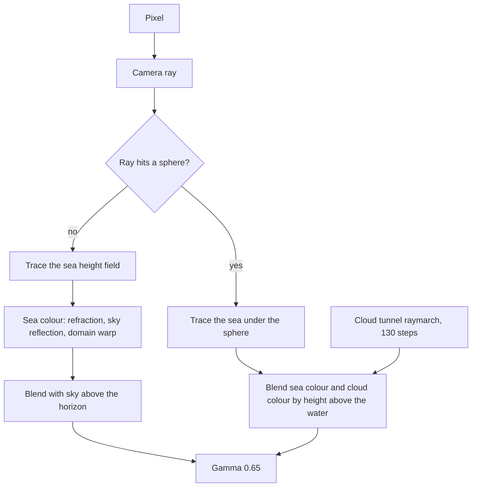

# Six Shadertoy shaders, read line by line

> A code reading of six GLSL shaders I published on Shadertoy in 2024: domain warping, a spiral, an anti-aliased grid, a sea scene, sun rays and a mouse-driven warp.

- HTML page: https://antoineboucher.info/CV/blog/posts/shadertoy-six-shaders/
- Language: en
- Translation (fr): https://antoineboucher.info/CV/blog/fr/posts/shadertoy-six-shaders/index.md
- Published: 2026-11-06
- Updated: 2026-11-06
- Tags: GLSL, Shadertoy, Shaders, Graphics, Procedural
- Author: Antoine Boucher (https://antoineboucher.info/CV/index-en.html)Between January and February 2024 I published six shaders on [Shadertoy](https://www.shadertoy.com/). Some are my own experiments, and some start from well-known shaders that I modified to learn how they work. This post reads each one line by line: what the code computes, where the ideas come from, and where the code does something other than what its comments say.

Each embed starts paused, so the page does not run six shaders at once. Press play to run one.

## How a Shadertoy shader runs

A Shadertoy image shader is one function, `mainImage`, that the GPU calls once per pixel, every frame. It receives the pixel position `fragCoord` and writes a colour to `fragColor`. A few uniforms come from the page:

- `iResolution`: the canvas size in pixels.
- `iTime`: seconds since the shader started.
- `iMouse`: the mouse position in pixels while a button is held.

There is no state between pixels or frames in a single-pass shader. Everything you see is a pure function of the pixel position, the time and the mouse. Most of the code below is about turning `fragCoord` into a useful coordinate, then turning that coordinate into a colour.

## 1. Domain Wrapping

The technique is usually called domain *warping*. Inigo Quilez describes it in his [article on warping](https://iquilezles.org/articles/warp/), and this shader follows the fractal Brownian motion example in chapter 13 of [The Book of Shaders](https://thebookofshaders.com/13/) by Patricio Gonzalez Vivo, with its colours.

### Value noise

```glsl
float random(vec2 co){
    return fract(sin(dot(co.xy, vec2(12.9898, 78.233))) * 43758.5453);
}

float noise(in vec2 _st) {
    vec2 i = floor(_st);
    vec2 f = fract(_st);

    float a = random(i);
    float b = random(i + vec2(1.0, 0.0));
    float c = random(i + vec2(0.0, 1.0));
    float d = random(i + vec2(1.0, 1.0));

    vec2 u = f * f * (3.0 - 2.0 * f);

    return mix(a, b, u.x) +
        (c - a) * u.y * (1.0 - u.x) +
        (d - b) * u.x * u.y;
}
```

`random` is the classic one-line hash. It multiplies a sine by a large number and keeps the fractional part, which gives a value between 0 and 1 that looks random but is the same for the same input.

`noise` splits the plane into unit cells. `floor` gives the cell and `fract` gives the position inside it. Each corner of the cell gets a random value, and the four values are blended. The blend weight is `u = f*f*(3 - 2f)`, the cubic smoothstep curve, so the slope is zero at cell borders and the cells join without visible creases. The last expression is bilinear interpolation of the four corners, written out by hand.

### Fractal Brownian motion

```glsl
float fbm(in vec2 _st) {
    float v = 0.0;
    float a = 0.5;
    vec2 shift = vec2(100.0);
    mat2 rot = mat2(cos(0.5), sin(0.5),
                    -sin(0.5), cos(0.50));
    for (int i = 0; i < 5; ++i) {
        v += a * noise(_st);
        _st = rot * _st * 2.0 + shift;
        a *= 0.5;
    }
    return v;
}
```

`fbm` adds five layers, or octaves, of noise. Each octave has twice the frequency and half the amplitude of the previous one, so large shapes carry fine detail. Before each new octave, the coordinate is rotated by 0.5 radians and shifted. Value noise is built on a square grid, and without the rotation the grid lines of every octave would line up and show as horizontal and vertical streaks.

### Warping the domain

```glsl
vec2 st = gl_FragCoord.xy / iResolution.xy * 3.0;

vec2 q = vec2(0.);
q.x = fbm( st + 0.00*iTime);
q.y = fbm( st + vec2(1.0));

vec2 r = vec2(0.);
r.x = fbm( st + 1.0*q + vec2(1.7,9.2)+ 0.15*iTime );
r.y = fbm( st + 1.0*q + vec2(8.3,2.8)+ 0.126*iTime);

float f = fbm(st+r);
```

This is the core idea. Instead of drawing `fbm(st)`, the shader distorts the input coordinate with more noise before sampling:

- `q` is a 2D vector of noise, one `fbm` per component, offset so the two components differ.
- `r` is noise sampled at `st + q`, so it is already warped once. Time moves it, at slightly different speeds on each axis.
- `f = fbm(st + r)` is the final value, so overall `f = fbm(st + fbm(st + fbm(st)))`.

Each level of nesting bends the pattern further, which produces the folded, marbled shapes. Two details are worth knowing. `q` is multiplied by `0.00*iTime`, so it never moves and only `r` animates. And the coordinate divides by `iResolution.xy` on both axes, so the pattern stretches with the canvas aspect ratio.

### Colour

```glsl
color = mix(vec3(0.101961,0.619608,0.666667),
            vec3(0.666667,0.666667,0.498039),
            clamp((f*f)*4.0,0.0,1.0));
color = mix(color, vec3(0,0,0.164706), clamp(length(q),0.0,1.0));
color = mix(color, vec3(0.666667,1,1), clamp(length(r.x),0.0,1.0));

fragColor = vec4((f*f*f+.6*f*f+.5*f)*color,1.);
```

The colour is built from three blends. The final value `f` picks between teal and khaki. Then the intermediate values tint it: the size of `q` pulls it toward dark navy, and `r.x` pulls it toward pale cyan. Because `q` and `r` vary differently from `f`, the colours follow the folds of the warp instead of just its brightness. The last line multiplies by the curve `f³ + 0.6f² + 0.5f`, which darkens low values faster than high ones and adds contrast.

## 2. Golden number spiral

This one is a good example of a shader whose comments describe more than its code does. Here is the colour function:

```glsl
vec3 calculateColor(vec2 uv, float time) {
    float angle = time * 0.2;
    uv = mat2(cos(angle), -sin(angle), sin(angle), cos(angle)) * uv;

    float goldenAngle = radians(137.508);
    float r = length(uv) * 8.0;
    float theta = atan(uv.y, uv.x);

    float z = mod(r, 10.0);
    float phi = mod(theta, 2.0 * 3.14);

    float primeEffect = step(0.5, fract(sin(dot(uv, vec2(12.9898, 78.233))) * 43758.5453));
    primeEffect = smoothstep(0.45, 0.55, primeEffect);

    float oddEvenEffect = mod(r, 2.0);

    vec3 primeColor = mix(vec3(0.9, 1.0, 0.7), vec3(0.1, 0.0, 0.6), abs(sin(z) + cos(phi)));
    vec3 oddColor = vec3(0.7, 0.3, 0.5);
    vec3 evenColor = vec3(0.3, 0.5, 0.7);

    vec3 col;
    if (primeEffect == 1.0) {
        col = primeColor;
    } else if (oddEvenEffect == 0.0) {
        col = oddColor;
    } else {
        col = evenColor;
    }
    col *= primeEffect * 0.5 + 0.5;
    return col;
}
```

What it actually computes:

- **Polar coordinates.** `r` is the distance from the centre and `theta` the angle. The whole image is rotated first, but by an angle that comes from the mouse, not from time: `mainImage` passes `iMouse.x / iResolution.x * 10` as `time`.
- **The golden angle is never used.** `goldenAngle` holds 137.508°, but no line reads it. The spiral in the title does not come from the golden ratio.
- **The "prime-like" points are random noise.** `primeEffect` hashes the coordinate and keeps values above 0.5, so about half of all sample points are set, at random. The `smoothstep` after it changes nothing, because its input is already 0 or 1. Nothing here tests for prime numbers.
- **The odd branch never runs.** `mod(r, 2.0)` is a continuous value, so it is almost never exactly `0.0`. In practice, every point that is not "prime" gets `evenColor`.
- **The visible structure comes from `primeColor`.** It blends two colours by `abs(sin(z) + cos(phi))`. `sin(z)` makes rings around the centre, and `cos(phi)` a gradient around the circle. Their sum reaches 2, so `mix` goes past its second colour and pushes some channels out of range. The tone mapping below brings them back.

So the image is a random 50/50 mix of two kinds of points: half show the rings and angular gradient at full intensity, and half are a flat blue at half intensity. It is an interesting texture, but not a golden spiral. A real one is a [phyllotaxis](https://en.wikipedia.org/wiki/Phyllotaxis) pattern: point number `n` sits at angle `n × 137.508°` and radius `c × sqrt(n)`. To draw it, a shader can loop over nearby `n` and keep the distance to the closest point. That would be the natural fix if I come back to this shader.

### Tone mapping and supersampling

```glsl
vec3 aces_tonemap(vec3 color) {
    mat3 m1 = mat3(0.59719, 0.07600, 0.02840,
                   0.35458, 0.90834, 0.13383,
                   0.04823, 0.01566, 0.83777);
    mat3 m2 = mat3(1.60475, -0.10208, -0.00327,
                   -0.53108,  1.10813, -0.07276,
                   -0.07367, -0.00605,  1.07602);
    vec3 v = m1 * color;
    vec3 a = v * (v + 0.0245786) - 0.000090537;
    vec3 b = v * (0.983729 * v + 0.4329510) + 0.238081;
    return pow(clamp(m2 * (a / b), 0.0, 1.0), vec3(1.0 / 2.2));
}
```

This is the widely used curve-fit of the ACES filmic tone mapper by Stephen Hill, best known from Matt Pettineo's [BakingLab](https://github.com/TheRealMJP/BakingLab). `m1` converts the colour into the ACES working space, the rational function `a / b` approximates the film response curve, and `m2` converts back. The final `pow(…, 1/2.2)` is a gamma encode for the screen.

```glsl
for (int i = 0; i < 9; i++) {
    vec2 ssCoord = fragCoord + offsets[i];
    vec2 uv = (ssCoord - 0.5 * iResolution.xy) / iResolution.y;
    uv *= 50.0 * iTime * 0.01;
    vec3 col = calculateColor(uv,(iMouse.x / iResolution.x) * 10.0);
    col = aces_tonemap(col);
    accumColor += vec4(col, 1.0);
}
fragColor = accumColor / 9.0;
```

`mainImage` samples each pixel nine times on a 3 × 3 grid of sub-pixel offsets and averages the results. This is supersampling, and it matters here because of the zoom: `uv` is multiplied by `0.5 × iTime`, so the view zooms out continuously. As time passes the rings get thinner than a pixel, and averaging nine samples keeps them from turning into moiré. The random points are averaged too, which turns them from hard dots into a finer grain.

## 3. Grid Line

```glsl
void mainImage( out vec4 fragColor, in vec2 fragCoord )
{
    vec2 uv = fragCoord / iResolution.xy;
    float gridSize = 30.0 + 10.0 * (iMouse.x / iResolution.x);

    vec2 grid = abs(fract(uv * gridSize - 0.5) - 0.5) / fwidth(uv * gridSize);
    float line = 1.0 - min(grid.x, grid.y);

    vec3 bgCol = 0.5 + 0.5 * cos(iTime + uv.xyx + vec3(0, 2, 4));
    vec3 col = mix(bgCol, vec3(1.0, 0.8, 0.1), line);

    fragColor = vec4(col, 1.0);
}
```

The shortest shader of the six, and the one with the most useful trick: a grid whose lines stay one pixel wide at any scale.

- `uv * gridSize` counts grid cells. The mouse picks between 30 and 40 cells across.
- `abs(fract(x - 0.5) - 0.5)` is the distance from `x` to the nearest whole number, so it is 0 on a grid line and 0.5 in the middle of a cell.
- `fwidth(x)` is how much `x` changes from one pixel to the next. GPUs compute it by comparing neighbouring pixels. Dividing by it turns the distance from "cells" into "pixels".
- `line = 1 - min(grid.x, grid.y)` is 1 on a line and falls to 0 one pixel away. The edge is a one-pixel ramp, which is a cheap form of anti-aliasing.

The background is the cosine palette that Shadertoy puts in every new shader: three cosines with phases 0, 2 and 4 make a hue that changes with position and time.

There is one quirk. Away from the lines, `line` keeps falling below 0, to about −10 in the middle of a cell on a typical canvas. `mix` with a negative weight does not stop at the background colour. It moves away from yellow, so most channels inside each cell are pushed past 0 or 1, and the display clips them to flat, saturated colours. Only the pixels next to each line show the smooth gradient. Writing `line = 1.0 - min(min(grid.x, grid.y), 1.0)` keeps the weight in range and shows the full background. Since `uv` is divided by the canvas size on both axes, cells are also slightly wider than tall on a landscape canvas.

## 4. Sea and Stars

This shader is a collage. I combined three well-known Shadertoy shaders with the domain warp from the first shader, and added spheres that sit in the water. Credit for the pieces:

- The ocean is [Seascape](https://www.shadertoy.com/view/Ms2SD1) by Alexander Alekseev (TDM).
- The star field in the sky is [Star Nest](https://www.shadertoy.com/view/XlfGRj) by Pablo Román Andrioli (Kali).
- The clouds inside the spheres are [Protean clouds](https://www.shadertoy.com/view/3l23Rh) by nimitz.

Each original has its own licence, stated on its page, and those terms apply to the borrowed code. The full source is on the Shadertoy page; the excerpts below show the parts that matter.



### The sea

The sea is a height field: for each `x, z` position, `map` returns how far a point is above the water.

```glsl
float sea_octave(vec2 uv, float choppy) {
    uv += noise(uv);
    vec2 wv = 1.0-abs(sin(uv));
    vec2 swv = abs(cos(uv));
    wv = mix(wv,swv,wv);
    return pow(1.0-pow(wv.x * wv.y,0.65),choppy);
}

float map(vec3 p) {
    float freq = SEA_FREQ, amp = SEA_HEIGHT, choppy = SEA_CHOPPY;
    vec2 uv = p.xz; uv.x *= 0.75;
    float d, h = 0.0;
    for(int i = 0; i < ITER_GEOMETRY; i++) {
        d = sea_octave((uv+SEA_TIME)*freq,choppy);
        d += sea_octave((uv-SEA_TIME)*freq,choppy);
        h += d * amp;
        uv *= octave_m; freq *= 1.9; amp *= 0.22;
        choppy = mix(choppy,1.0,0.2);
    }
    return p.y - h;
}
```

One `sea_octave` is a grid of sine bumps, wobbled by noise and sharpened by `pow(…, choppy)` so the crests are pointed and the troughs are wide, like real waves. Each octave is added twice, once moving forward in time and once backward, so the waves move against each other instead of sliding in one direction. Between octaves, `octave_m` rotates and scales the coordinate, the frequency rises by 1.9 and the amplitude drops to 22 %. There are two versions of the function: `map` with 12 octaves to find where the ray hits the water, and `map_detailed` with 20 octaves for the surface normal, where fine detail is visible.

`heightMapTracing` finds the hit point. It does not step along the ray in small increments. It starts from two points, one above and one below the water, and refines between them eight times by interpolating where the height crosses zero, much like the secant method. `getNormal` then takes the height at two nearby points and builds the normal from the differences.

### Changes from the original Seascape

The lighting is where my version diverges, and two of the changes switch effects off:

```glsl
float fresnel = clamp(1.0 - dot(n,-eye), 0.0, 1.0);
fresnel = pow(fresnel, 20.);
fresnel = min(pow(fresnel,3.0), 0.5);
...
color = mix(color, vec3(specular(n,l,eye,60.0)), pow(smoothstep(0.0, -0.02, l.y), 0.2));
```

- **Reflection.** The Fresnel term decides how much sky the water reflects. The original raises it to the power 3. This version raises it to the power 20 first, so the result is the power 60, which is close to zero except at grazing angles. The sea reflects almost no sky and looks darker and flatter than Seascape.
- **Specular highlight.** The highlight is blended with a weight based on the light's height, `l.y`. The light points upward (`l.y` is about 0.78), and `smoothstep(0.0, -0.02, l.y)` is 0 for any positive value. So the specular highlight never appears.
- **Domain warp.** At the end of `getSeaColor`, the shader computes the warp from the first shader in screen space and blends 25 % of it into the water colour. That gives the water its slowly drifting cyan and navy patches.

### The sky and the stars

```glsl
vec3 getSkyColor(vec3 e) {
    e.y = (max(e.y,0.0)*0.8+0.2)*0.8;
    vec3 color = vec3(pow(1.0-e.y,2.0), 1.0-e.y, 0.6+(1.0-e.y)*0.4) * 1.1;
    vec2 uv=gl_FragCoord.xy/iResolution.xy-.5;
    ...
    for (int r=0; r<volsteps; r++) {
        vec3 p=s*dir*.5;
        p = abs(vec3(tile)-mod(p,vec3(tile*2.)));
        for (int i=0; i<iterations; i++) {
            p=abs(p)/dot(p,p)-formuparam;
            a+=abs(length(p)-pa);
            pa=length(p);
        }
        ...
    }
    return color * v * 0.01;
}
```

The first two lines are Seascape's sky gradient, computed from the ray direction `e`. The rest is Star Nest. It marches 20 steps along a ray, folds space into repeating tiles, then iterates `p = abs(p)/dot(p,p) - 0.53`. That fractal formula concentrates energy into small bright points, and summing how much `p` changes gives the stars and the coloured haze.

In this version the star field uses the screen position (`gl_FragCoord`), not the ray direction. That has two consequences. The stars stay fixed on screen while the camera moves, and the sea's reflection shows the stars of the same screen pixel rather than the part of the sky the water would reflect. The `time` variable is computed but not used, so the star field does not drift as it does in Star Nest. The line `uv.y *= iResolution.y/iResolution.y` multiplies by 1, where Star Nest corrects the aspect ratio with `iResolution.y/iResolution.x`.

### Spheres in the water

This is my addition. Three spheres sit in the sea, and each one shows a cloud tunnel instead of a surface.

```glsl
for (int i = 0; i < 3; i++) {
    float waterLevelAtSphere = map(vec3(sphereCenters[i].x, 0.0, sphereCenters[i].z));
    vec3 adjustedSphereCenter = sphereCenters[i];
    adjustedSphereCenter.y = max(waterLevelAtSphere, sphereCenters[i].y);
    float tSphere = raySphereIntersect(ori, dir, adjustedSphereCenter, sphereRadii[i]);
    if (tSphere > 0.0) {
        hitSomething = true;
        vec3 spherePos = ori + dir * tSphere;
        ...
        float blendFactor = smoothstep(waterLevelAtSphere - 0.6, waterLevelAtSphere + 0.3, spherePos.y);
        vec3 sphereColor = calculateSphereColor(spherePos, sphereNormal, light, time + spherePos.x);
        vec3 seaColor = getSeaColor(p, n, light, dir, dist);
        color = mix(seaColor, sphereColor, blendFactor);
    }
}
```

For each sphere, the code measures the water height under its centre and raises the sphere to that level, so it floats at the surface. Where the ray hits a sphere, `blendFactor` compares the hit point with the water level. Below the water it shows the sea colour, above it shows the clouds, and a 0.9-unit band blends the two. That is what makes the spheres look half-submerged.

`calculateSphereColor` renders nimitz's Protean clouds: a volumetric raymarch of up to 130 steps through a twisting tunnel of noise, with fog and a vignette. It uses the screen position and its own camera, not the sphere's position or normal. So each sphere works as a window into the same cloud animation, rather than a textured ball.

A few things in this part are useful to know if you read the code:

- **No depth test.** The loop keeps the colour of the last sphere hit, not the nearest one. Where two spheres overlap on screen, the one later in the array wins.
- **Mismatched centres.** `sphereNormal` uses the original centre at `y = -10`, not the raised one.
- **Unused code.** `island_octave`, `getSandColor`, `SAND_COLOR` and `zoom` are defined but never called. They are left over from an idea for sand islands.
- **Cost.** A pixel that hits a sphere traces the sea, computes a 20-octave normal, runs the 130-step cloud march and evaluates the star field. This is by far the heaviest of the six shaders.

The pasted excerpt also relies on helpers it does not define: `noise`, `fbm`, `fromEuler`, `raySphereIntersect`, `disp`, `rot`, `mag2`, `m3`, `linstep` and `iLerp`. They come from the three source shaders and are part of the full code on Shadertoy.

## 5. Sun Ray Clockwise

```glsl
void mainImage( out vec4 fragColor, in vec2 fragCoord )
{
    vec2 uv = (fragCoord.xy - 0.5 * iResolution.xy) / iResolution.y;

    float angle = 360.0;
    float scale = 0.9;
    float offset = iTime * 0.2;

    float r = length(uv) * scale;
    float theta = atan(uv.y, uv.x) * degrees(1.0);

    theta += angle * offset;

    float pattern = mod(floor(theta / angle), 2.0);
    pattern *= step(0.5, abs(sin(r - offset) * cos(theta - offset)));

    vec3 col = mix(vec3(0.2, 0.3, 0.6), vec3(0.8, 0.7, 0.4), pattern);
    fragColor = vec4(col,1.0);
}
```

The rays in this shader come from mixing degrees and radians, and the result is better than the intent.

- **Centred coordinates.** Dividing by the height only keeps circles round on any canvas.
- **Angle in degrees.** `atan` returns radians, and `degrees(1.0)` is about 57.3, so `theta` runs from −180 to 180.
- **Rotation.** `theta += 360 × 0.2 × iTime` turns the pattern by 72° per second. A shape that stays at a constant `theta + 72t` moves toward smaller angles over time, and on screen smaller angles are clockwise. That is where the title comes from.
- **The rays.** `cos(theta - offset)` passes an angle in degrees to `cos`, which expects radians. Around one full circle, `theta` covers 360 units, so the cosine completes 360 / 2π, about 57 cycles. Taking `abs` doubles that, and `step(0.5, …)` turns each peak into a hard-edged band: over a hundred thin rays around the centre.
- **The rings.** `sin(r - offset)` is near zero close to the centre, so the product stays under 0.5 and no rays appear there. As `offset` grows, the band where `sin` is large moves through the image, so the rays pulse in and out.
- **The two sectors.** `mod(floor(theta / 360), 2)` changes value only once per full turn, so it is 0 or 1 over large parts of the screen. It flips in two places: along the left horizontal axis, where `atan` jumps from 180° to −180°, and along a line that rotates clockwise with the pattern. The rays show in one of the two sectors between those lines, and the other is plain blue. The sectors grow and shrink as the second line turns.

If the intent had been a few wide rays, `cos(radians(theta) * 12.0)` would give 12. The degree-radian mix-up is what makes this shader look like a sunburst.

## 6. Warping Mouse

This shader starts from Inigo Quilez's "Warping - procedural 2", the companion to his [warping article](https://iquilezles.org/articles/warp/), and adds mouse control. It uses the same idea as the first shader with more care: vector-valued fbm, lighting from the warped height and an inverted palette.

```glsl
float func(vec2 q, vec4 ron, vec2 mouse) {
    q += 0.03*sin( vec2(0.27,0.23)*iTime + length(q)*vec2(4.1,4.3));
    vec2 o = fbm4_2( 0.9*q );
    q += mouse * 0.03;
    o += 0.04*sin( vec2(0.12,0.14)*iTime + length(o));
    o += mouse * 0.03;
    vec2 n = fbm6_2( 3.0*o );
    ron = vec4( o, n );
    float f = 0.5 + 0.5*fbm4( 1.8*q + 6.0*n );
    return mix( f, f*f*f*3.5, f*abs(n.x) );
}
```

- **Two levels of warp.** `fbm4_2` returns two fbm values at once, 4 octaves, giving the warp vector `o`. `fbm6_2` warps again at 6 octaves, giving `n`. The final value samples a 4-octave fbm at `1.8q + 6n`.
- **Slow motion.** Small sine terms on `q` and `o` make the pattern breathe, at frequencies chosen so the two axes never line up.
- **Mouse control.** The mouse, in units of the canvas height, is added to `q` after `o` is computed and to `o` before `n`. A full sweep of the mouse moves the coordinates by only about 0.05. The pattern drifts gently instead of jumping.
- **Contrast.** The last line blends `f` toward `3.5 f³` where `n.x` is large, which deepens the dark veins.

### Colour, normal and light

```glsl
vec4 on = vec4(0.0);
float f = func(p, on, iMouse.xy/iResolution.y);

col = mix( vec3(0.2,0.1,0.4), vec3(0.3,0.05,0.05), f );
col = mix( col, vec3(0.9,0.9,0.9), dot(on.zw,on.zw) );
col = mix( col, vec3(0.4,0.3,0.3), 0.2 + 0.5*on.y*on.y );
col = mix( col, vec3(0.0,0.2,0.4), 0.5*smoothstep(1.2,1.3,abs(on.z)+abs(on.w)) );
col = clamp( col*f*2.0, 0.0, 1.0 );

vec3 nor = normalize( vec3( func(p+vec2(e,0.0),kk, …)-f, 2.0*e, func(p+vec2(0.0,e),kk, …)-f ) );
vec3 lig = normalize( vec3( 0.9, 0.2, -0.4 ) );
float dif = clamp( 0.3+0.7*dot( nor, lig ), 0.0, 1.0 );
vec3 lin = vec3(0.70,0.90,0.95)*(nor.y*0.5+0.5) + vec3(0.15,0.10,0.05)*dif;
col *= 1.2*lin;
col = 1.0 - col;
col = 1.1*col*col;
```

The colour treats `f` as a height map. The shader calls `func` twice more, one pixel to the right and one pixel up, and builds a surface normal from the differences, the same finite-difference method as the sea normal. The light is a cool sky term that depends on how much the normal faces up, plus a warm diffuse term from one direction. Then the colour is inverted and squared, which turns the dark purple base into the pale, paper-like look.

One detail changes the result. In Quilez's original, `ron` is declared `out vec4 ron`, so `func` sends the warp vectors `o` and `n` back to `mainImage`. Here it is a plain input, so `on` stays at zero. All four tint layers then use zero instead of the warp values: no white veins, a constant 20 % brown tint and no blue regions. The colour depends only on `f`. Adding `out` to the parameter brings back the full palette.

As with Sea and Stars, the excerpt here does not include the helper functions `fbm4`, `fbm4_2` and `fbm6_2`. They are in the full source on Shadertoy.

## What I take from these six

- **Read the code, not the comments.** Two of these shaders compute something different from what their names promise, and one of those accidents, the degree-radian mix-up, looks better than the plan.
- **`mix` does not clamp.** A weight outside 0 to 1 extrapolates, which caused the flat cells in Grid Line and the over-range colours in the spiral.
- **Small changes to borrowed code switch things off silently.** One extra `pow` removed Seascape's reflections, and a missing `out` removed half of the warp palette.
- **Most of the visual quality comes from a few ideas:** smooth noise, octaves, domain warping, finite-difference normals and a tone curve. Once those are clear, most Shadertoy code becomes readable.
