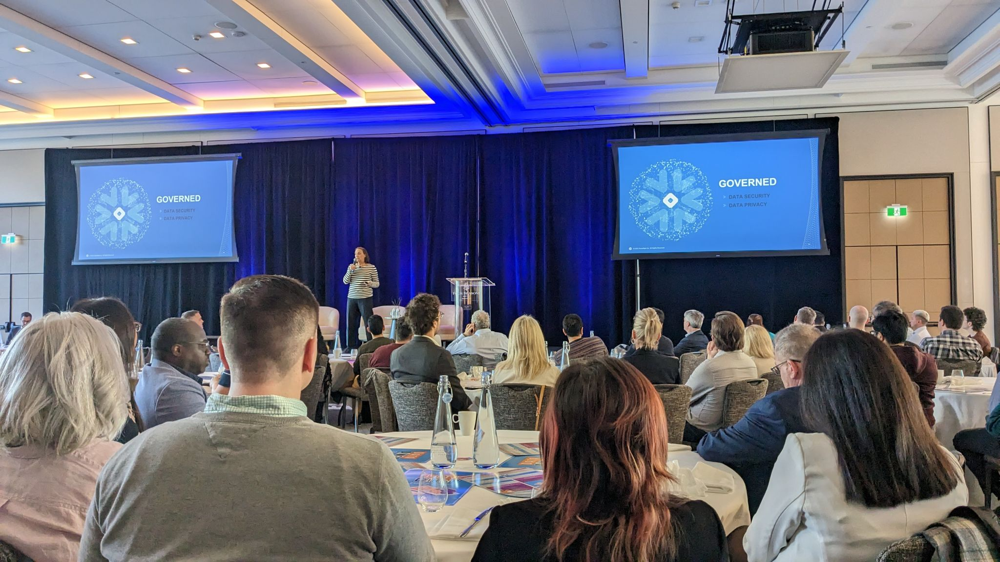
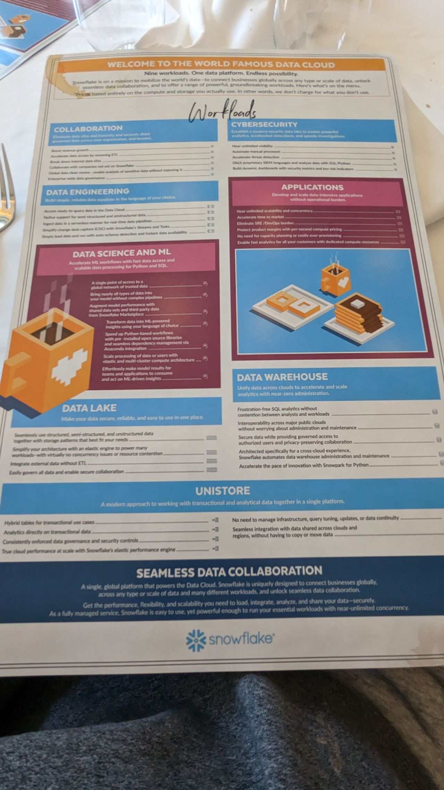
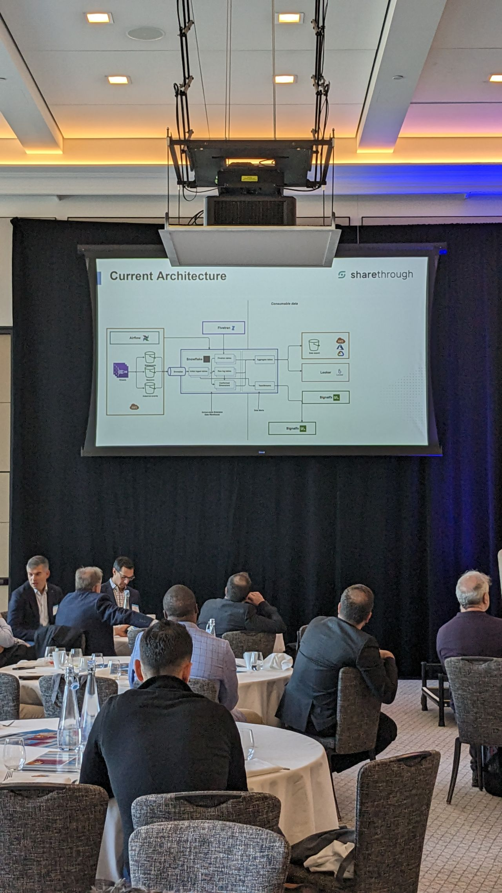
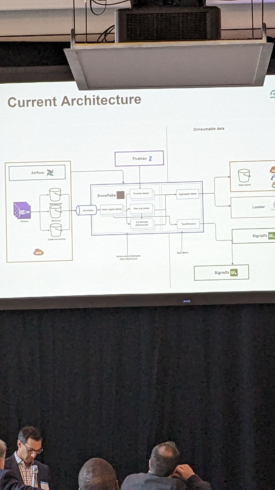
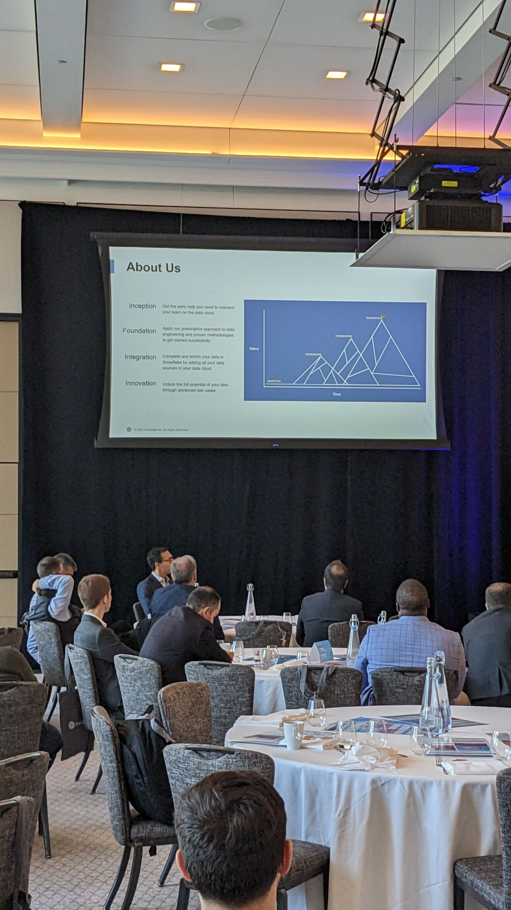
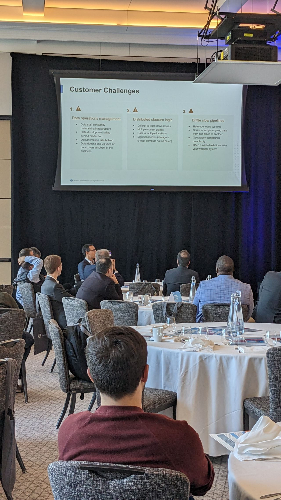
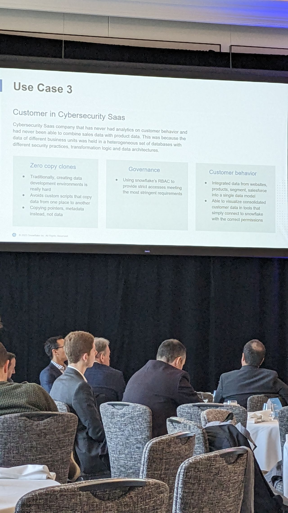

# Snowflake Data-for-Breakfast Conference Insights

> Expanded breakfast conference notes — healthcare scale, tax analytics, clean rooms, Infostrux keynote, and when a warehouse beats spreadsheets.

- HTML page: https://antoineboucher.info/CV/blog/posts/snowflake-data-for-breakfast/
- Language: en
- Translation (fr): https://antoineboucher.info/CV/blog/fr/posts/snowflake-data-for-breakfast/index.md
- Published: 2022-09-06
- Updated: 2026-05-22
- Tags: Conference, Snowflake, Data Analytics
- Author: Antoine Boucher (https://antoineboucher.info/CV/index-en.html)**Snowflake Data-for-Breakfast** was a morning conference on the cloud data platform — warehousing, sharing, governance, and customer stories that make abstract architecture feel operational. I went to hear how teams actually run Snowflake, not to collect swag. **Infostrux** ran a keynote that tied the room together.

## Why I attended

I was touching data platforms on coursework and side projects — enough SQL to be dangerous, not enough production war stories. A breakfast format is low commitment: if the first talk is weak, you still leave before lunch with one useful vocabulary word (**clean room**, **share**, **row access policy**).

## Overview materials

The opening deck framed Snowflake as **governed sharing** first, raw speed second. That ordering matters when your org’s fear is “we cannot expose that table,” not “we need another cluster.”

## What stuck from customer stories

### Global healthcare operations

One healthcare customer ran secure operations across **three continents** — partner data sharing without losing availability or SLA headroom.

| Lesson | Detail |
|--------|--------|
| **Replication + governance** | Compliance is not an afterthought when partners query live |
| **Latency budgets** | Clinical ops cannot wait for overnight batch only |
| **Sharing contracts** | Legal and technical share objects move together |

That is the pitch for a cloud warehouse when compliance and replication actually work in production — not a slide, a running system.

### Tax-sector analytics at scale

Another team needed to land **very large** datasets and explore them without knowing every question upfront.

Snowflake as a single consolidation and transform layer sped up troubleshooting and made **lineage** easier to explain to auditors and internal users. The unstated win: analysts stop emailing CSV attachments.

### Data clean rooms

**Clean rooms** came up for due diligence: two companies compare overlapping datasets without dumping everything into one bucket.

Privacy-preserving collaboration is a product story, not only a compliance checkbox — especially for M&A style questions where both sides distrust each other’s IT.

## Comparison table (my notes)

| Pattern | Good fit | Watch out |
|---------|----------|-----------|
| **Central warehouse** | Many teams, shared dimensions | Cost without query discipline |
| **Data sharing** | Partners need live slices | Contract + row policies |
| **Clean room** | Sensitive overlap analysis | Setup time vs one-off export |
| **Scale-up compute** | Exploratory spikes | Forgotten warehouses left on |

## Closing

Worth the morning if you touch data platforms — good snapshot of where Snowflake pushes (scale, sharing, governed collaboration). I left with clearer vocabulary for customer conversations, even when we are not on Snowflake day to day.

Same conference season as **[Run:ai on AWS](https://antoineboucher.info/CV/blog/posts/runai-aws-inference-webinar/)** — different stack, same habit of writing notes before the slides fade.

## Related posts

- [Vector databases and similar movies](https://antoineboucher.info/CV/blog/posts/vector-databases-similar-movies/) — another data-heavy thread on the blog
- [Economics of LEGO with data science](https://antoineboucher.info/CV/blog/posts/economics-lego-data-science/) — playful analytics at home scale
