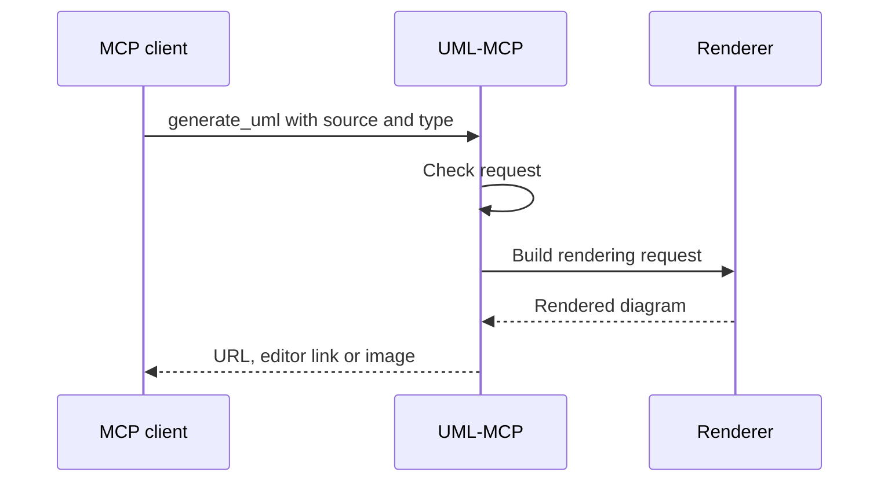

# uml-mcp — UML diagrams from chat via MCP

> Open-source MCP server for Mermaid, PlantUML, and Kroki diagrams in Cursor and ChatGPT — why I built it, how to install, and links to earlier diagram tooling.

- HTML page: https://antoineboucher.info/CV/blog/posts/uml-mcp/
- Language: en
- Translation (fr): https://antoineboucher.info/CV/blog/fr/posts/uml-mcp/index.md
- Published: 2026-09-02
- Updated: 2026-10-20
- Tags: MCP, UML, Mermaid, PlantUML, Cursor, Open Source
- Author: Antoine Boucher (https://antoineboucher.info/CV/index-en.html)

**[uml-mcp](https://github.com/antoinebou12/uml-mcp)** gives an MCP client real diagram tools: an assistant supplies Mermaid, PlantUML, or another supported diagram source, and the server returns rendered output and useful links. The current repository documents five tools and a catalog of roughly 37 Kroki-backed types. Those counts describe the documented interface, not a rendering benchmark.

## From Mermaid source to image and editor links

[`tools/kroki/mermaid.py`](https://github.com/antoinebou12/uml-mcp/blob/main/tools/kroki/mermaid.py) builds JSON state, compresses it with zlib, and encodes it as URL-safe base64. That state supports both an image link and an editable mermaid.live link.

The module distinguishes SVG at `/svg/` from PNG/JPEG/WebP at `/img/?type=...`. A wrong endpoint can break a perfectly valid diagram before its syntax ever becomes the problem.

The repository also exposes `generate_uml_image`, `validate_uml`, `list_diagram_types`, and `generate_uml_batch`. Choose the tool for inline preview, source checks, format discovery, or multiple independent renders.

## There is an operations side too

The current README documents `uml-mcp admin`, metrics, and a Kroki playground. They help separate invalid source, unavailable renderers, and configuration problems. A successful request still needs a human check that the diagram represents the intended system.

For the same diagram-source idea inside a node editor, see [ComfyUI-UML](https://antoineboucher.info/CV/blog/posts/comfyui-uml-diagram-workflows/).

## Why MCP instead of copy-paste templates?

I started with ChatGPT plugins ([D2C OpenAI diagram plugin](https://antoineboucher.info/CV/blog/posts/d2c-openai-diagram-plugin/)) and [AIPRM sequence templates](https://antoineboucher.info/CV/blog/posts/chatgpt-airprm-sequence-diagrams/). Both work, but editors wanted **native tools**: enable a server once, call `generate_uml` from the agent, save `.mmd` + SVG beside the post. MCP is that layer — same idea as the plugin, different host.

## What it supports

| Backend | Good for |
|---------|----------|
| **Mermaid** | GitHub-native flows, quick sequences |
| **PlantUML** | Classic UML, deployments, strict notation |
| **Kroki** | Unified render path when you mix formats |

Hosted endpoint: [uml-mcp.vercel.app/mcp](https://uml-mcp.vercel.app/mcp). Docs site: [antoinebou12.github.io/uml-mcp](https://antoinebou12.github.io/uml-mcp/).

## Cursor setup (short)

1. Clone or install from **[github.com/antoinebou12/uml-mcp](https://github.com/antoinebou12/uml-mcp)** (README has the MCP config block).
2. Add the server to Cursor MCP settings.
3. Ask for a diagram type explicitly — e.g. "Mermaid sequence: user, React, FastAPI, Postgres, login with cache miss."

I use it across this blog for pipeline and career diagrams; see [AI figurines post](https://antoineboucher.info/CV/blog/posts/ai-figurines-3d-printing/) or [software engineering journey](https://antoineboucher.info/CV/blog/posts/software-engineering-journey/) for examples.

## Limits

- Models still hallucinate syntax sometimes — always render locally before publishing.
- Secrets belong out of prompts; diagram user/service names, not production credentials.
- OpenAI plugin churn moved the ChatGPT story toward Custom GPT + MCP; treat the D2C plugin post as historical context with a live successor.

## Project page

More badges and links: **[uml-mcp project page](https://antoineboucher.info/CV/blog/projects/uml-mcp/)**.

## Related posts

- [D2C OpenAI plugin — PlantUML, Mermaid, D2](https://antoineboucher.info/CV/blog/posts/d2c-openai-diagram-plugin/)
- [Diagram prompts with ChatGPT and AIPRM](https://antoineboucher.info/CV/blog/posts/chatgpt-airprm-sequence-diagrams/)
- [Handheld homebrew repos](https://antoineboucher.info/CV/blog/posts/handheld-streaming-homebrew/) (unrelated stack, same "side project" bucket)
