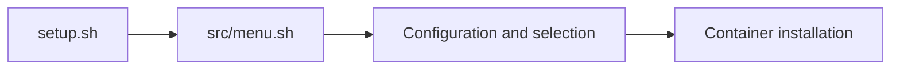

# another-install-script: A menu for homelab installation

> another-install-script is a shell entry point for choosing system setup and container installations. Its structure separates the menu from the service…

- HTML page: https://antoineboucher.info/CV/blog/projects/notes/another-install-script/
- Language: en
- Translation (fr): https://antoineboucher.info/CV/blog/fr/projects/notes/another-install-script/index.md
- Published: 2026-10-23
- Updated: 2026-10-23
- Author: Antoine Boucher (https://antoineboucher.info/CV/index-en.html)

- Repository: https://github.com/antoinebou12/another-install-script
- License: GPL-3.0
- Inspected revision: 6e1e193260504106593f6b92bb799aacafdf0e2b

## Summary

another-install-script is a shell entry point for choosing system setup and container installations. Its structure separates the menu from the service definitions so that adding a service does not require putting every command in setup.sh.

**Why it exists:** Interactive TUI shell installer automating deployment of Docker containers and server configurations.

**Best fit:** One-command server provisioning for homelabs and development VPS.

## Use cases

Whiptail menu in Bash that installs base tools and Docker Compose services on a personal Ubuntu server.

- **Install base server tools** (Server admin): The Installation entry of main_setup_menu (src/menu.sh) shows a checklist: basic packages, Docker, Cockpit, LXDE, Ansible, Dokku, Vagrant and more; src/install.sh runs the selected items.
- **Deploy selected containers** (Server admin, Docker Engine): Add Container lists the folders under containers/; each <name>.sh runs docker-compose up -d on the docker-compose.yml next to it (for example containers/gogs/).
- **Open ports for containers** (Server admin, UFW firewall): After containers are added, manage_firewall_ports_allow_list in src/firewall.sh reads their ports from config.yml and allows them; with system.firewall set to yes, ufw denies other incoming traffic but keeps SSH, 2222, HTTP and HTTPS.
- **Remove installed containers** (Server admin, Docker Engine): remove_container_menu shows the installed containers; each remove_docker_<name> function runs docker-compose down on that service.
- **Uninstall the setup** (Server admin, Docker Engine, UFW firewall): The Uninstall entry runs uninstall.sh, which loads the src/ modules to undo the setup. The Backup entry currently calls the same script; the backup helpers in src/backup.sh are not wired to the menu.

### Scenario: Provision a new VPS with a few self-hosted services

1. Clone the repository and run sudo bash setup.sh; it opens main_setup_menu because bashmenu is yes in config.yml.
2. Choose Installation and keep basic and docker checked; selecting docker opens the container list next.
3. Tick services such as gogs and bookstack; each script runs docker-compose up -d.
4. Let the firewall step allow the ports listed in config.yml and enable ufw.
5. Later, use Remove Container to stop a service with docker-compose down.

## Languages (GitHub Linguist bytes)

| Language | % |
| --- | ---: |
| Shell | 93.8 |
| Dockerfile | 3.12 |
| Python | 3.07 |

## Getting started (repository commands, not run here)

### README.md · How to install

```bash
git clone https://github.com/antoinebou13/another-install-script.git
cd another-install-script
sudo bash setup.sh
```

### README.md · Project Structure

```bash
+-- docs
|   +-- vendor
|       +-- ...
|   +-- docs.md
|   +-- generate_docs.md
|   +-- ...
+-- containers
|   +-- $container_name
|   |   |   +-- docker-compose.yml
|   |   |   +-- $container_name.sh
|   |   |   +-- ...
+-- src
```

### README.md · How to run coverage and tests

```bash
cd tests
bash test.sh
```

### README.md · How to run coverage and tests

```bash
cd tests
bash coverage.sh
```

### README.md · How to generate the documentation

```bash
git submodule update --init --recursive
git pull --recurse-submodules
git submodule update --remote
cd docs/generator
chmod +x generate_docs.sh
bash generate_docs.sh ../docs.md
```


## Features and components

- **Entry point and menus** — setup.sh sources src/menu.sh and calls main_setup_menu. The root script handles arguments, while the sourced module controls navigation. config.yml sits beside the launcher as the project’s configuration surface.
- **Service definitions** — The containers directory holds installation material for individual services. Keeping that material outside the menu makes the repository easier to extend, but each installation still changes the host or its Docker environment.

## Architecture

Components and connections verified in the repository.

- setup.sh → src/menu.sh
- src/menu.sh → Configuration and selection
- Configuration and selection → Container installation



**One path through the code:** Start with the main_setup_menu call, then inspect the selected service under containers before executing it. The menu is a dispatcher; the selected service determines the actual side effects.

## Constraints and checks

The README calls this a work in progress and records testing on an older Ubuntu release. Those notes do not establish compatibility with a current server.

## Files to read

- [setup.sh](https://github.com/antoinebou12/another-install-script/blob/master/setup.sh)
- [src/menu.sh](https://github.com/antoinebou12/another-install-script/blob/master/src/menu.sh)
- [config.yml](https://github.com/antoinebou12/another-install-script/blob/master/config.yml)


