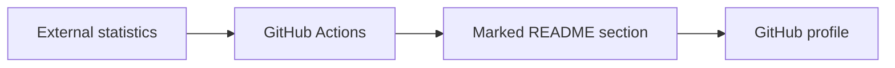

# antoinebou12: How the GitHub profile is assembled

> This is the repository behind my GitHub profile README. It combines ordinary Markdown with images, embedded widgets and scheduled updates. There is no…

- HTML page: https://antoineboucher.info/CV/blog/projects/notes/antoinebou12/
- Language: en
- Translation (fr): https://antoineboucher.info/CV/blog/fr/projects/notes/antoinebou12/index.md
- Published: 2026-10-23
- Updated: 2026-10-23
- Author: Antoine Boucher (https://antoineboucher.info/CV/index-en.html)
- Repository: https://github.com/antoinebou12/antoinebou12
- License: GPL-3.0
- Inspected revision: c519c6b47b35d3d391167aa43b6cf6cafe7d0435

## Summary

This is the repository behind my GitHub profile README. It combines ordinary Markdown with images, embedded widgets and scheduled updates. There is no application server in the profile itself.

**Why it exists:** Automated SVG and metrics rendering workflow maintaining dynamic profile assets.

**Best fit:** Automated profile asset generation.

## Features and components

- **README and assets** — README.md is the visible profile document. The images, models and profile-3d-contrib directories hold assets used alongside it. GitHub renders the document, while linked services may generate their own images separately.
- **Scheduled changes** — The update-readme workflow fetches LeetCode statistics, builds badge URLs and replaces the text between dedicated README markers. Separate workflows handle the contribution graphic, link checks and Pages.

## Architecture

Components and connections verified in the repository.

- External statistics → GitHub Actions
- GitHub Actions → Marked README section
- Marked README section → GitHub profile

**One path through the code:** In update-readme.yml, follow the HTTP response into the badge strings and then into the marker replacement. If either marker is missing, that replacement block is skipped.

## Constraints and checks

External badge endpoints can fail or become stale. A profile graphic is a presentation of a source’s data, not an independently verified measure of contribution quality.

## Files to read

- [README.md](https://github.com/antoinebou12/antoinebou12/blob/master/README.md)
- [.github/workflows/update-readme.yml](https://github.com/antoinebou12/antoinebou12/blob/master/.github/workflows/update-readme.yml)
- [.github/workflows/github-profile-3d-contrib.yml](https://github.com/antoinebou12/antoinebou12/blob/master/.github/workflows/github-profile-3d-contrib.yml)

