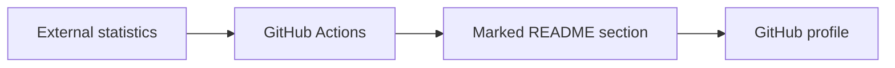

# antoinebou12: How the GitHub profile is assembled

> This is the repository behind my GitHub profile README. It combines ordinary Markdown with images, embedded widgets and scheduled updates. There is no…

- HTML page: https://antoineboucher.info/CV/blog/projects/notes/antoinebou12/
- Language: en
- Translation (fr): https://antoineboucher.info/CV/blog/fr/projects/notes/antoinebou12/index.md
- Published: 2026-10-23
- Updated: 2026-10-23
- Author: Antoine Boucher (https://antoineboucher.info/CV/index-en.html)

- Repository: https://github.com/antoinebou12/antoinebou12
- License: GPL-3.0
- Inspected revision: c519c6b47b35d3d391167aa43b6cf6cafe7d0435

## Summary

This is the repository behind my GitHub profile README. It combines ordinary Markdown with images, embedded widgets and scheduled updates. There is no application server in the profile itself.

**Why it exists:** Automated SVG and metrics rendering workflow maintaining dynamic profile assets.

**Best fit:** Automated profile asset generation.

## Use cases

GitHub profile README with links, badges, pinned projects and stats, kept current by scheduled Actions.

- **Read the profile and links** (Profile visitor): README.md opens with the platform and graphics headline, then links (GitHub, LinkedIn, website, CV, email), certification badges and the main languages and tools.
- **Browse pinned projects** (Profile visitor): A collapsible Featured projects section shows pin cards for repositories such as AINewsTracker, hass_renpho, ipc-toolkit and TrueMapData, plus the DashCTRL, ETSim and UFOKEK organisations.
- **Refresh 3D contribution chart** (GitHub Actions): github-profile-3d-contrib.yml runs daily at 05:00 UTC, generates the 3D contribution calendar, keeps only profile-night-green.svg and commits it.
- **Update LeetCode badges** (GitHub Actions): update-readme.yml runs daily at 12:00 UTC, fetches stats from leetcodestats.cyclic.app and rewrites the badges between the LEETCODE_STATS markers in README.md.
- **Check README links** (Profile owner, GitHub Actions): On each push or pull request to main or master, check-links.yml runs lychee on README.md and docs/**/*.md and writes a job summary.
- **Publish the Jekyll page** (Profile owner, GitHub Actions): jekyll-pages.yml builds docs/ with the jekyll-theme-primer theme and deploys it to GitHub Pages; docs/index.md points back to the profile README.

### Scenario: Edit the profile and let automation keep it current

1. The owner edits README.md, for example the Featured projects list, and pushes to master.
2. check-links.yml runs lychee on README.md and the docs Markdown and reports broken links.
3. jekyll-pages.yml builds docs/ and deploys the small Jekyll site to GitHub Pages.
4. Each day, github-profile-3d-contrib.yml regenerates profile-night-green.svg and commits it.
5. A visitor opens the profile page and sees the updated README, stats cards and 3D calendar.

## Features and components

- **README and assets** — README.md is the visible profile document. The images, models and profile-3d-contrib directories hold assets used alongside it. GitHub renders the document, while linked services may generate their own images separately.
- **Scheduled changes** — The update-readme workflow fetches LeetCode statistics, builds badge URLs and replaces the text between dedicated README markers. Separate workflows handle the contribution graphic, link checks and Pages.

## Architecture

Components and connections verified in the repository.

- External statistics → GitHub Actions
- GitHub Actions → Marked README section
- Marked README section → GitHub profile

**One path through the code:** In update-readme.yml, follow the HTTP response into the badge strings and then into the marker replacement. If either marker is missing, that replacement block is skipped.

## Constraints and checks

External badge endpoints can fail or become stale. A profile graphic is a presentation of a source’s data, not an independently verified measure of contribution quality.

## Files to read

- [README.md](https://github.com/antoinebou12/antoinebou12/blob/master/README.md)
- [.github/workflows/update-readme.yml](https://github.com/antoinebou12/antoinebou12/blob/master/.github/workflows/update-readme.yml)
- [.github/workflows/github-profile-3d-contrib.yml](https://github.com/antoinebou12/antoinebou12/blob/master/.github/workflows/github-profile-3d-contrib.yml)

