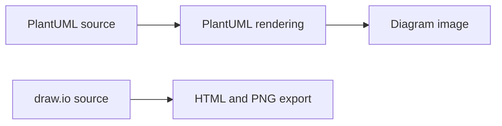

# architecture: Architecture as editable documentation

> This archived repository stores a home-infrastructure diagram in several formats. Its architecture is a documentation workflow: editable sources produce…

- HTML page: https://antoineboucher.info/CV/blog/projects/notes/architecture/
- Language: en
- Translation (fr): https://antoineboucher.info/CV/blog/fr/projects/notes/architecture/index.md
- Published: 2026-10-23
- Updated: 2026-10-23
- Author: Antoine Boucher (https://antoineboucher.info/CV/index-en.html)

- Repository: https://github.com/antoinebou12/architecture
- License: MIT
- Inspected revision: a511b1a730ced19f6340548d5a46e20ae6e2df9b

## Summary

This archived repository stores a home-infrastructure diagram in several formats. Its architecture is a documentation workflow: editable sources produce diagrams that can be opened or viewed without a running application.

**Why it exists:** Editable home-infrastructure diagrams preserved as PlantUML and draw.io sources, with HTML and image exports.

**Best fit:** Reading an archived infrastructure snapshot or editing its diagram sources to document a homelab.

## Languages (GitHub Linguist bytes)

| Language | % |
| --- | ---: |
| HTML | 100 |

## Features and components

- **Editable sources** — The root includes both a PlantUML source and a draw.io document. These are separate diagram representations. Their presence does not mean that one is automatically generated from the other.
- **Published views** — PNG and HTML files provide convenient viewing formats. The README links readers to those representations. The repository describes infrastructure; it does not deploy or monitor the services shown.

## Architecture

Components and connections verified in the repository.

- PlantUML source → PlantUML rendering
- PlantUML rendering → Diagram image
- draw.io source → HTML and PNG export

**One path through the code:** Choose the editable format first, then compare its rendered view with the exported image. Keeping both paths visible helps prevent a screenshot from becoming the only surviving description of the system.

## Constraints and checks

This is an archived infrastructure snapshot. Service names and connections in a diagram do not prove that those services are still running or reachable.

## Files to read

- [README.md](https://github.com/antoinebou12/architecture/blob/main/README.md)
- [architecture.plantuml](https://github.com/antoinebou12/architecture/blob/main/architecture.plantuml)
- [architecture.drawio](https://github.com/antoinebou12/architecture/blob/main/architecture.drawio)

