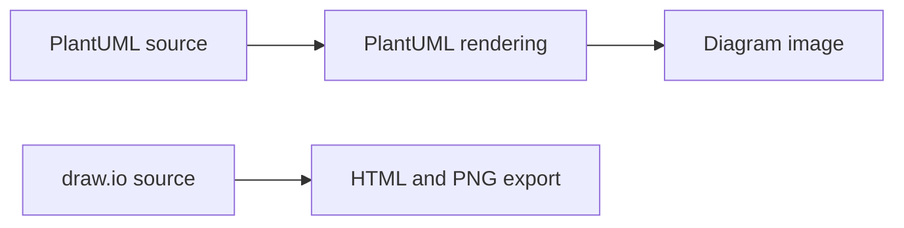

# architecture: Architecture as editable documentation

> This archived repository stores a home-infrastructure diagram in several formats. Its architecture is a documentation workflow: editable sources produce…

- HTML page: https://antoineboucher.info/CV/blog/projects/notes/architecture/
- Language: en
- Translation (fr): https://antoineboucher.info/CV/blog/fr/projects/notes/architecture/index.md
- Published: 2026-10-23
- Updated: 2026-10-23
- Author: Antoine Boucher (https://antoineboucher.info/CV/index-en.html)

- Repository: https://github.com/antoinebou12/architecture
- License: MIT
- Inspected revision: a511b1a730ced19f6340548d5a46e20ae6e2df9b

## Summary

This archived repository stores a home-infrastructure diagram in several formats. Its architecture is a documentation workflow: editable sources produce diagrams that can be opened or viewed without a running application.

**Why it exists:** Editable home-infrastructure diagrams preserved as PlantUML and draw.io sources, with HTML and image exports.

**Best fit:** Reading an archived infrastructure snapshot or editing its diagram sources to document a homelab.

## Use cases

C4 PlantUML and draw.io diagrams of a home lab: Cloudflare, an OVH VPS, hypervisors, a NAS and services.

- **View the v1 draw.io diagram** (Reader, Diagram renderers): architecture.drawio.html embeds the draw.io XML in the diagrams.net viewer script, with zoom, layers and lightbox; the README links it as v1.
- **Render the v2 C4 diagram** (Reader, Diagram renderers): architecture.plantuml includes C4_Deployment, Font Awesome, OSA and Office icon sets; the README v2 link is an encoded render on the PlantUML server.
- **Trace external access paths** (Reader): The Rel lines show users reaching Cloudflare over HTTPS, Cloudflare forwarding to the OVH VPS, the VPS reaching the home and personal networks over WireGuard, and the admin using Teleport over SSH.
- **Inventory VMs and containers** (Reader): Deployment nodes list XCP-ng, Proxmox and Windows hosts, a QNAP NAS with a media stack, and VMs such as Talos (Portainer, AI News Tracker, Freqtrade), Home Assistant and Caddy with Prometheus and Grafana, each with CPU, RAM and disk properties.
- **Edit and re-export the diagram** (Diagram maintainer, Diagram renderers): The maintainer edits architecture.plantuml or architecture.drawio and exports a picture such as home architecture.png.

### Scenario: Follow a web request into the home lab

1. Open architecture.plantuml, or the v2 link in README.md rendered by the PlantUML server.
2. Start at the User person, who reaches Cloudflare (CDN and reverse proxy) over HTTPS.
3. Follow Cloudflare to the OVH VPS, which runs Caddy, Teleport and Uptime Kuma.
4. Follow the WireGuard link from the VPS to the Personal Network and its Proxmox host.
5. See the Caddy VM route traffic to AI News Tracker, Marketwatch, Portainer, Plex and Jellyfin.

## Languages (GitHub Linguist bytes)

| Language | % |
| --- | ---: |
| HTML | 100 |

## Features and components

- **Editable sources** — The root includes both a PlantUML source and a draw.io document. These are separate diagram representations. Their presence does not mean that one is automatically generated from the other.
- **Published views** — PNG and HTML files provide convenient viewing formats. The README links readers to those representations. The repository describes infrastructure; it does not deploy or monitor the services shown.

## Architecture

Components and connections verified in the repository.

- PlantUML source → PlantUML rendering
- PlantUML rendering → Diagram image
- draw.io source → HTML and PNG export

**One path through the code:** Choose the editable format first, then compare its rendered view with the exported image. Keeping both paths visible helps prevent a screenshot from becoming the only surviving description of the system.

## Constraints and checks

This is an archived infrastructure snapshot. Service names and connections in a diagram do not prove that those services are still running or reachable.

## Files to read

- [README.md](https://github.com/antoinebou12/architecture/blob/main/README.md)
- [architecture.plantuml](https://github.com/antoinebou12/architecture/blob/main/architecture.plantuml)
- [architecture.drawio](https://github.com/antoinebou12/architecture/blob/main/architecture.drawio)

