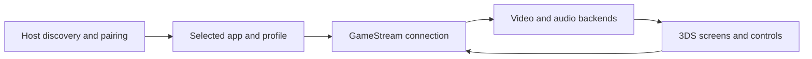

# Artemis-N3DS: Streaming within a dual-screen client

> Artemis-N3DS adapts Moonlight Embedded to the Nintendo 3DS family. It combines host discovery and pairing with a console-specific interface, input…

- HTML page: https://antoineboucher.info/CV/blog/projects/notes/artemis-n3ds/
- Language: en
- Translation (fr): https://antoineboucher.info/CV/blog/fr/projects/notes/artemis-n3ds/index.md
- Published: 2026-10-23
- Updated: 2026-10-23
- Author: Antoine Boucher (https://antoineboucher.info/CV/index-en.html)

- Repository: https://github.com/antoinebou12/Artemis-N3DS
- License: GPL-3.0
- Inspected revision: c5eb0205ba4eb00f4fff96097d987b3267a7be08

## Summary

Artemis-N3DS adapts Moonlight Embedded to the Nintendo 3DS family. It combines host discovery and pairing with a console-specific interface, input handling and video presentation. The New 3DS hardware path is a particular concern.

**Why it exists:** Constrained systems engineering streaming 60fps video over 802.11n Wi-Fi to a dual-screen ARM11 device.

**Best fit:** Remote desktop and gaming on legacy Nintendo New 3DS hardware.

## Use cases

Moonlight Embedded fork that streams games from a Sunshine PC to a New 3DS, with a bottom-screen helper UI.

- **Install the CIA or 3DSX** (3DS player): dist/INSTALL.md describes installing artemis.cia from the HOME Menu with FBI, or copying artemis.3dsx to sd:/3ds/artemis/ for the Homebrew Launcher; custom firmware is required.
- **Pair with a host** (3DS player, Sunshine host PC): The player adds a host by LAN IP (host_discovery.cpp can also scan the network) and chooses pair; pair_host in src/n3ds_main.cpp shows a PIN to type into Sunshine and keeps a pair record.
- **Stream a game or desktop** (3DS player, Sunshine host PC): Video plays on the top screen using the New 3DS hardware H.264 decoder; older 3DS models fall back to software decode at lower frame rates, per the README.
- **Switch touch input modes** (3DS player, Sunshine host PC): The SELECT hub on the bottom screen switches between gamepad, mouse, keyboard, magnify and mirror handlers in src/input/touch/, plus Fit, Fill, Stretch and zoom display options.
- **Save performance as CSV** (3DS player): From the Session tab, the performance overlay shows stream telemetry; export_stream_benchmark_csv in src/stream_benchmark.cpp writes benchmark_<time>.csv to the SD card.
- **Build with devkitPro** (Developer): docker build of the Dockerfile gives a devkitPro image; make inside it produces artemis.3dsx, artemis.cia and artemis.elf. A local devkitPro 3ds-dev setup with bannertool and makerom also works.

### Scenario: Play a PC game on a New 3DS over Wi-Fi

1. Copy artemis.cia to the SD card and install it in FBI with Install and delete CIA.
2. Open Artemis, press A to add a host and enter the PC’s LAN IP address.
3. Choose pair and type the PIN shown on the 3DS into Sunshine’s PIN page.
4. Choose stream and pick an app; the video plays on the top screen.
5. Press SELECT to switch to Mouse or Magnify, or open the performance overlay and save a CSV.
6. Quit from the Session tab to end the stream.

## Languages (GitHub Linguist bytes)

| Language | % |
| --- | ---: |
| C++ | 76.05 |
| C | 15.71 |
| CMake | 4.36 |
| Makefile | 2.84 |
| Shell | 0.64 |
| Dockerfile | 0.4 |

## Getting started (repository commands, not run here)

### README.md · Docker (easiest)

```bash
docker build --network=host -t moonlight-n3ds .
docker run --rm -it -v .:/moonlight-N3DS -w /moonlight-N3DS moonlight-n3ds:latest
make
```

### README.md · Local (devkitPro)

```bash
make
```


## Features and components

- **Control plane** — n3ds_main.cpp brings together host discovery, pair records, profiles and connection state. The selected host and application determine the stream request. Graphics lifecycle state is tracked separately from stream configuration.
- **Media and interaction** — Audio, input and video live in separate src modules. Hardware capabilities influence the guidance shown to the user. The UI can return from a stream, while explicit system-close handling must unwind the application instead.

## Architecture

Components and connections verified in the repository.

- Host discovery and pairing → Selected app and profile
- Selected app and profile → GameStream connection
- GameStream connection → Video and audio backends
- Video and audio backends → 3DS screens and controls
- 3DS screens and controls → GameStream connection



**One path through the code:** Follow SelectedHost and stream-profile selection before entering the media path. System close and a normal return to the menu are different transitions; the explicit close flag exists to keep those paths apart.

## Constraints and checks

The original and New 3DS have different decoding capabilities. Suggested presets in code are not measured guarantees of frame rate or network performance.

## Files to read

- [src/n3ds_main.cpp](https://github.com/antoinebou12/Artemis-N3DS/blob/n3ds-main/src/n3ds_main.cpp)
- [src/hardware_capabilities.cpp](https://github.com/antoinebou12/Artemis-N3DS/blob/n3ds-main/src/hardware_capabilities.cpp)
- [src/video/video.hpp](https://github.com/antoinebou12/Artemis-N3DS/blob/n3ds-main/src/video/video.hpp)


