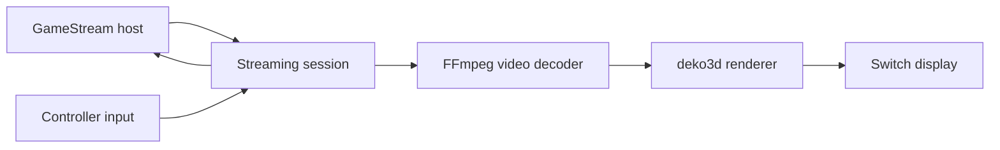

# Artemis-Switch: A streamed frame from host to screen

> Artemis-Switch is a fork in the Moonlight streaming family. The host runs the game; the client receives compressed video and audio while sending…

- HTML page: https://antoineboucher.info/CV/blog/projects/notes/artemis-switch/
- Language: en
- Translation (fr): https://antoineboucher.info/CV/blog/fr/projects/notes/artemis-switch/index.md
- Published: 2026-10-23
- Updated: 2026-10-23
- Author: Antoine Boucher (https://antoineboucher.info/CV/index-en.html)

- Repository: https://github.com/antoinebou12/Artemis-Switch
- License: GPL-3.0
- Inspected revision: 33e6854781a47e86ae349e0a7646ff00bd924ddd

## Summary

Artemis-Switch is a fork in the Moonlight streaming family. The host runs the game. The client receives compressed video and audio, renders frames and sends controller input back.

**Why it exists:** Hardware-accelerated GameStream/Moonlight client in C++ with custom NVN display frame pacing for zero-stutter video.

**Best fit:** Ultra-low latency PC game streaming directly to Nintendo Switch handheld mode.

## Use cases

Moonlight-Switch fork that streams PC games to a Nintendo Switch, with FSR upscaling, stream profiles and telemetry.

- **Pair and stream from a host** (Switch player, GameStream host PC): GameStreamClient.cpp and MoonlightSession.cpp handle PIN pairing and sessions with Sunshine, Apollo, Vibeshine or Punktfunk; DiscoverManager finds hosts and WakeOnLanManager can wake them.
- **Tune video presentation** (Switch player): Fit, Fill, Stretch, Zoom/Pan, rotation and full range share one deko3d presentation path, with FSR/EASU upscaling, RCAS sharpening and dithering on top of NVDEC decode.
- **Save stream profiles** (Switch player, GameStream host PC): Named profiles store FPS (30 to 120), resolution, bitrate, codec and presentation in profile.json; they can be assigned per host, edited and imported or exported (StreamProfileStore.cpp, ProfileEditorDialog.cpp).
- **Export a benchmark** (Switch player): The Performance page shows bitrate, latency, frame queue, GPU time and Switch clocks; Benchmark start, stop and save write a file through app/src/benchmark/BenchmarkExport.cpp.
- **Build and test the app** (Developer): With devkitA64 and CMake, the Moonlight.nro target builds the Switch binary, exported by CI as Artemis-Switch.nro; tests/ holds portable unit tests run with ctest, plus Python i18n and release checks.

### Scenario: Stream a PC game to a Switch

1. Copy Artemis-Switch.nro to sdmc:/switch/Artemis-Switch/ and start hbmenu through title redirection.
2. Open Artemis Switch, select the PC host and finish PIN pairing in the host’s web UI.
3. Create a stream profile (for example 60 FPS, H.265, Fit with FSR) and assign it to that host.
4. Launch an app and press - and + together to open the in-stream overlay.
5. Open Performance to watch bitrate and pipeline latency, then run and save a Benchmark.

## Languages (GitHub Linguist bytes)

| Language | % |
| --- | ---: |
| C++ | 53.78 |
| C | 33.23 |
| Java | 5.69 |
| CMake | 3.51 |
| Objective-C++ | 1.95 |
| Shell | 0.75 |
| Swift | 0.38 |
| Python | 0.35 |
| GLSL | 0.34 |
| Makefile | 0.02 |
| PowerShell | 0.01 |

## Getting started (repository commands, not run here)

### README.md · Developer build

```bash
git clone --recursive https://github.com/antoinebou12/Artemis-Switch.git
cd Artemis-Switch
cmake -B build/switch -DCMAKE_BUILD_TYPE=Release -DPLATFORM_SWITCH=ON -DUSE_DEKO3D=ON
cmake --build build/switch --target Moonlight.nro --parallel
```

### README.md · Developer validation

```bash
python tests/i18n_consistency_test.py
python tests/release_contract_test.py
cmake -S tests -B build/tests -DCMAKE_BUILD_TYPE=Debug
cmake --build build/tests --parallel
ctest --test-dir build/tests --output-on-failure
```

### README.md · Developer validation

```bash
python -m pip install ruff==0.12.10
python scripts/lint.py
cmake -S tests -B build/lint -DCMAKE_BUILD_TYPE=Debug -DARTEMIS_STRICT_WARNINGS=ON -DARTEMIS_ENABLE_CLANG_TIDY=ON
cmake --build build/lint --parallel
```

### README.md · Developer validation

```bash
cmake -S ci/integration -B build/integration -DCMAKE_BUILD_TYPE=Debug
cmake --build build/integration --parallel
ctest --test-dir build/integration --output-on-failure
```

### app/platforms/android-project/README.md · Building

```bash
cd android-project
```

### app/platforms/android-project/README.md · Building

```bash
./build_libromfs_generator.sh
```

### app/platforms/android-project/README.md · Building

```bash
export JAVA_HOME=/Applications/Android\ Studio.app/Contents/jbr/Contents/Home
export ANDROID_SDK_ROOT=~/Library/Android/sdk
./gradlew assembleDebug
./gradlew installDebug
```


## Features and components

- **Session and interface** — The Borealis interface handles host selection and settings. MoonlightSession coordinates streaming, while the Switch decoder-and-render provider chooses concrete video and audio implementations. UI state and media processing have different lifecycles.
- **Platform-specific output** — The provider constructs FFmpegVideoDecoder. With BOREALIS_USE_DEKO3D it selects ArtemisDKVideoRenderer, while other build flags select other renderers. Switch audio uses AudrenAudioRenderer. These are explicit build-time choices.

## Architecture

Components and connections verified in the repository.

- GameStream host → Streaming session
- Streaming session → FFmpeg video decoder
- FFmpeg video decoder → deko3d renderer
- deko3d renderer → Switch display
- Controller input → Streaming session
- Streaming session → GameStream host



**One path through the code:** Read the provider methods to see which backend is actually compiled, then follow the session’s decoded frames into that renderer. Network, decode and presentation delays need separate measurements to explain a slow stream.

## Constraints and checks

A successful build does not establish hardware latency, codec support or stability on every target. Upstream Moonlight authorship remains credited.

## Files to read

- [app/src/main.cpp](https://github.com/antoinebou12/Artemis-Switch/blob/main/app/src/main.cpp)
- [app/src/streaming/MoonlightSession.cpp](https://github.com/antoinebou12/Artemis-Switch/blob/main/app/src/streaming/MoonlightSession.cpp)
- [app/src/streaming/switch/SwitchMoonlightSessionDecoderAndRenderProvider.cpp](https://github.com/antoinebou12/Artemis-Switch/blob/main/app/src/streaming/switch/SwitchMoonlightSessionDecoderAndRenderProvider.cpp)


