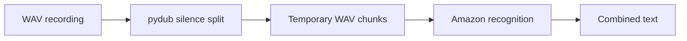

# AudioTranscript: From WAV chunks to transcription

> AudioTranscript breaks a WAV recording into chunks around silence, sends each chunk to a recognition service and concatenates the results. The current…

- HTML page: https://antoineboucher.info/CV/blog/projects/notes/audiotranscript/
- Language: en
- Translation (fr): https://antoineboucher.info/CV/blog/fr/projects/notes/audiotranscript/index.md
- Published: 2026-10-23
- Updated: 2026-10-23
- Author: Antoine Boucher (https://antoineboucher.info/CV/index-en.html)

- Repository: https://github.com/antoinebou12/AudioTranscript
- License: MIT
- Inspected revision: 91b458e4385f0be729d8af54d8b500dc9d00a274

## Summary

AudioTranscript breaks a WAV recording into chunks around silence, sends each chunk to a recognition service and concatenates the results. The current implementation uses Amazon recognition, even though its docstrings still mention Google.

**Why it exists:** Audio ingestion and transcription worker pipeline with timestamp alignment.

**Best fit:** Batch automated audio recording transcription and indexing.

## Use cases

Python CLI that splits a WAV file on silence and transcribes each chunk into a single text.

- **Split audio on silence** (CLI user): main.py loads the WAV with pydub and calls split_on_silence with --min-silence-len, --silence-thresh (relative to the file’s dBFS) and --keep-silence, writing each piece to audio-chunks/chunkN.wav.
- **Transcribe the chunks** (CLI user, Amazon Transcribe): Each chunk goes to recognize_amazon (us-east-1, S3 bucket from .env) and the texts are joined and printed. The README describes Google Speech Recognition, but the code calls Amazon; the --language option is not passed on.
- **Set AWS keys in .env** (CLI user, Amazon Transcribe): load_dotenv reads AWS_ACCESS_KEY_ID, AWS_SECRET_ACCESS_KEY and AWS_BUCKET_NAME; main.py raises an error if one is missing.
- **Try Whisper on a sample** (CLI user, Hugging Face Hub): ai.py is a separate script that loads openai/whisper-large-v2 with transformers and transcribes one LibriSpeech dummy sample; it is not wired to the CLI and its packages are not in requirements.txt.

### Scenario: Transcribe a recorded interview

1. Run pip install -r requirements.txt, plus python-dotenv, which main.py imports but the file does not list.
2. Create a .env file with AWS_ACCESS_KEY_ID, AWS_SECRET_ACCESS_KEY and AWS_BUCKET_NAME.
3. Run python main.py interview.wav -m 700 -s -16 (the path is positional and defaults to caro.wav).
4. main.py writes the chunks to audio-chunks/ and shows a Rich progress bar.
5. Each chunk is sent to Amazon Transcribe and the full text is printed at the end.

## Languages (GitHub Linguist bytes)

| Language | % |
| --- | ---: |
| Python | 100 |

## Getting started (repository commands, not run here)

### README.md · Usage

```bash
python main.py --path <audio_file_path> --min-silence-len <min_silence_length> --silence-thresh <silence_threshold> --keep-silence <keep_silence_duration> --language <language_code>
```


## Features and components

- **Audio segmentation** — main.py loads a WAV through pydub and calls split_on_silence. The threshold is calculated relative to the recording’s dBFS level. Each chunk is exported to audio-chunks before recognition.
- **Recognition and output** — A SpeechRecognition Recognizer reads each exported file and calls recognize_amazon. The loop appends the returned text to whole_text, which is printed and returned. Typer exposes the file and segmentation parameters.

## Architecture

Components and connections verified in the repository.

- WAV recording → pydub silence split
- pydub silence split → Temporary WAV chunks
- Temporary WAV chunks → Amazon recognition
- Amazon recognition → Combined text



**One path through the code:** Follow transcribe_audio_file rather than its docstring: the function checks AWS environment variables immediately before recognize_amazon. Its language argument is exposed by the CLI but is not passed into that call.

## Constraints and checks

Audio leaves the local machine for recognition. The code reuses fixed job and file names, so concurrent runs need separate naming and temporary-file handling.

## Files to read

- [main.py](https://github.com/antoinebou12/AudioTranscript/blob/main/main.py)
- [requirements.txt](https://github.com/antoinebou12/AudioTranscript/blob/main/requirements.txt)


