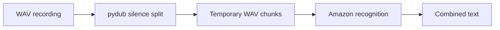

# AudioTranscript: From WAV chunks to transcription

> AudioTranscript breaks a WAV recording into chunks around silence, sends each chunk to a recognition service and concatenates the results. The current…

- HTML page: https://antoineboucher.info/CV/blog/projects/notes/audiotranscript/
- Language: en
- Translation (fr): https://antoineboucher.info/CV/blog/fr/projects/notes/audiotranscript/index.md
- Published: 2026-10-23
- Updated: 2026-10-23
- Author: Antoine Boucher (https://antoineboucher.info/CV/index-en.html)

- Repository: https://github.com/antoinebou12/AudioTranscript
- License: MIT
- Inspected revision: 91b458e4385f0be729d8af54d8b500dc9d00a274

## Summary

AudioTranscript breaks a WAV recording into chunks around silence, sends each chunk to a recognition service and concatenates the results. The current implementation uses Amazon recognition, even though its docstrings still mention Google.

**Why it exists:** Audio ingestion and transcription worker pipeline with timestamp alignment.

**Best fit:** Batch automated audio recording transcription and indexing.

## Languages (GitHub Linguist bytes)

| Language | % |
| --- | ---: |
| Python | 100 |

## Getting started (repository commands, not run here)

### README.md · Usage

```bash
python main.py --path <audio_file_path> --min-silence-len <min_silence_length> --silence-thresh <silence_threshold> --keep-silence <keep_silence_duration> --language <language_code>
```


## Features and components

- **Audio segmentation** — main.py loads a WAV through pydub and calls split_on_silence. The threshold is calculated relative to the recording’s dBFS level. Each chunk is exported to audio-chunks before recognition.
- **Recognition and output** — A SpeechRecognition Recognizer reads each exported file and calls recognize_amazon. The loop appends the returned text to whole_text, which is printed and returned. Typer exposes the file and segmentation parameters.

## Architecture

Components and connections verified in the repository.

- WAV recording → pydub silence split
- pydub silence split → Temporary WAV chunks
- Temporary WAV chunks → Amazon recognition
- Amazon recognition → Combined text



**One path through the code:** Follow transcribe_audio_file rather than its docstring: the function checks AWS environment variables immediately before recognize_amazon. Its language argument is exposed by the CLI but is not passed into that call.

## Constraints and checks

Audio leaves the local machine for recognition. The code reuses fixed job and file names, so concurrent runs need separate naming and temporary-file handling.

## Files to read

- [main.py](https://github.com/antoinebou12/AudioTranscript/blob/main/main.py)
- [requirements.txt](https://github.com/antoinebou12/AudioTranscript/blob/main/requirements.txt)


