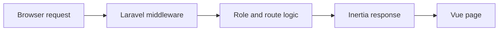

# AuthLaravel: Sessions, roles and Inertia pages

> AuthLaravel is an access-control learning project with a Laravel backend and Vue pages delivered through Inertia. The route definitions show how…

- HTML page: https://antoineboucher.info/CV/blog/projects/notes/authlaravel/
- Language: en
- Translation (fr): https://antoineboucher.info/CV/blog/fr/projects/notes/authlaravel/index.md
- Published: 2026-10-23
- Updated: 2026-10-23
- Author: Antoine Boucher (https://antoineboucher.info/CV/index-en.html)

- Repository: https://github.com/antoinebou12/AuthLaravel
- Inspected revision: 2ec4e5d4367341fa789c0027d17ecd43ba80cf01

## Summary

AuthLaravel is an access-control learning project with a Laravel backend and Vue pages delivered through Inertia. The route definitions show how authenticated users reach their dashboard and how administrators receive a different view.

**Why it exists:** Clean Laravel authentication template implementing JWT, session management, and role-based policies.

**Best fit:** Secure boilerplate foundation for Laravel API and web applications.

## Use cases

Laravel 10 and React (Inertia) lab app for ÉTS GTI619 on roles, login throttling and password flows.

- **Register an account** (Registered user): RegisteredUserController stores a new user with email, username, phone and password; the form is resources/js/Pages/Auth/Register.tsx.
- **Log in with throttling** (Registered user, Administrator): LoginRequest locks an email and IP pair after 5 failed attempts and records login_attempts, browser, OS, IP and last_login on the user row.
- **Reset a forgotten password** (Registered user, Mailpit (dev mail)): The forgot-password routes send a reset link by email; in the Sail stack, Mailpit catches it and shows it on port 8025.
- **Change profile and password** (Registered user): PUT /password goes to PasswordController, and /profile lets the user edit, update or delete the account through ProfileController.
- **View all users as admin** (Administrator): /admin uses the AdminAuthenticated middleware, and /dashboard renders AdminDashboard.tsx with every user’s email, roles and permissions when the role is roles:admin; other roles get the plain dashboard.

### Scenario: Run the lab and test role-based access

1. From AuthLaravel/, run ./vendor/bin/sail up -d to start the app with MariaDB, Redis and Mailpit.
2. Run ./vendor/bin/sail artisan migrate and db:seed to create the admin, user, residential and business accounts.
3. Open http://localhost/login and sign in as admin@example.com to see the user table on the dashboard.
4. Sign in as user@example.com and open /admin; the middleware sends the user back to the dashboard.
5. Use Forgot password and read the reset email in Mailpit at http://localhost:8025.

## Languages (GitHub Linguist bytes)

| Language | % |
| --- | ---: |
| PHP | 53.63 |
| TypeScript | 35.05 |
| Blade | 10.93 |
| JavaScript | 0.37 |
| CSS | 0.02 |

## Getting started (repository commands, not run here)

### AuthLaravel/README.md · Steps

```bash
./vendor/bin/sail up -d
npm build
./vendor/bin/sail artisan migrate
./vendor/bin/sail artisan db:seed
http://localhost/login
email: http://localhost:8025
```

### README.md · Steps

```bash
./vendor/bin/sail up -d
npm build
./vendor/bin/sail artisan migrate
./vendor/bin/sail artisan db:seed
http://localhost/login
email: http://localhost:8025
```


## Features and components

- **Routes and middleware** — The dashboard route uses auth and verified middleware, then tests the user’s admin role. The admin branch loads users and renders AdminDashboard; other users receive Dashboard. The /admin route has its own middleware declaration.
- **Pages and account actions** — Inertia connects server-side route decisions to frontend pages. Profile editing delegates to ProfileController, while password-reset routes use Laravel’s password broker. Authentication and page selection are related but separate operations.

## Architecture

Components and connections verified in the repository.

- Browser request → Laravel middleware
- Laravel middleware → Role and route logic
- Role and route logic → Inertia response
- Inertia response → Vue page



**One path through the code:** Compare /dashboard with /admin in routes/web.php. Both select an administrative page, but their middleware differs. Authorization should be checked on the underlying data operations as well as on page navigation.

## Constraints and checks

This is coursework, not a security certification. The routes alone do not prove that every controller operation enforces the intended role model.

## Files to read

- [AuthLaravel/routes/web.php](https://github.com/antoinebou12/AuthLaravel/blob/main/AuthLaravel/routes/web.php)
- [AuthLaravel/composer.json](https://github.com/antoinebou12/AuthLaravel/blob/main/AuthLaravel/composer.json)
- [AuthLaravel/package.json](https://github.com/antoinebou12/AuthLaravel/blob/main/AuthLaravel/package.json)


