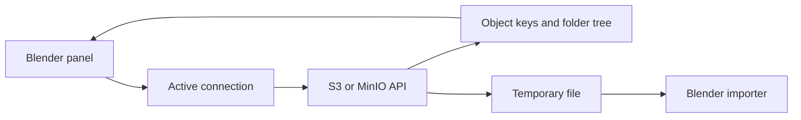

# bloc: Object storage inside Blender

> My bloc fork adds a Blender-facing workflow around S3 and MinIO storage. It preserves the upstream Blender-Cloud-Storage credit. The add-on translates…

- HTML page: https://antoineboucher.info/CV/blog/projects/notes/bloc/
- Language: en
- Translation (fr): https://antoineboucher.info/CV/blog/fr/projects/notes/bloc/index.md
- Published: 2026-10-23
- Updated: 2026-10-23
- Author: Antoine Boucher (https://antoineboucher.info/CV/index-en.html)

- Repository: https://github.com/antoinebou12/bloc
- License: GPL-3.0
- Inspected revision: 6c83c217d541b632fdb0b8acc998c37e6f910075

## Summary

My bloc fork adds a Blender-facing workflow around S3 and MinIO storage. It preserves the upstream Blender-Cloud-Storage credit. The add-on translates object keys into a folder browser, then downloads assets before asking Blender to import them.

**Why it exists:** Direct AWS S3 object storage integration inside Blender via Boto3, eliminating local drive storage bloat for 3D assets.

**Best fit:** Cloud-native 3D asset synchronization, backup, and distributed rendering workflows.

## Use cases

Blender add-on that lists, uploads, downloads and imports files from MinIO or AWS S3 buckets in a sidebar panel.

- **Add a storage connection** (Blender user): In the add-on preferences, CloudConnection entries hold the type (MinIO or AWS S3), endpoint or region, access and secret keys and bucket name; several connections can be listed.
- **Browse and search the bucket** (Blender user, MinIO or S3 bucket): Refresh File List calls list_objects (MinIO) or list_objects_v2 (boto3) and draws a folder tree in the View3D Cloud tab; the Search field filters names by substring.
- **Upload the current .blend** (Blender user, MinIO or S3 bucket): Upload Current File sends the saved .blend under its file name. The README mentions uploading textures and other dependencies, but addon.py only uploads the .blend itself.
- **Import a mesh into the scene** (Blender user, MinIO or S3 bucket): Download saves an object to the system temp folder; Load to Scene downloads it and calls Blender’s STL, OBJ, USD or PLY importer.
- **Delete a remote file** (Blender user, MinIO or S3 bucket): Delete calls remove_object (MinIO) or delete_object (S3) and refreshes the list.

### Scenario: Pull a scan from a MinIO bucket into Blender

1. Install the add-on from Edit > Preferences > Add-ons; on first load it installs boto3, minio and rapidfuzz with pip.
2. In the preferences, add a MinIO connection with endpoint URL, keys and bucket name.
3. Open the Cloud tab in the 3D view sidebar and press Refresh File List.
4. Type part of a file name in Search to narrow the list.
5. Press Load to Scene on an .obj or .stl file to import it.

## Languages (GitHub Linguist bytes)

| Language | % |
| --- | ---: |
| Python | 100 |

## Features and components

- **Connection and listing** — CloudConnection stores provider, endpoint, bucket and region settings. The active connection determines the boto3 or MinIO client. Listing results are split on slashes to construct a nested dictionary for the panel.
- **Search and import** — CloudSearchManager scores names and path segments with RapidFuzz. A download first produces a temporary local file. The load operator then chooses an STL, OBJ, PLY or USD importer, so download success and import success remain separate states.

## Architecture

Components and connections verified in the repository.

- Blender panel → Active connection
- Active connection → S3 or MinIO API
- S3 or MinIO API → Object keys and folder tree
- Object keys and folder tree → Blender panel
- S3 or MinIO API → Temporary file
- Temporary file → Blender importer

**One path through the code:** Follow refresh from object keys to the tree, then follow load from the selected key to a temporary path and an import operator. Background listing hands UI updates back through Blender timers. The stored object itself is not a local folder.

## Constraints and checks

The S3 path makes one list_objects_v2 request without pagination. Uploading the saved .blend file does not prove that external textures have been packaged.

## Files to read

- [addon.py](https://github.com/antoinebou12/bloc/blob/main/addon.py)
- [blender_manifest.toml](https://github.com/antoinebou12/bloc/blob/main/blender_manifest.toml)

