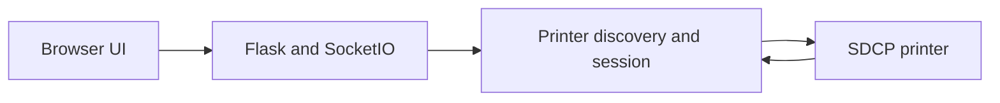

# ChitUI: A local bridge to resin printers

> ChitUI places a browser interface in front of SDCP resin printers. A Python process serves the web assets, discovers printers on the local network and…

- HTML page: https://antoineboucher.info/CV/blog/projects/notes/chitui/
- Language: en
- Translation (fr): https://antoineboucher.info/CV/blog/fr/projects/notes/chitui/index.md
- Published: 2026-10-23
- Updated: 2026-10-23
- Author: Antoine Boucher (https://antoineboucher.info/CV/index-en.html)
- Repository: https://github.com/antoinebou12/ChitUI
- Inspected revision: a4236172836c65116a88dcd39a934441691be34c

## Summary

ChitUI places a browser interface in front of SDCP resin printers. A Python process serves the web assets, discovers printers on the local network and translates browser actions into printer communication.

**Why it exists:** Full-featured web control interface for Chitubox SDCP 3.0 resin printers with LAN UDP discovery.

**Best fit:** Headless remote management and real-time print monitoring for SLA 3D printers.

## Languages (GitHub Linguist bytes)

| Language | % |
| --- | ---: |
| JavaScript | 48.61 |
| HTML | 24.57 |
| Python | 22.86 |
| CSS | 3.51 |
| Dockerfile | 0.45 |

## Verified technologies

- SDCP 3.0 — README title
- Docker — README Docker section
- Browser UI — README Usage, default port 54780
- Local network — README Docker host networking for UDP discovery

## Getting started (repository commands, not run here)

### README.md · Setup

```bash
python -mvenv .venv
source .venv/bin/activate
pip install -r requirements.txt
```

### README.md · Usage

```bash
python main.py
```


### Docker

```bash
docker build -t chitui:latest .
docker run --rm --name chitui --net=host chitui:latest
```

## Features and components

- **Browser and local server** — main.py builds a Flask application with web as its static folder and attaches Flask-SocketIO. Printer and WebSocket registries live in process memory. Discovery uses the local network, which explains the README’s Docker host-network requirement.
- **File transfer** — The upload route validates the extension and saves the incoming file temporarily. The printer upload helper calculates an MD5 checksum and sends one-megabyte parts with offsets. A separate event-stream route reports upload progress.

## Architecture

Components and connections verified in the repository.

- Browser UI → Flask and SocketIO
- Flask and SocketIO → Printer discovery and session
- Printer discovery and session → SDCP printer
- SDCP printer → Printer discovery and session



**One path through the code:** Follow /upload through the temporary file and the printer transfer helper. Transfer progress is global in this implementation, so simultaneous uploads would need per-job state to avoid mixing their percentages.

## Workflow

1. **Choose a file** — Select a supported print file for a discovered printer. The upload handler accepts multipart fields named file and printer.
2. **Validate the request** — The handler checks missing file or printer fields and the allowed extensions ctb, goo and prz before continuing.
3. **Store temporarily** — The server receives the file into temporary storage before starting transfer to the printer.
4. **Transfer to printer** — The helper sends chunks to the selected printer on the local network. Progress events are available on GET /progress as text/event-stream.
5. **Confirm the outcome** — Check the response and verify the file on the printer. The helper may report success after a failed part; treat the success body alone as incomplete proof of delivery.

## API


- `POST /upload`
- `GET /upload`
- `GET /progress`

## Constraints and checks

Treat this fork as a local-network prototype. A reachable web interface does not confirm compatibility with a particular printer firmware or safe remote access.

## Files to read

- [main.py](https://github.com/antoinebou12/ChitUI/blob/master/main.py)
- [Dockerfile](https://github.com/antoinebou12/ChitUI/blob/master/Dockerfile)
- [requirements.txt](https://github.com/antoinebou12/ChitUI/blob/master/requirements.txt)

