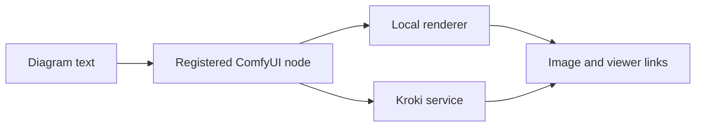

# ComfyUI-UML: Diagram rendering inside a node graph

> ComfyUI-UML adds diagram-oriented nodes to ComfyUI. Text enters a workflow, a rendering backend turns it into an image, and the workflow can retain the…

- HTML page: https://antoineboucher.info/CV/blog/projects/notes/comfyui-uml/
- Language: en
- Translation (fr): https://antoineboucher.info/CV/blog/fr/projects/notes/comfyui-uml/index.md
- Published: 2026-10-23
- Updated: 2026-10-23
- Author: Antoine Boucher (https://antoineboucher.info/CV/index-en.html)

- Repository: https://github.com/antoinebou12/ComfyUI-UML
- Inspected revision: 1f1411580e0db67efd7a4ad669e42ba8677f546a

## Summary

ComfyUI-UML adds diagram-oriented nodes to ComfyUI. Text enters a workflow, a rendering backend turns it into an image, and the workflow can retain the source and viewer links alongside that output.

**Why it exists:** Custom node implementation for ComfyUI node graphs integrating automated UML synthesis into image pipelines.

**Best fit:** Visual AI workflows combining diagram generation with image refinement.

## Languages (GitHub Linguist bytes)

| Language | % |
| --- | ---: |
| Python | 50.91 |
| JavaScript | 45.75 |
| HTML | 3.34 |

## Getting started (repository commands, not run here)

### README.md · Installation

```bash
comfy node install comfyui-uml
```


## Features and components

- **Plugin registration** — The root __init__.py loads the nodes package under the unique name comfyui_uml_nodes. This avoids colliding with ComfyUI’s own nodes module. It exports the class mappings and the web directory used by the extension.
- **Rendering and viewer** — The nodes directory separates diagram generation, Kroki communication and viewer URLs. Browser assets are exposed through WEB_DIRECTORY, while route registration adds the viewer’s save-to-output integration. Local rendering options and Kroki are distinct backends.

## Architecture

Components and connections verified in the repository.

- Diagram text → Registered ComfyUI node
- Registered ComfyUI node → Local renderer
- Registered ComfyUI node → Kroki service
- Local renderer → Image and viewer links
- Kroki service → Image and viewer links



**One path through the code:** Start at NODE_CLASS_MAPPINGS, then follow a diagram node into its renderer. The loader uses an explicit module specification because ComfyUI may import the plugin directly from a file path.

## Constraints and checks

Kroki rendering sends diagram text to the configured service. Use a suitable private endpoint for confidential diagrams and check which local renderer dependencies are installed.

## Files to read

- [__init__.py](https://github.com/antoinebou12/ComfyUI-UML/blob/main/__init__.py)
- [nodes/uml_diagram.py](https://github.com/antoinebou12/ComfyUI-UML/blob/main/nodes/uml_diagram.py)
- [nodes/kroki_client.py](https://github.com/antoinebou12/ComfyUI-UML/blob/main/nodes/kroki_client.py)


