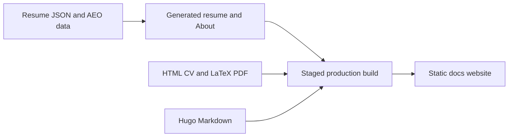

# CV: One repository, several publishing paths

> This website combines hand-edited bilingual CV pages, structured resume data, generated About pages, LaTeX PDFs and a Hugo blog. The build brings those…

- HTML page: https://antoineboucher.info/CV/blog/projects/notes/cv/
- Language: en
- Translation (fr): https://antoineboucher.info/CV/blog/fr/projects/notes/cv/index.md
- Published: 2026-10-23
- Updated: 2026-10-23
- Author: Antoine Boucher (https://antoineboucher.info/CV/index-en.html)

- Repository: https://github.com/antoinebou12/CV
- License: MIT
- Inspected revision: 2fdf469a3056498868554d59661713206d435b7b

## Summary

This website combines bilingual CV pages, structured resume data, LaTeX PDFs and a Hugo blog. A local script builds and validates both the CV and blog, then publishes them together from docs/ on main.

**Why it exists:** High-performance, accessible, bilingual static portfolio and CV with AEO schema, automated CI/CD, and zero runtime overhead.

**Best fit:** Professional software engineering presentation and technical documentation.

## Languages (GitHub Linguist bytes)

| Language | % |
| --- | ---: |
| JavaScript | 36.98 |
| HTML | 34.21 |
| Python | 10.17 |
| TeX | 8.19 |
| CSS | 7.68 |
| PowerShell | 0.99 |
| Shell | 0.72 |
| Batchfile | 0.54 |
| Mermaid | 0.39 |
| Go Template | 0.1 |
| Jinja | 0.04 |

## Getting started (repository commands, not run here)

### README.md · Hugo blog (Paper)

```bash
cd hugo/themes/paper
npm ci
npm run build:css
cd ../..
hugo server -D
```

### README.md · Building CVs

```bash
python build_cv.py build --language en
python build_cv.py build --all
python build_cv.py build --all --parallel
python build_cv.py build --language en --output ./output/cv.pdf
python build_cv.py build --language en --clean
python build_cv.py build --language en --verbose
python build_cv.py build --all --ci
```

### README.md · LaTeX CVs

```bash
python build_cv.py build --language en
```

### helm/cv-stack/README.md · Installation

```bash
helm install cv-stack ./helm/cv-stack
helm install cv-stack ./helm/cv-stack -f my-values.yaml
helm install cv-stack ./helm/cv-stack --namespace cv-stack --create-namespace
```

### tools/medium-mirror/README.md · Setup

```bash
cd tools/medium-mirror
npm install
npx playwright install chromium
```


## Features and components

- **Content sources** — data/resume.en.json and resume.fr.json hold the machine-readable resume. The index HTML pages remain canonical for their layout. data/aeo.yaml drives the generated About content, while Hugo owns the Markdown posts and project notes.
- **Assembly and verification** — build_docs.py stages the root pages and assets, builds Hugo under the blog path, merges the root sitemap and runs deployment verification before copying the output to docs. Staging keeps a failed build from overwriting that published tree.

## Architecture

Components and connections verified in the repository.

- Resume JSON and AEO data → Generated resume and About
- Generated resume and About → Staged production build
- HTML CV and LaTeX PDF → Staged production build
- Hugo Markdown → Staged production build
- Staged production build → Static docs website



**One path through the code:** Follow a blog change from hugo/content into the Hugo build, then into the deployment staging directory. A CV data change follows another path, so updating a JSON record does not automatically rewrite every hand-edited HTML or LaTeX section.

## Constraints and checks

English and French outputs need parity checks. A successful local build is separate from pushing the repository and verifying the public deployment.

## Files to read

- [scripts/deploy/build_docs.py](https://github.com/antoinebou12/CV/blob/main/scripts/deploy/build_docs.py)
- [scripts/build/render_resume_md.py](https://github.com/antoinebou12/CV/blob/main/scripts/build/render_resume_md.py)
- [scripts/build/generate_aeo_content.py](https://github.com/antoinebou12/CV/blob/main/scripts/build/generate_aeo_content.py)
- [hugo/hugo.toml](https://github.com/antoinebou12/CV/blob/main/hugo/hugo.toml)


