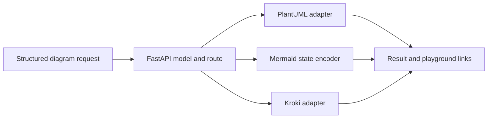

# D2COpenAIPlugin: Routing text to diagram backends

> D2COpenAIPlugin is a FastAPI diagram service with a plugin manifest and an OpenAPI surface. Its implementation selects among PlantUML, Mermaid and Kroki…

- HTML page: https://antoineboucher.info/CV/blog/projects/notes/d2copenaiplugin/
- Language: en
- Translation (fr): https://antoineboucher.info/CV/blog/fr/projects/notes/d2copenaiplugin/index.md
- Published: 2026-10-23
- Updated: 2026-10-23
- Author: Antoine Boucher (https://antoineboucher.info/CV/index-en.html)

- Repository: https://github.com/antoinebou12/D2COpenAIPlugin
- License: MIT
- Inspected revision: 7d15ee155d5f392b1d90192dc2e21ec479a6291a

## Summary

D2COpenAIPlugin is a FastAPI diagram service with a plugin manifest and an OpenAPI surface. Its implementation selects among PlantUML, Mermaid and Kroki paths based on the request’s diagram language.

**Why it exists:** OpenAI ChatGPT plugin manifest and OpenAPI endpoint handler for text-to-diagram conversion.

**Best fit:** ChatGPT Plus GPT Store integration for software architects.

## Use cases

FastAPI ChatGPT-plugin backend that turns PlantUML, Mermaid, D2 or Kroki source into diagram links.

- **Get a PlantUML image link** (ChatGPT plugin client, Diagram renderers): POST /generate_diagram with lang plantuml encodes the code for the public PlantUML server (theme blueprint by default) and returns url, content and playground.
- **Open Mermaid in Live Editor** (ChatGPT plugin client, Diagram renderers): For lang mermaid, mermaid/mermaid.py builds an encoded editor state (theme dark by default) and returns Mermaid Live Editor links.
- **Render D2 or Kroki types** (ChatGPT plugin client, Diagram renderers): D2 aliases and every language in KROKI_LANGUAGE_SUPPORT go through generate_kroki_diagram in kroki/kroki.py and return an SVG link.
- **Serve the plugin manifest** (ChatGPT plugin client): app.py serves /.well-known/ai-plugin.json, /openapi.yaml, /openapi.json, /logo.png and /.well-known/privacy.txt so a ChatGPT client can load the plugin.
- **Run and test locally** (Developer): uvicorn app:app serves the API on port 5003 with docs at /; test_app.py covers the endpoints in CI, and vercel.json routes every path to app.py.

### Scenario: Connect the plugin to ChatGPT on localhost

1. Create a virtualenv, run pip install -r requirements-dev.txt and python -m pytest.
2. Start the API with uvicorn app:app --host 127.0.0.1 --port 5003.
3. In ChatGPT, choose Develop your own plugin and enter localhost:5003 to load /.well-known/ai-plugin.json.
4. Ask for a sequence diagram; ChatGPT calls POST /generate_diagram with lang plantuml.
5. The API returns the image URL and a playground link that ChatGPT shows to the user.

## Languages (GitHub Linguist bytes)

| Language | % |
| --- | ---: |
| Python | 100 |

## Getting started (repository commands, not run here)

### README.md · Quick start

```bash
git clone https://github.com/antoinebou12/D2COpenAIPlugin.git
cd D2COpenAIPlugin
python -m venv .venv
```

### README.md · Quick start

```bash
.\.venv\Scripts\Activate.ps1
```

### README.md · Quick start

```bash
source .venv/bin/activate
```

### README.md · Quick start

```bash
pip install -r requirements-dev.txt
python -m pytest
uvicorn app:app --host 127.0.0.1 --port 5003
```

### README.md · Quick start

```bash
python app.py
```

### plantuml/README.md · Installation

```bash
pip install plantumlapi
```

### plantuml/README.md · Command Line Usage

```bash
usage: plantuml.py [-h] [-o OUT] [-s SERVER] filename [filename ...]
Generate images from PlantUML defined files using PlantUML server
positional arguments: 
  filename            file(s) to generate images from
optional arguments: 
  -h, --help          show this help message and exit 
  -o OUT, --out OUT   directory to put the files into 
  -s SERVER, --server SERVER 
                      server to generate from; defaults to plantuml.com 
```


## Features and components

- **Request model** — DiagramRequest contains lang, type, code and theme. Validators check the language and source length. /generate_diagram rejects missing fields before dispatching to a backend; the code then builds result and playground links.
- **Backend adapters** — PlantUML uses its dedicated client, Mermaid builds an editor state, and D2 aliases are normalized to the Kroki d2 renderer. Other supported languages use the Kroki language registry. The adapters isolate differing URL and encoding conventions.

## Architecture

Components and connections verified in the repository.

- Structured diagram request → FastAPI model and route
- FastAPI model and route → PlantUML adapter
- FastAPI model and route → Mermaid state encoder
- FastAPI model and route → Kroki adapter
- PlantUML adapter → Result and playground links
- Mermaid state encoder → Result and playground links
- Kroki adapter → Result and playground links



**One path through the code:** Compare the PlantUML and D2 branches in app.py. They accept the same request model but use different rendering adapters. The type validator logs an invalid type rather than raising, so it is not equivalent to strict language validation.

## Constraints and checks

The plugin manifest documents the original integration format. Its presence does not establish current availability in a third-party product or confidentiality of remote rendering.

## Files to read

- [app.py](https://github.com/antoinebou12/D2COpenAIPlugin/blob/main/app.py)
- [kroki/kroki.py](https://github.com/antoinebou12/D2COpenAIPlugin/blob/main/kroki/kroki.py)
- [mermaid/mermaid.py](https://github.com/antoinebou12/D2COpenAIPlugin/blob/main/mermaid/mermaid.py)


