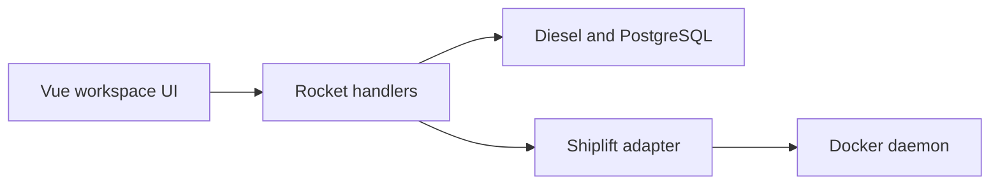

# DasherControl: A workspace dashboard across three boundaries

> DasherControl brings homelab links and embedded applications into saved workspaces. Vue handles the interface, Rust and Rocket expose the API, and…

- HTML page: https://antoineboucher.info/CV/blog/projects/notes/dashercontrol/
- Language: en
- Translation (fr): https://antoineboucher.info/CV/blog/fr/projects/notes/dashercontrol/index.md
- Published: 2026-10-23
- Updated: 2026-10-23
- Author: Antoine Boucher (https://antoineboucher.info/CV/index-en.html)
- Repository: https://github.com/antoinebou12/DasherControl
- License: MIT
- Inspected revision: d5e4b5af44ce8a19025fd41569978f9a3b1b910d

## Summary

DasherControl brings homelab links and embedded applications into saved workspaces. Vue handles the interface, Rust and Rocket expose the API, and Diesel persists the layout in PostgreSQL. Docker control follows a separate path.

**Why it exists:** Decoupled homelab architecture: Rust/Rocket backend managing Docker daemon via Shiplift, paired with a reactive Vue workspace frontend.

**Best fit:** Centralized command dashboard for homelab containerized services, bookmarks, and layout management.

## Languages (GitHub Linguist bytes)

| Language | % |
| --- | ---: |
| Rust | 46.84 |
| Vue | 43.67 |
| JavaScript | 4 |
| Shell | 2.55 |
| Dockerfile | 2.05 |
| PLpgSQL | 0.89 |

## Verified technologies

- Rust (Rocket) — Rocket web framework in Cargo.toml
- Vue 3 — Frontend SPA in package.json
- PostgreSQL — Diesel ORM migrations with PostgreSQL
- Docker Compose — Multi-stage Dockerfile and docker-compose.yml

## Getting started (repository commands, not run here)

### README.md · Install (Tested only on Ubuntu 20.04)

```bash
// bash scripts/rust-setup-dev.sh
// bash scripts/js-dev-setup.sh
cd frontend && npm install && npm run build && cd ..
cargo install diesel_cli --no-default-features --features postgres
// go in Rocket.toml and .env and change DATABASE_URL to your postgresql server
diesel migration run
// create admin user
cargo run --bin create_admin
// run web app
cargo run
```

### README.md · Docker

```bash
DOCKER_BUILDKIT=1 docker build -t antoinebou13/dashercontrol .
```

### README.md · Docker-compose

```bash
DOCKER_BUILDKIT=1 docker-compose up -d --build && docker-compose logs
```


### Docker

```bash
DOCKER_BUILDKIT=1 docker build -t antoinebou13/dashercontrol .
DOCKER_BUILDKIT=1 docker-compose up -d --build && docker-compose logs -f
```

## Features and components

- **Workspace ownership** — Workspace list handlers derive a tenant identifier from a token. The applet retrieval handler checks the workspace’s tenant before returning its contents. A workspace and its applets therefore form a persisted user-owned layout.
- **Container operations** — src/containers/docker.rs wraps Shiplift operations for Docker. These calls manage containers and images rather than layout records. Their failure handling matters: a failed list request prints an error and returns an empty vector.

## Architecture

Components and connections verified in the repository.

- Vue workspace UI → Rocket handlers
- Rocket handlers → Diesel and PostgreSQL
- Rocket handlers → Shiplift adapter
- Shiplift adapter → Docker daemon



**One path through the code:** Loading a workspace reaches the tenant-aware handlers and then its applet records. Restarting a container goes through the Docker adapter instead. The UI should distinguish an empty workspace, an unavailable Docker service and an iframe blocked by the embedded application.

## Compose services

| Service | Runtime | Ports | Depends on |
| --- | --- | --- | --- |
| dashercontrol | Build from multi-stage Dockerfile | 8000:8000 | postgres, startup healthcheck |
| postgres | postgres:14-alpine | 5432:5432 |  |

## Constraints and checks

Older create and delete routes use different authorization checks. This prototype needs an operation-by-operation authorization review before shared deployment.

## Files to read

- [src/workspaces/handler.rs](https://github.com/antoinebou12/DasherControl/blob/main/src/workspaces/handler.rs)
- [src/containers/docker.rs](https://github.com/antoinebou12/DasherControl/blob/main/src/containers/docker.rs)
- [Cargo.toml](https://github.com/antoinebou12/DasherControl/blob/main/Cargo.toml)

