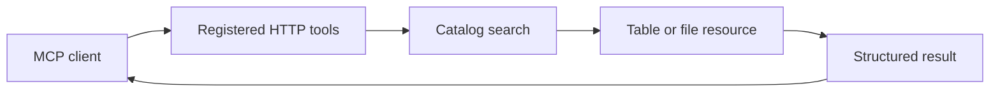

# donneesqc-mcp: An MCP gateway to public data

> donneesqc-mcp is a fork exposing Québec and Montréal open-data operations through MCP tools. Its entry point registers the tool collection and starts an…

- HTML page: https://antoineboucher.info/CV/blog/projects/notes/donneesqc-mcp/
- Language: en
- Translation (fr): https://antoineboucher.info/CV/blog/fr/projects/notes/donneesqc-mcp/index.md
- Published: 2026-10-23
- Updated: 2026-10-23
- Author: Antoine Boucher (https://antoineboucher.info/CV/index-en.html)

- Repository: https://github.com/antoinebou12/donneesqc-mcp
- License: MIT
- Inspected revision: 53a6ee4209c44ccfe360556a1b86c29d855f3e2f

## Summary

donneesqc-mcp is a fork exposing Québec and Montréal open-data operations through MCP tools. Its entry point registers the tool collection and starts an HTTP transport, leaving dataset access and geographic helpers in separate modules.

**Why it exists:** Production MCP server connecting AI assistants to Quebec & Montreal open data APIs with strict schema validation.

**Best fit:** Natural language querying of public municipal and provincial datasets across transportation, demographics, and municipal services.

## Languages (GitHub Linguist bytes)

| Language | % |
| --- | ---: |
| Python | 98.28 |
| Shell | 1.36 |
| Dockerfile | 0.36 |

## Getting started (repository commands, not run here)

### README.md · Installation manuelle

```bash
git clone https://github.com/Stefen-Taime/donneesqc-mcp.git
cd donneesqc-mcp
uv sync
cp .env.example .env
set -a && source .env && set +a
uv run python main.py
```

### README.md · Quick start

```bash
git clone https://github.com/Stefen-Taime/donneesqc-mcp.git
cd donneesqc-mcp
docker compose up -d
```


## Features and components

- **Server bootstrap** — main.py configures logging, optionally initializes Sentry, calls register_all_tools and runs the MCP object with streamable-http. Monitoring is optional; it is not the mechanism that serves dataset queries.
- **Data-service boundary** — The documented tool groups cover catalog discovery, CKAN DataStore access, resource downloads and geographic enrichment. A catalog result describes a resource; the actual table or file is a separate request and may use a different format.

## Architecture

Components and connections verified in the repository.

- MCP client → Registered HTTP tools
- Registered HTTP tools → Catalog search
- Catalog search → Table or file resource
- Table or file resource → Structured result
- Structured result → MCP client



**One path through the code:** Follow main into register_all_tools, then choose the dataset-access tool behind a catalog result. Resource identifiers, formats and geographic coordinate systems matter more than a dataset title alone.

## Constraints and checks

Open-data catalogs and schemas can change. A successful catalog query does not prove that every resource is fresh, complete or compatible with a downstream calculation.

## Files to read

- [main.py](https://github.com/antoinebou12/donneesqc-mcp/blob/main/main.py)
- [tools/__init__.py](https://github.com/antoinebou12/donneesqc-mcp/blob/main/tools/__init__.py)
- [README.md](https://github.com/antoinebou12/donneesqc-mcp/blob/main/README.md)


