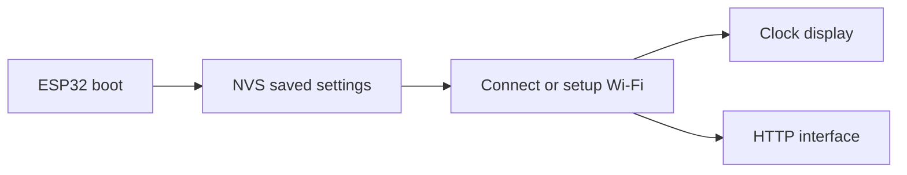

# ESP32-7SEG: An embedded clock with network setup

> ESP32-7SEG connects an ESP32 clock display to network configuration and an HTTP interface. The firmware startup decides whether saved Wi-Fi settings can…

- HTML page: https://antoineboucher.info/CV/blog/projects/notes/esp32-7seg/
- Language: en
- Translation (fr): https://antoineboucher.info/CV/blog/fr/projects/notes/esp32-7seg/index.md
- Published: 2026-10-23
- Updated: 2026-10-23
- Author: Antoine Boucher (https://antoineboucher.info/CV/index-en.html)

- Repository: https://github.com/antoinebou12/ESP32-7SEG
- License: MIT
- Inspected revision: 6cac20eed8dc6293d011a0c8a8341654e0870b80

## Summary

ESP32-7SEG connects an ESP32 clock display to network configuration and an HTTP interface. The firmware startup decides whether saved Wi-Fi settings can be reused or whether the device needs its setup path.

**Why it exists:** Embedded microcontroller firmware and mobile controller for driving multi-digit 7-segment displays.

**Best fit:** Physical computing status dashboards and hardware displays.

## Use cases

ESP32 firmware and an Android app that drive an I2C 7-segment display as a countdown or stopwatch over Wi-Fi.

- **Join the board to Wi-Fi** (Timer operator, ESP32 + 7-seg display): Without saved credentials, wifi.cpp starts an access point named ESPTimer; the / page then serves the setup form, and POST /connect stores the SSID and password in NVS.
- **Start a countdown or stopwatch** (Timer operator, ESP32 + 7-seg display): POST /timer-action with action, mode, minutes and seconds starts, pauses or stops a FreeRTOS task (COUNTDOWN or STOPWATCH) in display.cpp.
- **Set the digits directly** (Timer operator, ESP32 + 7-seg display): POST /update-display with minutes and seconds calls updateDisplay() and pushes a displayUpdated message.
- **Follow updates live** (Android app, ESP32 + 7-seg display): The /ws WebSocket broadcasts timerStarted, timerStopped and displayUpdated JSON; the Android WebSocketClient listens to it.
- **Control it from Android** (Timer operator, Android app): TimerApiService.kt maps the same endpoints with Retrofit (/timer-action, /connect, /scan, /update-display, /device-info) behind the TimerControl and WiFiConnect fragments.

### Scenario: Setting up a 5-minute countdown on a fresh board

1. Wire the Adafruit I2C backpack to SDA, SCL, VCC and GND, then flash the firmware with pio run -t upload (env firebeetle).
2. On first boot no credentials are in NVS, so join the ESPTimer access point and open the board's page.
3. Pick a network from /scan and submit it to /connect; the board saves it and joins the LAN.
4. Read the new IP in the serial monitor at 115200 baud and open it in a browser or the Android app.
5. Send action=start, mode=countdown, minutes=5, seconds=0 to /timer-action; the display counts down and /ws reports each update.

## Languages (GitHub Linguist bytes)

| Language | % |
| --- | ---: |
| Kotlin | 58.26 |
| C++ | 39.56 |
| C | 2.18 |

## Features and components

- **Boot and connectivity** — setup initializes NVS and checks its result. It loads saved credentials, attempts a connection and falls back to setupWiFi if needed. The same fallback runs when no saved credentials exist.
- **Display and web modules** — After connectivity setup, main.cpp calls startClockDisplay and setupWebServer. display.cpp, wifi.cpp and web_server.cpp keep hardware display, connection management and HTTP handling in separate modules.

## Architecture

Components and connections verified in the repository.

- ESP32 boot → NVS saved settings
- NVS saved settings → Connect or setup Wi-Fi
- Connect or setup Wi-Fi → Clock display
- Connect or setup Wi-Fi → HTTP interface

**One path through the code:** Follow the saved-credentials branch in setup. A stored network is attempted first, but failure still reaches setupWiFi. Only after that branch does the code start the display and web server.

## Constraints and checks

Hardware wiring, display support and Wi-Fi setup must be checked on the device. This HTTP interface should not be assumed safe for unrestricted Internet exposure.

## Files to read

- [src/main.cpp](https://github.com/antoinebou12/ESP32-7SEG/blob/main/src/main.cpp)
- [src/display.cpp](https://github.com/antoinebou12/ESP32-7SEG/blob/main/src/display.cpp)
- [src/web_server.cpp](https://github.com/antoinebou12/ESP32-7SEG/blob/main/src/web_server.cpp)
- [platformio.ini](https://github.com/antoinebou12/ESP32-7SEG/blob/main/platformio.ini)

