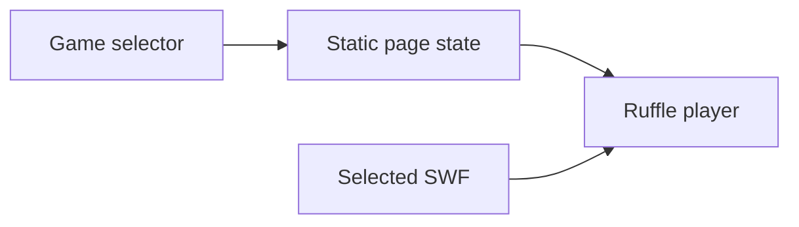

# FlashGames: A static shell around a Flash runtime

> FlashGames preserves small Flash games in a browser-facing collection. The page selects a SWF and hosts the Ruffle player. The game binary and the…

- HTML page: https://antoineboucher.info/CV/blog/projects/notes/flashgames/
- Language: en
- Translation (fr): https://antoineboucher.info/CV/blog/fr/projects/notes/flashgames/index.md
- Published: 2026-10-23
- Updated: 2026-10-23
- Author: Antoine Boucher (https://antoineboucher.info/CV/index-en.html)

- Repository: https://github.com/antoinebou12/FlashGames
- License: MIT
- Inspected revision: 7ee14ee2c3029c3b797d22f7594d04c4c900441c

## Summary

FlashGames preserves small Flash games in a browser-facing collection. The page selects a SWF and hosts the Ruffle player. The game binary and the surrounding HTML interface remain separate pieces.

**Why it exists:** Preservation archive of early 2010s ActionScript/Flash game creations with self-contained assets.

**Best fit:** Digital preservation and retro gaming nostalgia.

## Use cases

A browser page that replays three Flash games from 2010 through the Ruffle emulator, with no plugin needed.

- **Pick a game from the list** (Player): The #swfSelector drop-down in index.html lists Tag, Ricochet Kill and Ballon, each with a short description.
- **Play a SWF in the browser** (Player, Ruffle emulator): loadSWF() creates a Ruffle player with RufflePlayer.newest() and loads tag.swf, ricochet kill.swf or jeux.swf into #swfContainer.
- **Open a game by URL hash** (Player): updateHash() writes the game key into the URL hash, and the load and hashchange listeners reload that game, so a link like #tag opens it directly.
- **Run the collection locally** (Player, Ruffle emulator): The README says to clone the repository and open index.html; Ruffle is loaded from unpkg, so a network connection is still needed.

### Scenario: Replaying Ricochet Kill from a shared link

1. Open https://antoinebou12.github.io/FlashGames/ (or index.html from a clone).
2. The page loads the first game, Tag, because no hash is set.
3. Choose Ricochet Kill in the Select a Game list; the URL becomes #ricochet_kill.
4. Ruffle loads ricochet kill.swf into the black game area and the description bar updates.
5. Play with the mouse, then copy the URL to send someone straight to the same game.

## Languages (GitHub Linguist bytes)

| Language | % |
| --- | ---: |
| HTML | 100 |

## Features and components

- **Selection and runtime** — index.html includes the Ruffle script, a game selector and a player container. Selection updates the page state before loading the chosen SWF. Styles and icons come from CDN assets rather than a local frontend build.
- **Preserved game files** — The repository stores the SWF files alongside the page. Ruffle supplies the browser-compatible execution layer; the page does not rewrite the games into JavaScript source.

## Architecture

Components and connections verified in the repository.

- Game selector → Static page state
- Static page state → Ruffle player
- Selected SWF → Ruffle player

**One path through the code:** Trace the selector’s updateHash handler toward the player container. This is a useful distinction when debugging: a selector problem belongs to the page, while unsupported game behavior may belong to the runtime.

## Constraints and checks

Runtime compatibility must be checked per game. External scripts also affect availability even though the page itself is static.

## Files to read

- [index.html](https://github.com/antoinebou12/FlashGames/blob/main/index.html)
- [README.md](https://github.com/antoinebou12/FlashGames/blob/main/README.md)

