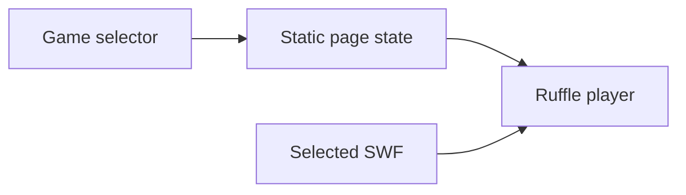

# FlashGames: A static shell around a Flash runtime

> FlashGames preserves small Flash games in a browser-facing collection. The page selects a SWF and hosts the Ruffle player. The game binary and the…

- HTML page: https://antoineboucher.info/CV/blog/projects/notes/flashgames/
- Language: en
- Translation (fr): https://antoineboucher.info/CV/blog/fr/projects/notes/flashgames/index.md
- Published: 2026-10-23
- Updated: 2026-10-23
- Author: Antoine Boucher (https://antoineboucher.info/CV/index-en.html)
- Repository: https://github.com/antoinebou12/FlashGames
- License: MIT
- Inspected revision: 7ee14ee2c3029c3b797d22f7594d04c4c900441c

## Summary

FlashGames preserves small Flash games in a browser-facing collection. The page selects a SWF and hosts the Ruffle player. The game binary and the surrounding HTML interface remain separate pieces.

**Why it exists:** Preservation archive of early 2010s ActionScript/Flash game creations with self-contained assets.

**Best fit:** Digital preservation and retro gaming nostalgia.

## Languages (GitHub Linguist bytes)

| Language | % |
| --- | ---: |
| HTML | 100 |

## Features and components

- **Selection and runtime** — index.html includes the Ruffle script, a game selector and a player container. Selection updates the page state before loading the chosen SWF. Styles and icons come from CDN assets rather than a local frontend build.
- **Preserved game files** — The repository stores the SWF files alongside the page. Ruffle supplies the browser-compatible execution layer; the page does not rewrite the games into JavaScript source.

## Architecture

Components and connections verified in the repository.

- Game selector → Static page state
- Static page state → Ruffle player
- Selected SWF → Ruffle player

**One path through the code:** Trace the selector’s updateHash handler toward the player container. This is a useful distinction when debugging: a selector problem belongs to the page, while unsupported game behavior may belong to the runtime.

## Constraints and checks

Runtime compatibility must be checked per game. External scripts also affect availability even though the page itself is static.

## Files to read

- [index.html](https://github.com/antoinebou12/FlashGames/blob/main/index.html)
- [README.md](https://github.com/antoinebou12/FlashGames/blob/main/README.md)

