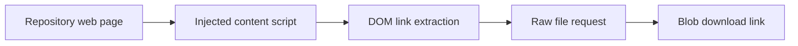

# GithubSimpleFileDownloader: A browser extension tied to page structure

> This archived extension attempted to add individual-file download controls to repository browsers. Its GitHub implementation shows the fragility of…

- HTML page: https://antoineboucher.info/CV/blog/projects/notes/githubsimplefiledownloader/
- Language: en
- Translation (fr): https://antoineboucher.info/CV/blog/fr/projects/notes/githubsimplefiledownloader/index.md
- Published: 2026-10-23
- Updated: 2026-10-23
- Author: Antoine Boucher (https://antoineboucher.info/CV/index-en.html)

- Repository: https://github.com/antoinebou12/GithubSimpleFileDownloader
- Inspected revision: dfdd7966db41841e272eddfeefe80332feab161d

## Summary

This archived extension attempted to add individual-file download controls to repository browsers. Its GitHub implementation shows the fragility of building an integration around another website’s DOM rather than a stable application interface.

**Why it exists:** Browser extension injecting one-click raw file download buttons into GitHub & GitLab interfaces.

**Best fit:** Quick single-file extraction without cloning large repositories.

## Use cases

A Chrome extension that adds a download link and file size next to each file in GitHub, GitLab and Bitbucket listings.

- **Add icons to file listings** (Repository visitor, Git hosting site): manifest.json injects inject_github.js, inject_gitlab.js or inject_bitbucket.js on matching pages; each script appends an icon link to every row (td.content, td.tree-item-file-name or tr.iterable-item).
- **Download a single file** (Repository visitor, Git hosting site): The script rewrites the blob link to its raw URL (raw.githubusercontent.com on GitHub, /raw/ on GitLab), fetches the text and sets a Blob object URL with a download attribute.
- **Show each file's size** (Repository visitor, Git hosting site): On GitHub, getFileURLDocument() loads the file page with XMLHttpRequest and changeFileSize() copies the Bytes/KB/MB line into a span next to the icon.
- **Open a folder from its icon** (Repository visitor, Git hosting site): Paths without a file extension are treated as directories, so the icon simply links to the folder page instead of downloading.

### Scenario: Grabbing one config file from a GitHub repository

1. Load the extension in Chrome (Manifest V2, content scripts for github.com, gitlab.com and bitbucket.org).
2. Open a repository's file list on github.com; inject_github.js waits for document.readyState to be complete.
3. A small GitHub icon and a size label appear next to each file row.
4. Click the icon next to the file: the raw content is saved under the file's name.
5. If icons do not appear, refresh the page as the README advises; the README title also flags the extension as not working.

## Languages (GitHub Linguist bytes)

| Language | % |
| --- | ---: |
| JavaScript | 97.74 |
| CSS | 2.26 |

## Features and components

- **Content-script injection** — The GitHub script waits for document readiness, locates td.content cells and inserts icons, links and size labels. Separate scripts target GitLab and Bitbucket. Each adapter depends on that site’s markup.
- **Raw-file download** — The script converts a repository file link to a raw URL, fetches text and creates a Blob download link. Its text-based path should not be assumed to preserve arbitrary binary files.

## Architecture

Components and connections verified in the repository.

- Repository web page → Injected content script
- Injected content script → DOM link extraction
- DOM link extraction → Raw file request
- Raw file request → Blob download link

**One path through the code:** Start at querySelectorAll('td.content') and inspect how child-node positions select the original link. A changed table layout can break this path before the network request is even made.

## Constraints and checks

The README explicitly marks the extension as not working. This is a historical implementation, not a current download recommendation.

## Files to read

- [manifest.json](https://github.com/antoinebou12/GithubSimpleFileDownloader/blob/master/manifest.json)
- [src/inject/inject_github.js](https://github.com/antoinebou12/GithubSimpleFileDownloader/blob/master/src/inject/inject_github.js)
- [src/inject/inject_gitlab.js](https://github.com/antoinebou12/GithubSimpleFileDownloader/blob/master/src/inject/inject_gitlab.js)

