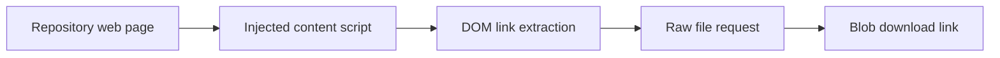

# GithubSimpleFileDownloader: A browser extension tied to page structure

> This archived extension attempted to add individual-file download controls to repository browsers. Its GitHub implementation shows the fragility of…

- HTML page: https://antoineboucher.info/CV/blog/projects/notes/githubsimplefiledownloader/
- Language: en
- Translation (fr): https://antoineboucher.info/CV/blog/fr/projects/notes/githubsimplefiledownloader/index.md
- Published: 2026-10-23
- Updated: 2026-10-23
- Author: Antoine Boucher (https://antoineboucher.info/CV/index-en.html)

- Repository: https://github.com/antoinebou12/GithubSimpleFileDownloader
- Inspected revision: dfdd7966db41841e272eddfeefe80332feab161d

## Summary

This archived extension attempted to add individual-file download controls to repository browsers. Its GitHub implementation shows the fragility of building an integration around another website’s DOM rather than a stable application interface.

**Why it exists:** Browser extension injecting one-click raw file download buttons into GitHub & GitLab interfaces.

**Best fit:** Quick single-file extraction without cloning large repositories.

## Languages (GitHub Linguist bytes)

| Language | % |
| --- | ---: |
| JavaScript | 97.74 |
| CSS | 2.26 |

## Features and components

- **Content-script injection** — The GitHub script waits for document readiness, locates td.content cells and inserts icons, links and size labels. Separate scripts target GitLab and Bitbucket. Each adapter depends on that site’s markup.
- **Raw-file download** — The script converts a repository file link to a raw URL, fetches text and creates a Blob download link. Its text-based path should not be assumed to preserve arbitrary binary files.

## Architecture

Components and connections verified in the repository.

- Repository web page → Injected content script
- Injected content script → DOM link extraction
- DOM link extraction → Raw file request
- Raw file request → Blob download link

**One path through the code:** Start at querySelectorAll('td.content') and inspect how child-node positions select the original link. A changed table layout can break this path before the network request is even made.

## Constraints and checks

The README explicitly marks the extension as not working. This is a historical implementation, not a current download recommendation.

## Files to read

- [manifest.json](https://github.com/antoinebou12/GithubSimpleFileDownloader/blob/master/manifest.json)
- [src/inject/inject_github.js](https://github.com/antoinebou12/GithubSimpleFileDownloader/blob/master/src/inject/inject_github.js)
- [src/inject/inject_gitlab.js](https://github.com/antoinebou12/GithubSimpleFileDownloader/blob/master/src/inject/inject_gitlab.js)

