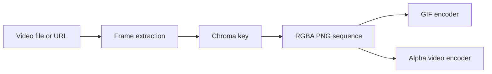

# GreenScreenVideotoAlphaPNGs: A transparent-frame production pipeline

> GreenScreenVideotoAlphaPNGs separates video acquisition, frame extraction and chroma keying from final encoding. RGBA PNG frames are an intermediate…

- HTML page: https://antoineboucher.info/CV/blog/projects/notes/greenscreenvideotoalphapngs/
- Language: en
- Translation (fr): https://antoineboucher.info/CV/blog/fr/projects/notes/greenscreenvideotoalphapngs/index.md
- Published: 2026-10-23
- Updated: 2026-10-23
- Author: Antoine Boucher (https://antoineboucher.info/CV/index-en.html)

- Repository: https://github.com/antoinebou12/GreenScreenVideotoAlphaPNGs
- License: MIT
- Inspected revision: b487e51f3c702aee2b21f0149727c3cb2708f09a

## Summary

GreenScreenVideotoAlphaPNGs separates video acquisition, frame extraction and chroma keying from final encoding. RGBA PNG frames are an intermediate output that can feed either the GIF path or an alpha-capable video codec.

**Why it exists:** OpenCV color-keying pipeline converting chroma-key green videos to RGBA alpha PNG sequences.

**Best fit:** Asset preparation for augmented reality (Snapchat Lens Studio, Spark AR).

## Languages (GitHub Linguist bytes)

| Language | % |
| --- | ---: |
| C++ | 57.96 |
| Python | 32.32 |
| JavaScript | 7.93 |
| PowerShell | 0.94 |
| Shell | 0.85 |

## Getting started (repository commands, not run here)

### README.md · Quick start (uv)

```bash
.\install.ps1
uv run greenscreen --help
```

### README.md · Quick start (uv)

```bash
bash install.sh
uv run greenscreen --help
```

### README.md · APNGLib (optional C++ extension)

```bash
$env:SKIP_APNGLIB='1'; uv sync --extra dev
```

### README.md · APNGLib (optional C++ extension)

```bash
$env:SKIP_APNGLIB='0'; uv sync --extra dev
```


## Features and components

- **Conversion stage** — The Typer convert command delegates to run_convert. It accepts a local video or URL and can prefer FFmpeg or force OpenCV extraction. The chroma module handles pixel transparency separately from acquisition.
- **Encoding choices** — gif and video take a directory of PNG frames. The GIF path offers an FFmpeg palette option; video accepts qtrle or prores_4444. Encoding is a new stage, so frame rate and format can change without repeating acquisition.

## Architecture

Components and connections verified in the repository.

- Video file or URL → Frame extraction
- Frame extraction → Chroma key
- Chroma key → RGBA PNG sequence
- RGBA PNG sequence → GIF encoder
- RGBA PNG sequence → Alpha video encoder



**One path through the code:** Follow cmd_convert into run_convert, then reuse its PNG output for cmd_video. Preserving the intermediate frames makes it easier to inspect matte edges before compression obscures them.

## Constraints and checks

Codec availability depends on the installed FFmpeg build. GIF transparency and video alpha have different capabilities and should not be treated as equivalent.

## Files to read

- [src/greenscreen/cli.py](https://github.com/antoinebou12/GreenScreenVideotoAlphaPNGs/blob/master/src/greenscreen/cli.py)
- [src/greenscreen/chroma.py](https://github.com/antoinebou12/GreenScreenVideotoAlphaPNGs/blob/master/src/greenscreen/chroma.py)
- [src/greenscreen/video_pipeline.py](https://github.com/antoinebou12/GreenScreenVideotoAlphaPNGs/blob/master/src/greenscreen/video_pipeline.py)


