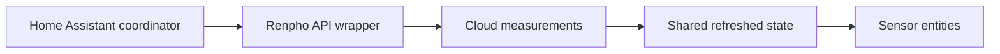

# hass_renpho: Polling a cloud API into Home Assistant sensors

> hass_renpho is a fork of a Home Assistant integration for Renpho measurements. A shared coordinator refreshes cloud data and sensor entities expose that…

- HTML page: https://antoineboucher.info/CV/blog/projects/notes/hass-renpho/
- Language: en
- Translation (fr): https://antoineboucher.info/CV/blog/fr/projects/notes/hass-renpho/index.md
- Published: 2026-10-23
- Updated: 2026-10-23
- Author: Antoine Boucher (https://antoineboucher.info/CV/index-en.html)

- Repository: https://github.com/antoinebou12/hass_renpho
- Inspected revision: b38c9dfa5416e5c1d09619d963b7bfaac238494b

## Summary

hass_renpho is a fork of a Home Assistant integration for Renpho measurements. A shared coordinator refreshes cloud data and sensor entities expose that state. The repository warns that its old-app API path is no longer reliably working.

**Why it exists:** Custom Home Assistant integration decoding Renpho Bluetooth & Cloud API biometric telemetry.

**Best fit:** Self-hosted health metric tracking and smart home automation triggers.

## Use cases

A Home Assistant integration that polls the legacy Renpho cloud API and exposes scale measurements as sensors.

- **Sign in and pick a scale user** (Home Assistant user, Home Assistant, Renpho cloud API): config_flow.py validates the email and password against Renpho, then shows a select_user step when the account has several scale users.
- **Poll measurements on a timer** (Home Assistant, Renpho cloud API): RenphoWeightCoordinator calls get_measurements(), list_girth() and list_girth_goal() every refresh seconds through a DataUpdateCoordinator.
- **Show body metrics as sensors** (Home Assistant user, Home Assistant): sensor.py and sensor_configs.py create sensors for weight, BMI, body fat, water, BMR, girth values and goals, with kg or lb for weight.
- **Route calls through a proxy** (Home Assistant user, Renpho cloud API): An optional proxy setting (http:// or socks5://) is checked by check_proxy() before Renpho calls, for IPs that renpho.qnclouds.com blocks.
- **Test an account in the API** (Home Assistant user, Renpho cloud API): api/app.py is a FastAPI app with routes such as /auth, /users, /measurements and /girth_info; vercel.json deploys it and the README points to its /docs page.

### Scenario: Getting the morning weigh-in into Home Assistant

1. Copy custom_components/renpho into <config_dir>/custom_components/renpho/ (or install through HACS).
2. Add renpho: with email, password and refresh: 600 to configuration.yaml, plus sensor: platform: renpho.
3. Restart Home Assistant; the integration signs in to the legacy Renpho API and resolves the user id.
4. Step on the scale with the outdated Renpho app so the measurement reaches the cloud.
5. Within the next refresh cycle the weight and body-fat sensors update on the dashboard.

## Languages (GitHub Linguist bytes)

| Language | % |
| --- | ---: |
| Python | 99.51 |
| Dockerfile | 0.49 |

## Getting started (repository commands, not run here)

### README.md · Installation

```bash
Stable
Use the latest release
Not stable
git clone https://github.com/antoinebou12/hass_renpho
```


## Features and components

- **Coordinated refresh** — RenphoWeightCoordinator extends DataUpdateCoordinator with a configurable refresh interval. One update calls get_measurements, list_girth and list_girth_goal, then records the last-update time.
- **Errors and sensor state** — The coordinator converts timeouts and API failures into UpdateFailed. Cancellation is treated separately during shutdown. Sensor definitions and the API wrapper remain outside the polling class.

## Architecture

Components and connections verified in the repository.

- Home Assistant coordinator → Renpho API wrapper
- Renpho API wrapper → Cloud measurements
- Cloud measurements → Shared refreshed state
- Shared refreshed state → Sensor entities



**One path through the code:** Follow _async_update_data through its three API calls and exception handling. A sensor value may be the last successful reading; the update status and timestamp are needed to distinguish it from fresh data.

## Constraints and checks

The upstream API is unofficial and the README reports breakage. This article does not establish current compatibility or medical accuracy of device measurements.

## Files to read

- [custom_components/renpho/coordinator.py](https://github.com/antoinebou12/hass_renpho/blob/master/custom_components/renpho/coordinator.py)
- [custom_components/renpho/sensor.py](https://github.com/antoinebou12/hass_renpho/blob/master/custom_components/renpho/sensor.py)
- [custom_components/renpho/api_renpho.py](https://github.com/antoinebou12/hass_renpho/blob/master/custom_components/renpho/api_renpho.py)


