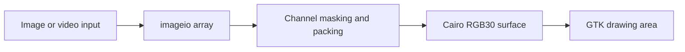

# HDR-10bpp-Display-Test: Packing ten-bit channels for a Cairo surface

> This display experiment loads image data into a GTK drawing area through Cairo. Viewer3.py makes the pixel representation explicit: channel samples are…

- HTML page: https://antoineboucher.info/CV/blog/projects/notes/hdr-10bpp-display-test/
- Language: en
- Translation (fr): https://antoineboucher.info/CV/blog/fr/projects/notes/hdr-10bpp-display-test/index.md
- Published: 2026-10-23
- Updated: 2026-10-23
- Author: Antoine Boucher (https://antoineboucher.info/CV/index-en.html)

- Repository: https://github.com/antoinebou12/HDR-10bpp-Display-Test
- Inspected revision: 9c72e072cdcae0c7d922f502049b6a155fa2daed

## Summary

This display experiment loads image data into a GTK drawing area through Cairo. Viewer3.py makes the pixel representation explicit: channel samples are masked and packed into a uint32 buffer before creating an RGB30 surface.

**Why it exists:** 10-bit HDR pipeline testing color banding and luminance curves on Linux display servers.

**Best fit:** Calibration and verification of 4K 10-bit HDR displays on Linux workstations.

## Use cases

Linux scripts to check that an HDR display really shows 10 bits per channel under an X server at depth 30.

- **Start X at depth 30** (Display tester, X server (Xorg)): Xdepth.sh runs startx -- -depth 30 and prints the depth from xwininfo, falling back to depth 24; xorg.conf sets DefaultDepth 30.
- **Show a 10-bit gray gradient** (Display tester, HDR10 monitor): Viewer.py packs the RGB channels of images/gray_gradient_10.tiff into a cairo FORMAT_RGB30 surface and draws it in a GTK 3 window.
- **Compare 8-bit and 10-bit** (Display tester, HDR10 monitor): The images/ folder holds gray_gradient_8.tiff next to gray_gradient_10.tiff, so the same gradient can be viewed at both depths to compare banding by eye.
- **Play a video at 10 bpc** (Display tester, HDR10 monitor): Viewer3.py adds a Typer CLI with --image-path and --video-path; videos are read frame by frame with imageio's ffmpeg reader in a thread at 30 fps.

### Scenario: Checking a new HDR10 monitor on Ubuntu

1. Stop the display manager: sudo systemctl stop lightdm || sudo systemctl stop gdm, then sudo pkill Xorg.
2. Start X with startx -- -depth 30 (or run Xdepth.sh).
3. Confirm with xwininfo -root | grep Depth that the root window reports depth 30.
4. Run python3 Viewer.py to open images/gray_gradient_10.tiff in the viewer window.
5. Look for banding in the gradient; smooth steps mean the 10-bit path works end to end.

## Languages (GitHub Linguist bytes)

| Language | % |
| --- | ---: |
| Python | 98.43 |
| Shell | 1.57 |

## Getting started (repository commands, not run here)

### README.md · Prerequisites

```bash
sudo apt-get install xserver-xorg python3 python3-gi python3-gi-cairo gir1.2-gtk-3.0 imagej
```

### README.md · Installing

```bash
pip3 install imageio
```

### README.md · Running the test

```bash
git clone https://github.com/yourusername/HDR-10bpp-Display-Test.git
```

### README.md · Running the test

```bash
cd HDR-10bpp-Display-Test
```

### README.md · Running the test

```bash
sudo systemctl stop lightdm || sudo systemctl stop gdm
sudo pkill Xorg
```


## Features and components

- **Pixels and drawing** — imageio reads the source array. _draw_on allocates a packed buffer and shifts each channel according to the selected depth, then passes it to cairo.ImageSurface.create_for_data. The GTK draw callback paints that surface.
- **Video path** — A worker reads video frames and updates the current image at a requested cadence. Drawing also manually processes pending GTK events. This older approach deserves particular attention to UI-thread ownership when maintained.

## Architecture

Components and connections verified in the repository.

- Image or video input → imageio array
- imageio array → Channel masking and packing
- Channel masking and packing → Cairo RGB30 surface
- Cairo RGB30 surface → GTK drawing area



**One path through the code:** Inspect _draw_on to see exactly where bit depth affects shifts and surface selection. Ten-bit storage concerns numeric precision; HDR transfer functions, metadata and display calibration require additional work outside this packing step.

## Constraints and checks

The lookup mentions twelve-bit input but has no matching twelve-bit Cairo format. This code does not demonstrate a complete HDR display pipeline.

## Files to read

- [Viewer3.py](https://github.com/antoinebou12/HDR-10bpp-Display-Test/blob/master/Viewer3.py)
- [Xdepth.sh](https://github.com/antoinebou12/HDR-10bpp-Display-Test/blob/master/Xdepth.sh)
- [xorg.conf](https://github.com/antoinebou12/HDR-10bpp-Display-Test/blob/master/xorg.conf)


