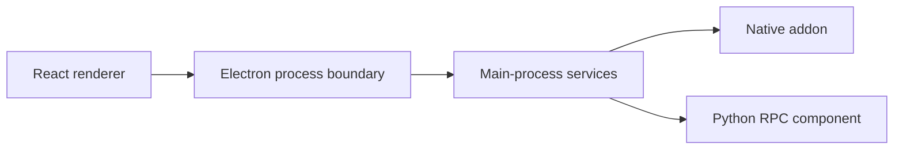

# hydra: An Electron application across process boundaries

> This Hydra fork is a desktop launcher with an Electron shell and React interface. Its build also includes a native addon and Python RPC component. Those…

- HTML page: https://antoineboucher.info/CV/blog/projects/notes/hydra/
- Language: en
- Translation (fr): https://antoineboucher.info/CV/blog/fr/projects/notes/hydra/index.md
- Published: 2026-10-23
- Updated: 2026-10-23
- Author: Antoine Boucher (https://antoineboucher.info/CV/index-en.html)

- Repository: https://github.com/antoinebou12/hydra
- License: MIT
- Inspected revision: e769e3b398c039a9e3d9977dbb1e5aa70776732e

## Summary

This Hydra fork is a desktop launcher with an Electron shell and React interface. Its build also includes a native addon and a Python RPC component, each with its own toolchain.

**Why it exists:** Desktop Electron and TypeScript application orchestrating gaming library metadata and downloads.

**Best fit:** Open-source alternative game launcher and library organizer.

## Use cases

A fork of Hydra Launcher, an Electron game library that downloads, launches, tracks playtime and syncs saves.

- **Build a game library** (Player, Hydra API and Cloud): IPC handlers in src/main/events/library (add-game-to-library, add-custom-game-to-library, assign-game-to-collection) manage the local library; catalogue events fetch game details and artwork.
- **Download and queue games** (Player, Torrents and hosters): Torrent downloads run in python_rpc/main.py with libtorrent, while services/hosters handles direct hosts such as Gofile, Mediafire and Pixeldrain; torrenting events manage the queue.
- **Add download sources** (Player, Torrents and hosters): download-sources events add, remove and sync the source lists that feed download options for each game.
- **Launch and track playtime** (Player): process-watcher.ts scans running processes against known executables to record playtime; on Linux, umu.ts and wine-prefix.ts prepare Proton or Wine.
- **Back up saves to the cloud** (Player, Hydra API and Cloud): Ludusavi.backupGame() runs the bundled ludusavi binary to collect save files, and the cloud-save services upload, compare and restore them with Hydra Cloud.
- **Unlock achievements** (Player, Hydra API and Cloud): services/achievements finds and parses local achievement files, merges them with remote data and shows notifications.

### Scenario: From catalogue page to a backed-up save

1. Install Node.js with Yarn, Python 3.9+ (pip install -r requirements.txt) and Rust, then run yarn; postinstall builds hydra-native.
2. Open a game in the catalogue and add it to the library.
3. Pick a download option; the Python RPC process starts the torrent and the download page shows progress.
4. Launch the game; the process watcher detects the executable and counts playtime.
5. Close the game and sync the save; ludusavi backs up the files and the cloud-save service uploads them.

## Languages (GitHub Linguist bytes)

| Language | % |
| --- | ---: |
| TypeScript | 81.85 |
| SCSS | 10.64 |
| Rust | 6.46 |
| Python | 0.55 |
| JavaScript | 0.49 |
| HTML | 0.01 |
| NSIS | 0 |

## Features and components

- **Main and renderer** — package.json points Electron to out/main/index.js. Separate TypeScript checks cover node and web code. Electron-Vite builds the desktop application, while React and the UI libraries belong to the renderer side.
- **Native and Python modules** — build:native runs a dedicated addon script. build:python-rpc packages python_rpc separately, and platform packaging invokes both paths. Installing JavaScript dependencies alone is therefore not the complete release build.

## Architecture

Components and connections verified in the repository.

- React renderer → Electron process boundary
- Electron process boundary → Main-process services
- Main-process services → Native addon
- Main-process services → Python RPC component

**One path through the code:** Start with the build scripts and distinguish renderer compilation, native-addon compilation and Python packaging. Then inspect the process API for a particular feature; package dependencies alone do not identify which process owns it.

## Constraints and checks

This note describes a fork’s structure and retains upstream credit. It does not claim authorship of the launcher or verify its download sources.

## Files to read

- [package.json](https://github.com/antoinebou12/hydra/blob/main/package.json)
- [electron.vite.config.ts](https://github.com/antoinebou12/hydra/blob/main/electron.vite.config.ts)
- [README.md](https://github.com/antoinebou12/hydra/blob/main/README.md)

