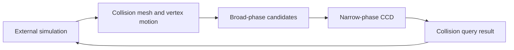

# ipc-toolkit: Collision queries as a library boundary

> ipc-toolkit provides geometric building blocks for contact-aware simulation. This fork contains collision meshes, broad-phase candidates, continuous…

- HTML page: https://antoineboucher.info/CV/blog/projects/notes/ipc-toolkit/
- Language: en
- Translation (fr): https://antoineboucher.info/CV/blog/fr/projects/notes/ipc-toolkit/index.md
- Published: 2026-10-23
- Updated: 2026-10-23
- Author: Antoine Boucher (https://antoineboucher.info/CV/index-en.html)

- Repository: https://github.com/antoinebou12/ipc-toolkit
- License: MIT
- Inspected revision: 4d9e47e9f5b2afd46be99234d127d12e3c7a74cd

## Summary

ipc-toolkit provides geometric building blocks for contact-aware simulation. This fork contains collision meshes, broad-phase candidates, continuous collision detection and contact-related energies. An external simulation still owns its time stepping and solve loop.

**Why it exists:** Friction and contact physics toolkit for robust computer graphics and finite element simulation.

**Best fit:** Nonlinear continuous contact mechanics in 3D physics engines.

## Use cases

A C++ library with Python bindings for Incremental Potential Contact: contact barriers, CCD and friction for simulators.

- **Build a collision mesh** (Simulation developer): ipc::CollisionMesh takes vertex, edge and face matrices (Eigen), as in the README quick start.
- **Find contacts within dhat** (Simulation developer, Host simulator): NormalCollisions::build() uses a broad phase (hash grid, LBVH, sweep and prune…) to collect primitive pairs closer than dhat.
- **Evaluate barrier, derivatives** (Simulation developer, Host simulator): BarrierPotential returns the energy, gradient and sparse Hessian that the host solver adds to its objective.
- **Get a collision-free step size** (Simulation developer, Host simulator): compute_collision_free_stepsize() runs continuous collision detection (Tight Inclusion by default, nonlinear and additive variants in src/ipc/ccd) between two vertex states.
- **Add anisotropic friction** (Simulation developer, Host simulator): FrictionPotential works on TangentialCollisions; smooth_mu.hpp adds elliptical anisotropic friction coefficients (commit Anisotropic friction #210).
- **Script it from Python** (Simulation developer): pybind11 bindings under python/src expose the same API as ipctk (pip install ipctk), built when IPC_TOOLKIT_BUILD_PYTHON is ON.

### Scenario: Adding contact to one implicit time step

1. Install the bindings with pip install ipctk, or add the library to a CMake project.
2. Create a CollisionMesh from the vertices, edges and faces of the scene.
3. Build NormalCollisions with dhat = 1e-3 for the current positions.
4. Add the BarrierPotential energy, gradient and Hessian to the solver's Newton system.
5. Before accepting the Newton step, clamp it with compute_collision_free_stepsize so no surfaces cross.

## Languages (GitHub Linguist bytes)

| Language | % |
| --- | ---: |
| C++ | 94.46 |
| CMake | 2.98 |
| Python | 2.1 |
| Cuda | 0.38 |
| Dockerfile | 0.08 |

## Verified technologies

- C++ — Library language from repository sources
- CCD — Continuous collision detection in ipc.hpp / ipc.cpp
- CMake — CMakeLists.txt build system

## Getting started (repository commands, not run here)

### python/README.md · Installation

```bash
pip install ipctk
```

### python/README.md · Installation

```bash
pip install git+https://github.com/ipc-sim/ipc-toolkit
```

### python/README.md · Build

```bash
pip install .
```

### python/README.md · Build

```bash
python -c "import ipctk"
```

### python/README.md · CMake Build

```bash
mkdir build
cd build
cmake -DCMAKE_BUILD_TYPE=Release -DIPC_TOOLKIT_BUILD_PYTHON=ON ..
make -j$(nproc)
```


## Features and components

- **Geometry and collision queries** — ipc.hpp accepts a CollisionMesh and vertex positions for intersection and collision-free-step queries. Broad-phase and narrow-phase CCD implementations are explicit parameters with defaults, separating candidate discovery from detailed tests.
- **Contact calculations** — The source tree separates distance, barrier, friction, tangent and potential modules. These components support a caller’s objective and derivatives; they do not automatically integrate an entire physical scene.

## Architecture

Components and connections verified in the repository.

- External simulation → Collision mesh and vertex motion
- Collision mesh and vertex motion → Broad-phase candidates
- Broad-phase candidates → Narrow-phase CCD
- Narrow-phase CCD → Collision query result
- Collision query result → External simulation



**One path through the code:** Follow is_step_collision_free from the public declaration into its implementation. Its result answers a geometric query for a proposed motion. The caller must decide how that result changes a step, line search or contact solve.

## Constraints and checks

Fork inclusion is not proof of upstream acceptance. Numerical behavior depends on caller inputs, tolerances and solver integration.

## Files to read

- [src/ipc/ipc.hpp](https://github.com/antoinebou12/ipc-toolkit/blob/main/src/ipc/ipc.hpp)
- [src/ipc/ipc.cpp](https://github.com/antoinebou12/ipc-toolkit/blob/main/src/ipc/ipc.cpp)
- [CMakeLists.txt](https://github.com/antoinebou12/ipc-toolkit/blob/main/CMakeLists.txt)


