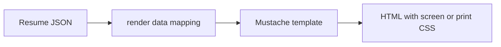

# jsonresume-theme-kendall: A JSON document into a resume template

> This fork of the Kendall JSON Resume theme turns structured resume data into HTML. The renderer prepares presentation fields before handing the result…

- HTML page: https://antoineboucher.info/CV/blog/projects/notes/jsonresume-theme-kendall/
- Language: en
- Translation (fr): https://antoineboucher.info/CV/blog/fr/projects/notes/jsonresume-theme-kendall/index.md
- Published: 2026-10-23
- Updated: 2026-10-23
- Author: Antoine Boucher (https://antoineboucher.info/CV/index-en.html)

- Repository: https://github.com/antoinebou12/jsonresume-theme-kendall
- License: MIT
- Inspected revision: d1401cef84466c09cb84f8752c185fc96e3f5c6e

## Summary

This fork of the Kendall JSON Resume theme turns structured resume data into HTML. The renderer prepares presentation fields before handing the result to a Mustache template and the accompanying screen and print styles.

**Why it exists:** Minimalist, print-perfect resume theme supporting schema.org semantic markup and clean layout.

**Best fit:** Automated resume compilation from structured JSON data.

## Use cases

A JSON Resume theme that renders resume.json to a Bootstrap HTML page with Mustache and FontAwesome icons.

- **Render resume.json to HTML** (Resume author, resume-cli): index.js exports render(), which prepares the resume object and fills resume.template with Mustache, inlining style.css and print.css.
- **Preview the theme locally** (Resume author, resume-cli): The README runs resume serve --theme . from the theme folder and opens the preview on http://localhost:4000.
- **Show a photo or Gravatar** (Resume author, Gravatar): When basics.image is missing, render() builds a Gravatar URL from basics.email with the gravatar package.
- **Map profiles to icons** (Resume author): Each basics.profiles network is mapped to a FontAwesome class, with special cases such as stackoverflow, gitlab and keybase.
- **Print a clean copy** (Resume author): print.css is injected as a media="print" style; it hides the photo and removes link URLs after anchors.

### Scenario: Previewing a resume with the Kendall theme

1. Install the CLI with npm install -g resume-cli.
2. Create and fill resume.json with resume init.
3. Run npm install in the theme folder to get mustache, lodash and gravatar.
4. Run resume serve --theme . and open http://localhost:4000.
5. Check that only filled sections (work, education, skills…) appear, then print from the browser.

## Languages (GitHub Linguist bytes)

| Language | % |
| --- | ---: |
| JavaScript | 55.76 |
| CSS | 44.24 |

## Getting started (repository commands, not run here)

### README.md · Install the command line

```bash
sudo npm install -g resume-cli
```

### README.md · Install npm packages

```bash
sudo npm install
```

### README.md · Serve theme

```bash
resume serve --theme .
```

### README.md · Serve theme

```bash
Preview: http://localhost:4000
Press ctrl-c to stop
```


## Features and components

- **Presentation mapping** — index.js maps network names to icon classes, formats work dates and derives flags for optional sections. It also chooses an explicit image or a Gravatar URL. This logic adapts data for the template.
- **Template and styles** — resume.template contains the HTML layout, while style.css and print.css separate screen and print appearance. The data transformation and document layout can be inspected independently.

## Architecture

Components and connections verified in the repository.

- Resume JSON → render data mapping
- render data mapping → Mustache template
- Mustache template → HTML with screen or print CSS



**One path through the code:** Follow a work startDate into the derived month and year fields. The renderer mutates fields on the supplied object, so callers reusing that object should account for the added presentation data.

## Constraints and checks

Old theme dependencies and expected schema fields need review with current resume data. A valid JSON document alone does not guarantee a clean printed layout.

## Files to read

- [index.js](https://github.com/antoinebou12/jsonresume-theme-kendall/blob/master/index.js)
- [resume.template](https://github.com/antoinebou12/jsonresume-theme-kendall/blob/master/resume.template)
- [print.css](https://github.com/antoinebou12/jsonresume-theme-kendall/blob/master/print.css)


