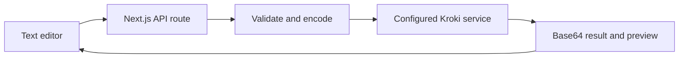

# kroki-playground: An editor, an API and a renderer

> kroki-playground is a Next.js interface for editing text diagrams and previewing their output. Its server route validates the requested diagram type and…

- HTML page: https://antoineboucher.info/CV/blog/projects/notes/kroki-playground/
- Language: en
- Translation (fr): https://antoineboucher.info/CV/blog/fr/projects/notes/kroki-playground/index.md
- Published: 2026-10-23
- Updated: 2026-10-23
- Author: Antoine Boucher (https://antoineboucher.info/CV/index-en.html)

- Repository: https://github.com/antoinebou12/kroki-playground
- License: MIT
- Inspected revision: 8def712a64de0f9badb65f2e1a3bb855aeb25523

## Summary

kroki-playground is a Next.js interface for editing text diagrams and previewing their output. Its server route validates the requested diagram type and format, encodes the source and fetches the rendered result from Kroki.

**Why it exists:** Serverless diagram experimentation suite in TypeScript running on Vercel with instant preview.

**Best fit:** Rapid prototyping of PlantUML, Mermaid, GraphViz, and C4 architecture diagrams.

## Use cases

A Next.js playground to write diagram source for Kroki, preview the SVG live and share it through the URL.

- **Preview a diagram live** (Diagram author, Kroki server): DiagramGenerator.tsx deflates the source with encodeDiagramPayload() (pako, base64url) and loads <base>/<type>/svg/<encoded> from kroki.io or NEXT_PUBLIC_KROKI_BASE_URL.
- **Switch between diagram types** (Diagram author): lib/kroki/diagramTypes.ts lists the Kroki route names (plantuml, mermaid, graphviz, d2, vega-lite…) offered in the type picker.
- **Share or download the result** (Diagram author): The page pushes ?type=…&source=… into the browser history, can copy the Kroki URL to the clipboard and saves the image as diagram.svg.
- **Render through the REST API** (API client developer, Kroki server): app/api/generate-diagram/route.ts accepts GET or POST with diagramSource, selectedDiagram and outputFormat and returns base64 diagramData; the README and openapi.yaml name the path /api/generateDiagram.
- **Read the OpenAPI docs** (API client developer): /api-docs renders public/openapi.yaml with swagger-ui-react, and GET /api/openapi serves the specification.

### Scenario: Sketching a sequence diagram and sending it to a teammate

1. Run npm install then npm run dev and open http://localhost:3000.
2. Choose plantuml in the type list and paste the @startuml … @enduml source.
3. The SVG preview refreshes from Kroki as the source changes.
4. Copy the page URL, which now carries ?type=plantuml&source=<encoded>, and send it.
5. Click download to save diagram.svg for the design document.

## Languages (GitHub Linguist bytes)

| Language | % |
| --- | ---: |
| TypeScript | 98.19 |
| JavaScript | 0.99 |
| CSS | 0.82 |

## Features and components

- **Validation before rendering** — app/api/generate-diagram/route.ts accepts GET and POST inputs through a shared validator. encodeDiagramPayload prepares the source for the Kroki URL. KROKI_BASE_URL selects the server-side rendering endpoint.
- **Response and failure states** — The route reads the returned bytes and responds with diagramUrl, base64 diagramData and mimeType. A non-success response from Kroki becomes a 502 with an upstream error code, distinct from invalid input.

## Architecture

Components and connections verified in the repository.

- Text editor → Next.js API route
- Next.js API route → Validate and encode
- Validate and encode → Configured Kroki service
- Configured Kroki service → Base64 result and preview
- Base64 result and preview → Text editor

**One path through the code:** Follow POST from req.json to validation and the upstream fetch. The response contains encoded image bytes, not raw SVG as the entire HTTP body. A consumer must use the returned MIME type when displaying those bytes.

## API

## Constraints and checks

An encoded share URL still contains recoverable diagram source. Compression and base64 encoding do not make a confidential diagram private.

## Files to read

- [app/api/generate-diagram/route.ts](https://github.com/antoinebou12/kroki-playground/blob/main/app/api/generate-diagram/route.ts)
- [lib/kroki/encode.ts](https://github.com/antoinebou12/kroki-playground/blob/main/lib/kroki/encode.ts)
- [lib/kroki/validate.ts](https://github.com/antoinebou12/kroki-playground/blob/main/lib/kroki/validate.ts)
- [package.json](https://github.com/antoinebou12/kroki-playground/blob/main/package.json)

