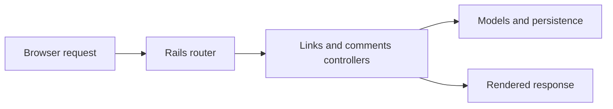

# linkshare: A Rails application for shared links

> linkshare is an archived Rails learning project for publishing links, commenting and voting. Its routes reveal a conventional server-rendered…

- HTML page: https://antoineboucher.info/CV/blog/projects/notes/linkshare/
- Language: en
- Translation (fr): https://antoineboucher.info/CV/blog/fr/projects/notes/linkshare/index.md
- Published: 2026-10-23
- Updated: 2026-10-23
- Author: Antoine Boucher (https://antoineboucher.info/CV/index-en.html)
- Repository: https://github.com/antoinebou12/linkshare
- Inspected revision: 2e223f99a50c07f3e60377f6c3252051b815c468

## Summary

linkshare is an archived Rails learning project for sharing links, commenting and voting. It renders pages on the server and includes account management and an administrative interface.

**Why it exists:** Ruby on Rails web platform featuring asynchronous OpenGraph metadata scrapers and card previews.

**Best fit:** Social bookmarking and rich link curation.

## Languages (GitHub Linguist bytes)

| Language | % |
| --- | ---: |
| Ruby | 55.29 |
| HTML | 19.55 |
| CSS | 13.28 |
| JavaScript | 11.56 |
| CoffeeScript | 0.32 |

## Features and components

- **Resources and actions** — config/routes.rb maps links to resource actions and nests comments beneath links. Member routes send like and dislike actions to upvote and downvote. The root page is links#index.
- **Accounts and administration** — Devise supplies the account-route surface, and RailsAdmin is mounted under /admin. Controllers and models are separate from the routing file; declaring a route does not show its full authorization or persistence behavior.

## Architecture

Components and connections verified in the repository.

- Browser request → Rails router
- Rails router → Links and comments controllers
- Links and comments controllers → Models and persistence
- Links and comments controllers → Rendered response

**One path through the code:** Follow PUT /links/:id/like into the upvote action, then inspect the model operation. This keeps the HTTP action, the user identity and the stored vote from being treated as one indistinguishable step.

## Constraints and checks

Archived dependencies and the exposed admin surface need review before redeployment. The route map alone is not evidence of authorization correctness.

## Files to read

- [config/routes.rb](https://github.com/antoinebou12/linkshare/blob/master/config/routes.rb)
- [Gemfile](https://github.com/antoinebou12/linkshare/blob/master/Gemfile)
- [README.md](https://github.com/antoinebou12/linkshare/blob/master/README.md)

