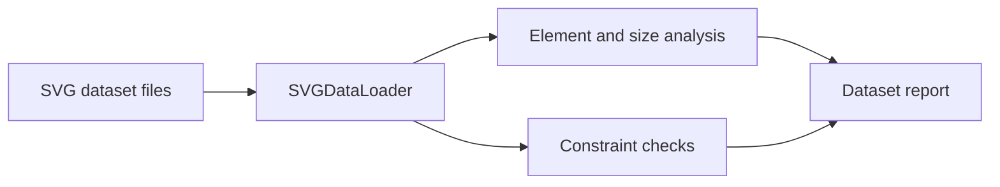

# LLM2SVG: Dataset analysis before model claims

> This LLM2SVG fork contains SVG dataset utilities and an evaluation-oriented scaffold. The visible implementation is useful for inspecting examples and…

- HTML page: https://antoineboucher.info/CV/blog/projects/notes/llm2svg/
- Language: en
- Translation (fr): https://antoineboucher.info/CV/blog/fr/projects/notes/llm2svg/index.md
- Published: 2026-10-23
- Updated: 2026-10-23
- Author: Antoine Boucher (https://antoineboucher.info/CV/index-en.html)

- Repository: https://github.com/antoinebou12/LLM2SVG
- Inspected revision: a8337761b49bbdcbac24f58c6adc5f17d1ac2a07

## Summary

This LLM2SVG fork contains SVG dataset utilities and an evaluation-oriented scaffold. The visible implementation is useful for inspecting examples and constraints; it does not establish a completed or trained text-to-SVG model.

**Why it exists:** Structured prompt engineering framework and Python validator generating crisp, valid SVG illustrations from LLM responses.

**Best fit:** Automated vector icon and diagram generation for design systems.

## Languages (GitHub Linguist bytes)

| Language | % |
| --- | ---: |
| Python | 100 |

## Getting started (repository commands, not run here)

### README.md · Dependencies

```bash
pip install cairosvg torch torchvision
```


## Features and components

- **Loading and constraints** — SVGAnalyzer composes SVGDataLoader and SVGConstraints. It enumerates samples, records file sizes and checks constraints. Dataset loading and validation are separate responsibilities.
- **Dataset reports** — The analyzer counts element names and builds per-sample validation results, with a summary-report method returning a pandas DataFrame. Element counting uses a regular expression to tolerate malformed SVG text.

## Architecture

Components and connections verified in the repository.

- SVG dataset files → SVGDataLoader
- SVGDataLoader → Element and size analysis
- SVGDataLoader → Constraint checks
- Element and size analysis → Dataset report
- Constraint checks → Dataset report



**One path through the code:** Follow validate_all_svgs and compare it with analyze_elements. Passing the declared constraints and having a plausible set of element names are different checks; neither establishes visual similarity to a text prompt.

## Constraints and checks

The analyzer has a machine-specific default data path. Model quality, training results and evaluation scores should not be inferred from these utility files.

## Files to read

- [utils/svg_analyzer.py](https://github.com/antoinebou12/LLM2SVG/blob/main/utils/svg_analyzer.py)
- [utils/data_loader.py](https://github.com/antoinebou12/LLM2SVG/blob/main/utils/data_loader.py)
- [utils/svg_constraints.py](https://github.com/antoinebou12/LLM2SVG/blob/main/utils/svg_constraints.py)


