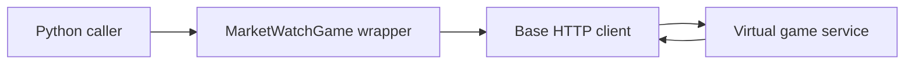

# marketwatch: A client around a virtual trading game

> marketwatch is an archived Python client for MarketWatch’s virtual trading game. It wraps login, game queries and simulated order operations. These are…

- HTML page: https://antoineboucher.info/CV/blog/projects/notes/marketwatch/
- Language: en
- Translation (fr): https://antoineboucher.info/CV/blog/fr/projects/notes/marketwatch/index.md
- Published: 2026-10-23
- Updated: 2026-10-23
- Author: Antoine Boucher (https://antoineboucher.info/CV/index-en.html)

- Repository: https://github.com/antoinebou12/marketwatch
- License: Apache-2.0
- Inspected revision: 9a8bd76c464501f249aff141f1e105e7345155c6

## Summary

marketwatch is an archived Python client for MarketWatch’s virtual trading game. It wraps login, game queries and simulated order operations. These are game interactions, not connections to a brokerage account.

**Why it exists:** Robust Python client library scraping and wrapping the MarketWatch virtual stock market game API.

**Best fit:** Automated trading bot development and portfolio backtesting.

## Use cases

Python client for the MarketWatch stock game: quotes, trades, portfolios and watchlists (login now blocked by captcha).

- **Get a stock price** (Game player, MarketWatch website): MarketWatch.get_price in marketwatch/__init__.py fetches the stock page with httpx and reads the intraday price with BeautifulSoup; the README marks it as working with skip_login=True.
- **Buy, sell, short or cover** (Game player, MarketWatch website): buy, sell, short and cover build an order payload and submit it to a game; MarketWatchGame in marketwatch/game.py binds the same calls to one game ID.
- **Read portfolio and orders** (Game player, MarketWatch website): get_portfolio, get_positions, get_pending_orders, get_leaderboard and get_game_settings scrape game pages; cancel_order and cancel_all_orders remove pending orders.
- **Manage watchlists** (Game player, MarketWatch website): create_watchlist, add_to_watchlist, get_watchlists, delete_watchlist and delete_watchlist_item call the MarketWatch watchlist endpoints.
- **Serve HTML game cards** (Game player, MarketWatch website): api/app.py is a FastAPI app with HTTP Basic auth that renders Jinja2 templates for /game, /portfolio, /leaderboard, /card and /watchlist.
- **Trade on an EMA crossover** (GitHub Actions, MarketWatch website): .github/workflows/ema-workflow.yml runs on a five-minute cron, pulls prices with yfinance, computes 20 and 80 period EMAs and buys or sells 100 shares on a crossover.

### Scenario: Check a quote, then trade in a game

1. Install the package with pip install marketwatch.
2. Create MarketWatch(email, password, skip_login=True) and call get_price("AAPL").
3. For game calls, log in with real credentials; the README warns this step currently fails on a captcha.
4. Once logged in, call get_games(), then buy(game_id, "AAPL", 100).
5. Check the result with get_positions(game_id) and get_pending_orders(game_id).

## Languages (GitHub Linguist bytes)

| Language | % |
| --- | ---: |
| Python | 77.68 |
| Jupyter Notebook | 13.22 |
| Jinja | 7.65 |
| Dockerfile | 1.45 |

## Getting started (repository commands, not run here)

### README.md · Installation

```bash
pip install marketwatch
```

### README.md · Installation

```bash
pip install git+https://github.com/antoinebou12/marketwatch.git
```

### README.md · Installation

```bash
git clone https://github.com/antoinebou12/marketwatch.git
```


## Features and components

- **Session and game scope** — MarketWatchGame subclasses MarketWatch and stores a game identifier. Methods such as buy and sell delegate to the base client with that identifier. Ledger and portfolio operations are scoped by the game.
- **Remote dependency** — The client depends on the website’s authentication and response structure. A Python method still existing does not mean its remote counterpart remains accessible. Authentication failure can block otherwise unchanged game methods.

## Architecture

Components and connections verified in the repository.

- Python caller → MarketWatchGame wrapper
- MarketWatchGame wrapper → Base HTTP client
- Base HTTP client → Virtual game service
- Virtual game service → Base HTTP client



**One path through the code:** Follow buy from the game wrapper into the base client. The wrapper adds the game ID; session handling and the actual HTTP request happen below it.

## Constraints and checks

The README reports broken login because of CAPTCHA. This historical client should not be presented as a working automated trading integration.

## Files to read

- [marketwatch/game.py](https://github.com/antoinebou12/marketwatch/blob/main/marketwatch/game.py)
- [marketwatch/__init__.py](https://github.com/antoinebou12/marketwatch/blob/main/marketwatch/__init__.py)
- [README.md](https://github.com/antoinebou12/marketwatch/blob/main/README.md)


