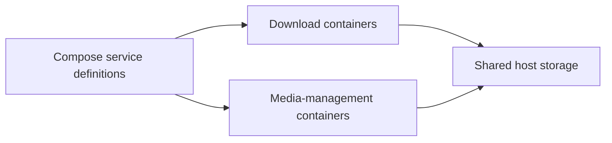

# MediaBoxDockerCompose: A media stack connected by volumes and networks

> MediaBoxDockerCompose brings several homelab services together in Docker Compose. Its architecture lives mainly in service definitions, shared…

- HTML page: https://antoineboucher.info/CV/blog/projects/notes/mediaboxdockercompose/
- Language: en
- Translation (fr): https://antoineboucher.info/CV/blog/fr/projects/notes/mediaboxdockercompose/index.md
- Published: 2026-10-23
- Updated: 2026-10-23
- Author: Antoine Boucher (https://antoineboucher.info/CV/index-en.html)

- Repository: https://github.com/antoinebou12/MediaBoxDockerCompose
- License: MIT
- Inspected revision: 57d930a836819f7fd3a3421ee5ece5efe3e41778

## Summary

MediaBoxDockerCompose brings several homelab services together in Docker Compose. Service definitions, shared filesystem paths and network connections describe how they work together.

**Why it exists:** Comprehensive GitOps container stack combining WireGuard VPN tunnel networking with 15+ homelab automation services.

**Best fit:** Automated, isolated private cloud media server with remote access and encrypted traffic routing.

## Use cases

Docker Compose stack for a home media server: download automation, Plex/Jellyfin, admin tools and a Caddy proxy.

- **Start the media stack** (Homelab admin, Docker host): docker-compose.yml defines about twenty containers that share PUID, PGID, TZ and ROOT from .env; docker-compose up -d starts them all.
- **Automate media downloads** (Homelab admin, Docker host): Sonarr, Radarr, Lidarr and Bazarr handle TV, movies, music and subtitles, fed by Jackett, Prowlarr or NZBHydra2 and sent to Deluge or NZBGet, all under ${ROOT}.
- **Watch or request media** (Media viewer, Docker host): Plex (port 32400) and Jellyfin (port 8096) serve the library; Ombi and Jellyseerr take requests and Tautulli reports Plex activity.
- **Monitor and browse the host** (Homelab admin, Docker host): Netdata (port 19999) shows host metrics, FileBrowser gives web file access and Dashmachine (port 5000) is a start page configured by dashmachine/config.ini.
- **Publish services via Caddy** (Homelab admin): caddy/Caddyfile maps subdomains such as sonarr.{$DOMAIN} to local ports with logging, rate limiting, an IP allowlist and basic auth taken from caddy/.env.
- **Add optional extras** (Homelab admin, Docker host): Separate compose files under extra/ add Samba shares, a WireGuard access server and Portainer; whisper/docker-compose.yml runs a Whisper ASR web service on port 9000.

### Scenario: Bring up a TV and movie server on one machine

1. Install Docker and Docker Compose, then clone the repository.
2. Edit .env: set TZ, PUID, PGID, ROOT (for example /media/MediaBox) and PLEX_CLAIM.
3. Run docker-compose up -d from the repository root.
4. Open Prowlarr on port 9696 and Sonarr on port 8989 to connect indexers and the download client.
5. Point Plex (port 32400) or Jellyfin (port 8096) at the completed folders under ROOT and start watching.

## Verified technologies

- Docker Compose — docker-compose.yml multi-service stack
- WireGuard VPN — Secure VPN tunnel integration
- Whisper AI — Automated audio transcription worker
- Portainer — Container management interface

## Getting started (repository commands, not run here)

### README.md · Usage

```bash
docker-compose up -d
```


### Docker

```bash
docker-compose up -d
```

## Features and components

- **Service roles** — The compose file includes download clients and media-management services such as Deluge, Jackett, Sonarr and Radarr. Each container has its own image and configuration. README service links should be distinguished from services actually enabled in Compose.
- **Persistent paths** — Volume mappings connect container paths to host storage. A path used by one service must agree with the path seen by another when files move between them. Networking and persistence solve different integration problems.

## Architecture

Components and connections verified in the repository.

- Compose service definitions → Download containers
- Compose service definitions → Media-management containers
- Download containers → Shared host storage
- Media-management containers → Shared host storage



**One path through the code:** Choose one service and compare its mounted download and library paths with the service that consumes them. Then check its network and port settings. Two healthy containers can still disagree about where a file exists.

## Compose services

| Service | Runtime | Ports | Depends on |
| --- | --- | --- | --- |
| plex | plexinc/pms-docker | 32400:32400 |  |
| wireguard | linuxserver/wireguard | 51820:51820/udp |  |
| whisper | local build / compose | 9000:9000 |  |
| portainer | portainer/portainer-ce | 9443:9443 |  |
| samba | dperson/samba | 139:139, 445:445 |  |

## Constraints and checks

Image tags and external services age independently. Review credentials, published ports and host permissions before starting this personal stack elsewhere.

## Files to read

- [docker-compose.yml](https://github.com/antoinebou12/MediaBoxDockerCompose/blob/master/docker-compose.yml)
- [README.md](https://github.com/antoinebou12/MediaBoxDockerCompose/blob/master/README.md)


