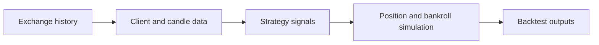

# nova-backtest: Historical candles into a strategy simulation

> nova-backtest is an archived fork of the NovaLabs crypto backtesting library: it downloads candles from eight exchanges, finds each trade's exit with vectorised look-ahead, charges maker fees and caps open positions. The exit algorithm, a worked trade and the limits, read from the code.

- HTML page: https://antoineboucher.info/CV/blog/projects/notes/nova-backtest/
- Language: en
- Translation (fr): https://antoineboucher.info/CV/blog/fr/projects/notes/nova-backtest/index.md
- Published: 2026-10-23
- Updated: 2026-11-06
- Author: Antoine Boucher (https://antoineboucher.info/CV/index-en.html)

- Repository: https://github.com/antoinebou12/nova-backtest
- License: MIT
- Inspected revision: dda19e6e09bdd59dd483a964f2e47085d2a1bdef

## Summary

nova-backtest is an archived fork of a strategy-backtesting framework. The core class selects an exchange client, loads a historical interval and manages a simulated bankroll and position constraints.

**Why it exists:** Financial backtesting framework interfacing with centralized crypto exchange APIs for quantitative strategy testing.

**Best fit:** Algorithmic trading strategy validation on historical tick data.

## Use cases

Python library to download crypto exchange candles and backtest a trading strategy with profit and drawdown stats.

- **Download historical candles** (Strategy developer, Exchange REST API): BackTest.get_historical_data in novalabs-backtest/utils/backtest.py calls the exchange client and caches OHLCV data in database/<exchange>/hist_<pair>_<candle>.csv, starting from 2019-01-01.
- **Pick an exchange client** (Strategy developer, Exchange REST API): clients() in novalabs-backtest/clients/clients.py returns a client for Binance, Bybit, OKX, Huobi, KuCoin, MEXC, Oanda or BTCEX, each following BackTestClientInterface.
- **Define entry and exit rules** (Strategy developer): A strategy subclasses BackTest and fills build_indicators, entry_strategy (entry_signal, take_profit, stop_loss, position_size) and exit_strategy (exit_signal).
- **Run the backtest** (Strategy developer): run_backtest simulates positions per pair with exchange fees, a maximum number of positions and a maximum holding time, then plots cumulative profit.
- **Save performance statistics** (Strategy developer): The run writes results/<strategy>_pairs_stats.csv and results/<strategy>_overall_stats.json with returns, drawdown and per-pair figures.
- **Build indicator features** (Strategy developer): TechnicalIndicatorsCreation in novalabs-backtest/utils/indicators.py adds lags, close ratios and support or resistance levels to a candle DataFrame.

### Scenario: Backtest a MACD strategy on Binance pairs

1. Install the dependencies listed in requirements.txt (the README's pip command spells the package novelabs-backtest).
2. Subclass BackTest with exchange="binance", candle="1h", list_pairs=["BTCUSDT", "ETHUSDT"], a start bankroll, leverage and max_pos.
3. Compute the MACD histogram in build_indicators and set entry_signal, take_profit and stop_loss in entry_strategy.
4. Call run_backtest(); missing pairs are downloaded into database/binance/ on first use.
5. Read the profit chart and the JSON and CSV files written under results/.

## Languages (GitHub Linguist bytes)

| Language | % |
| --- | ---: |
| Python | 99.74 |
| Dockerfile | 0.26 |

## Features and components

- **Inputs and clients** — BackTest receives exchange, strategy name, candle interval, pair list and start/end times. It constructs a client through the clients factory and loads the exchange fee assumptions from FEES.
- **Simulation state** — The constructor stores initial and current bankroll, leverage, maximum positions and holding duration. Geometric sizing is an explicit option. Reports depend on these assumptions as well as the strategy’s signals.

## Architecture

Components and connections verified in the repository.

- Exchange history → Client and candle data
- Client and candle data → Strategy signals
- Strategy signals → Position and bankroll simulation
- Position and bankroll simulation → Backtest outputs

**One path through the code:** Read the BackTest constructor before interpreting a chart. Fees, leverage and position sizing affect the simulated equity path; changing one creates a different experiment even with identical candles.

## Constraints and checks

Historical simulations are not live execution or evidence of future returns. This fork is archived, and exchange API compatibility needs fresh testing.

## Files to read

- [novalabs-backtest/utils/backtest.py](https://github.com/antoinebou12/nova-backtest/blob/Master/novalabs-backtest/utils/backtest.py)
- [novalabs-backtest/utils/constant.py](https://github.com/antoinebou12/nova-backtest/blob/Master/novalabs-backtest/utils/constant.py)
- [README.md](https://github.com/antoinebou12/nova-backtest/blob/Master/README.md)

