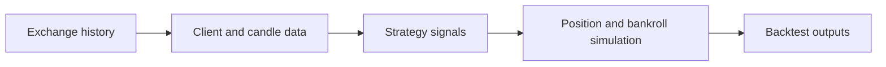

# nova-backtest: Historical candles into a strategy simulation

> nova-backtest is an archived fork of a strategy-backtesting framework. The core class selects an exchange client, loads a historical interval and…

- HTML page: https://antoineboucher.info/CV/blog/projects/notes/nova-backtest/
- Language: en
- Translation (fr): https://antoineboucher.info/CV/blog/fr/projects/notes/nova-backtest/index.md
- Published: 2026-10-23
- Updated: 2026-10-23
- Author: Antoine Boucher (https://antoineboucher.info/CV/index-en.html)

- Repository: https://github.com/antoinebou12/nova-backtest
- License: MIT
- Inspected revision: dda19e6e09bdd59dd483a964f2e47085d2a1bdef

## Summary

nova-backtest is an archived fork of a strategy-backtesting framework. The core class selects an exchange client, loads a historical interval and manages a simulated bankroll and position constraints.

**Why it exists:** Financial backtesting framework interfacing with centralized crypto exchange APIs for quantitative strategy testing.

**Best fit:** Algorithmic trading strategy validation on historical tick data.

## Languages (GitHub Linguist bytes)

| Language | % |
| --- | ---: |
| Python | 99.74 |
| Dockerfile | 0.26 |

## Features and components

- **Inputs and clients** — BackTest receives exchange, strategy name, candle interval, pair list and start/end times. It constructs a client through the clients factory and loads the exchange fee assumptions from FEES.
- **Simulation state** — The constructor stores initial and current bankroll, leverage, maximum positions and holding duration. Geometric sizing is an explicit option. Reports depend on these assumptions as well as the strategy’s signals.

## Architecture

Components and connections verified in the repository.

- Exchange history → Client and candle data
- Client and candle data → Strategy signals
- Strategy signals → Position and bankroll simulation
- Position and bankroll simulation → Backtest outputs

**One path through the code:** Read the BackTest constructor before interpreting a chart. Fees, leverage and position sizing affect the simulated equity path; changing one creates a different experiment even with identical candles.

## Constraints and checks

Historical simulations are not live execution or evidence of future returns. This fork is archived, and exchange API compatibility needs fresh testing.

## Files to read

- [novalabs-backtest/utils/backtest.py](https://github.com/antoinebou12/nova-backtest/blob/Master/novalabs-backtest/utils/backtest.py)
- [novalabs-backtest/utils/constant.py](https://github.com/antoinebou12/nova-backtest/blob/Master/novalabs-backtest/utils/constant.py)
- [README.md](https://github.com/antoinebou12/nova-backtest/blob/Master/README.md)

