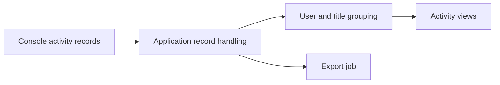

# NX-Activity-Log: Turning console play records into views

> NX-Activity-Log is a fork of a Switch homebrew activity viewer. The application reads console play records and presents per-user and per-title…

- HTML page: https://antoineboucher.info/CV/blog/projects/notes/nx-activity-log/
- Language: en
- Translation (fr): https://antoineboucher.info/CV/blog/fr/projects/notes/nx-activity-log/index.md
- Published: 2026-10-23
- Updated: 2026-10-23
- Author: Antoine Boucher (https://antoineboucher.info/CV/index-en.html)

- Repository: https://github.com/antoinebou12/NX-Activity-Log
- License: MIT
- Inspected revision: 757928a164399801dca1445a3cb3300f16abda06

## Summary

NX-Activity-Log is a fork of a Switch homebrew activity viewer. The application reads console play records and presents per-user and per-title summaries. Those records are inputs from the console rather than events generated by the UI.

**Why it exists:** High-precision telemetry parser reading raw Switch playtime event logs without system telemetry bans.

**Best fit:** Detailed gameplay analytics and playtime tracking for Switch homebrew.

## Languages (GitHub Linguist bytes)

| Language | % |
| --- | ---: |
| C++ | 92.17 |
| Makefile | 4.16 |
| C | 3.44 |
| Assembly | 0.23 |

## Features and components

- **Application lifecycle** — main.cpp creates Main::Application, runs it and releases it afterward. The source tree separates console-facing code under nx from UI and utility modules. Import and export jobs have their own source files.
- **Records and presentation** — The documented views organize activity by user, game and time period. That requires keeping record extraction separate from grouping and display. Exported data is another output of the application, not a substitute for the source records.

## Architecture

Components and connections verified in the repository.

- Console activity records → Application record handling
- Application record handling → User and title grouping
- User and title grouping → Activity views
- Application record handling → Export job

**One path through the code:** Begin with Main::Application and follow the console-facing nx modules before the views. This distinguishes a change in aggregation from a change in which records are available on the device.

## Constraints and checks

This is a fork, and console record access depends on the environment. The repository does not establish complete or tamper-proof historical tracking.

## Files to read

- [Application/source/main.cpp](https://github.com/antoinebou12/NX-Activity-Log/blob/main/Application/source/main.cpp)
- [Application/source/Application.cpp](https://github.com/antoinebou12/NX-Activity-Log/blob/main/Application/source/Application.cpp)
- [Application/source/Application.ExportJob.cpp](https://github.com/antoinebou12/NX-Activity-Log/blob/main/Application/source/Application.ExportJob.cpp)

