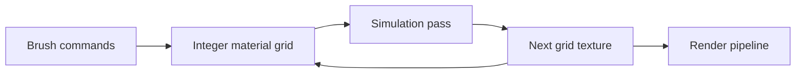

# nxsand: A GPU grid for falling sand

> nxsand is a falling-sand simulation for Switch with a desktop development target. Materials live in an integer grid. Simulation passes update that grid,…

- HTML page: https://antoineboucher.info/CV/blog/projects/notes/nxsand/
- Language: en
- Translation (fr): https://antoineboucher.info/CV/blog/fr/projects/notes/nxsand/index.md
- Published: 2026-10-23
- Updated: 2026-10-23
- Author: Antoine Boucher (https://antoineboucher.info/CV/index-en.html)
- Repository: https://github.com/antoinebou12/nxsand
- Inspected revision: af70da331e9e74ce0d5bd0365e1447f42cfc97d0

## Summary

nxsand is a falling-sand simulation for Switch with a desktop development target. Materials live in an integer grid. Simulation passes update that grid, and a separate rendering path turns material identifiers into the displayed image.

**Why it exists:** Cellular automaton sand physics simulation engine running on libnx with touch and controller input.

**Best fit:** Interactive physics simulations on handheld console touchscreens.

## Languages (GitHub Linguist bytes)

| Language | % |
| --- | ---: |
| C++ | 80.07 |
| GLSL | 10 |
| Python | 4.44 |
| PowerShell | 3.32 |
| Makefile | 1.63 |
| Shell | 0.31 |
| Just | 0.23 |

## Getting started (repository commands, not run here)

### README.md · Reference versions (June 2026)

```bash
dkp-pacman -Q libnx switch-sdl2
dkp-pacman -Syu    # pull newer libnx / switch-sdl2 when available
```

### README.md · 2. Install Switch libraries

```bash
dkp-pacman -S switch-dev switch-sdl2 switch-mesa switch-glm switch-freetype switch-harfbuzz
```

### README.md · 3. Build the NRO

```bash
make
```

### README.md · Desktop (optional)

```bash
make desktop
./build/NXSand
make test         # CPU reference tests, no GPU
```

### README.md · Desktop (optional)

```bash
pacman -S --needed mingw-w64-x86_64-gcc mingw-w64-x86_64-make mingw-w64-x86_64-SDL2 mingw-w64-x86_64-freetype mingw-w64-x86_64-angleproject
```


## Features and components

- **Simulation state** — SimState holds dimensions, tick state and brush parameters. SimPipeline owns two textures and framebuffers and exposes paint, step, readback and upload operations. Ping-pong storage keeps the previous grid available while producing the next.
- **Backend and tests** — The fragment path uses GL_R8UI; the compute path uses GL_R32UI for imageStore. Active-tile tracking and fallback state are exposed in the pipeline. The Makefile separates CPU tests, GPU tests and the Switch application build.

## Architecture

Components and connections verified in the repository.

- Brush commands → Integer material grid
- Integer material grid → Simulation pass
- Simulation pass → Next grid texture
- Next grid texture → Integer material grid
- Next grid texture → Render pipeline



**One path through the code:** Follow paintDisk into grid modification, then step into the selected backend. readTexture identifies the current grid for rendering. Save readback must also account for OpenGL row orientation rather than copying a displayed screenshot.

## Constraints and checks

GPU feature support and performance depend on the device and backend. The desktop test target does not substitute for Switch hardware measurements.

## Files to read

- [source/gpu/sim_pipeline.hpp](https://github.com/antoinebou12/nxsand/blob/main/source/gpu/sim_pipeline.hpp)
- [source/sim/sim_state.hpp](https://github.com/antoinebou12/nxsand/blob/main/source/sim/sim_state.hpp)
- [Makefile](https://github.com/antoinebou12/nxsand/blob/main/Makefile)

