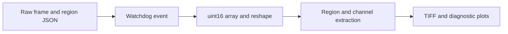

# RawAnalyser: From raw sensor values to diagnostic plots

> RawAnalyser is an older Python image-analysis experiment for clipping, channel values, gamma and vignetting. Its input assumptions are visible in the…

- HTML page: https://antoineboucher.info/CV/blog/projects/notes/rawanalyser/
- Language: en
- Translation (fr): https://antoineboucher.info/CV/blog/fr/projects/notes/rawanalyser/index.md
- Published: 2026-10-23
- Updated: 2026-10-23
- Author: Antoine Boucher (https://antoineboucher.info/CV/index-en.html)

- Repository: https://github.com/antoinebou12/RawAnalyser
- Inspected revision: ff745802fe293ebba44bf54389509dbb95d0fe5f

## Summary

RawAnalyser is an older Python image-analysis experiment for clipping, channel values, gamma and vignetting. Its input assumptions are visible in the implementation, including a fixed raw frame shape and regions selected through a JSON file.

**Why it exists:** Sensor pixel analysis tool computing clipping histograms and dynamic range for RAW camera frames.

**Best fit:** Camera sensor benchmarking and exposure verification in computational photography.

## Languages (GitHub Linguist bytes)

| Language | % |
| --- | ---: |
| Python | 100 |

## Getting started (repository commands, not run here)

### README.md · Usage

```bash
python RawAnalyser.py <pathfolder> <pointfile> --func <clipping,gamma,vignette,histogram,noHist,basic, default all> --bl <black level, default 1024> --vignette <pathvignette>
```

### README.md · Usage

```bash
python GUI.py
```

### README.md · Usage

```bash
python RawPixel.pt input<file> x y  --bitdepth <8,10,16,default 16>
```


## Features and components

- **File watcher and raw layout** — NewAnalyse reacts to file creation, loads region coordinates and reads uint16 data. The code reshapes the array to 1088 by 1928 pixels and writes a TIFF. Those dimensions are part of the implementation, not inferred from the file.
- **Regions and channels** — The analysis builds crop and gray-reference matrices before separating channel samples with fixed index patterns. Plots and statistics therefore depend on both the region file and the assumed sensor layout.

## Architecture

Components and connections verified in the repository.

- Raw frame and region JSON → Watchdog event
- Watchdog event → uint16 array and reshape
- uint16 array and reshape → Region and channel extraction
- Region and channel extraction → TIFF and diagnostic plots



**One path through the code:** Follow np.fromfile into reshape, then compare the crop bounds with the channel loops. A plausible-looking plot can still be wrong if the input dimensions or Bayer layout differ from those fixed assumptions.

## Constraints and checks

Python 2 syntax and deprecated scientific-library calls make this historical code. It is not a general RAW decoder or a validated camera-calibration package.

## Files to read

- [RawAnalyser.py](https://github.com/antoinebou12/RawAnalyser/blob/master/RawAnalyser.py)
- [GUI.py](https://github.com/antoinebou12/RawAnalyser/blob/master/GUI.py)
- [RawPixel.py](https://github.com/antoinebou12/RawAnalyser/blob/master/RawPixel.py)


