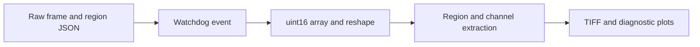

# RawAnalyser: From raw sensor values to diagnostic plots

> RawAnalyser is an older Python image-analysis experiment for clipping, channel values, gamma and vignetting. Its input assumptions are visible in the…

- HTML page: https://antoineboucher.info/CV/blog/projects/notes/rawanalyser/
- Language: en
- Translation (fr): https://antoineboucher.info/CV/blog/fr/projects/notes/rawanalyser/index.md
- Published: 2026-10-23
- Updated: 2026-10-23
- Author: Antoine Boucher (https://antoineboucher.info/CV/index-en.html)

- Repository: https://github.com/antoinebou12/RawAnalyser
- Inspected revision: ff745802fe293ebba44bf54389509dbb95d0fe5f

## Summary

RawAnalyser is an older Python image-analysis experiment for clipping, channel values, gamma and vignetting. Its input assumptions are visible in the implementation, including a fixed raw frame shape and regions selected through a JSON file.

**Why it exists:** Sensor pixel analysis tool computing clipping histograms and dynamic range for RAW camera frames.

**Best fit:** Camera sensor benchmarking and exposure verification in computational photography.

## Use cases

Python 2 scripts for camera-tuning engineers to check clipping, gamma and vignetting in raw Bayer sensor captures.

- **Mark ROI and gray patches** (Image quality engineer): GUI.py (PyQt5) opens a .raw or .tiff file, converts raw to TIFF for display and saves the clicked region of interest and gray patch corners to json/points.json.
- **Analyse each new raw capture** (Image quality engineer, Camera capture folder): RawAnalyser.py uses a watchdog observer on the given folder; every new 1928 x 1088 16-bit raw file is split into Bayer channels, saved as TIFF and analysed.
- **Detect black or white clipping** (Image quality engineer): clipping() prints per-channel minimum and maximum 10-bit levels and flags CLIPPING BLACK or white in colour when values reach the sensor limits.
- **Measure gamma and vignetting** (Image quality engineer): gamma() samples the gray patches from points.json; vignette() subtracts the black level (--bl, default 1024), divides by a stored .npy vignette map and writes a corrected TIFF.
- **Inspect one pixel's value** (Image quality engineer): RawPixel.py prints the value and Bayer colour of the pixel at x, y for a given width, height and bit depth, and dumps channels to array/*.txt.
- **Convert raw files to TIFF** (Image quality engineer, Camera capture folder): Raw2Tiff.py writes a TIFF from one raw file; 20MPto5MP.py bins 20 MP OV20880 frames by summing 2 x 2 same-colour pixels into a 5 MP image.

### Scenario: Check an OV2740 colour-checker capture

1. Install Python 2.7 and the packages in requirements.txt, plus tifffile.
2. Run python GUI.py, open a capture from raw/ and click the ROI and gray patches to update json/points.json.
3. Start python RawAnalyser.py raw json/points.json --func basic --bl 1024 to watch the folder.
4. Copy a new .raw capture into raw/; the script prints clipping warnings and gamma figures and writes a TIFF under tiff/.
5. Check a suspicious spot with python RawPixel.py <file> x y --width 1928 --height 1088.

## Languages (GitHub Linguist bytes)

| Language | % |
| --- | ---: |
| Python | 100 |

## Getting started (repository commands, not run here)

### README.md · Usage

```bash
python RawAnalyser.py <pathfolder> <pointfile> --func <clipping,gamma,vignette,histogram,noHist,basic, default all> --bl <black level, default 1024> --vignette <pathvignette>
```

### README.md · Usage

```bash
python GUI.py
```

### README.md · Usage

```bash
python RawPixel.pt input<file> x y  --bitdepth <8,10,16,default 16>
```


## Features and components

- **File watcher and raw layout** — NewAnalyse reacts to file creation, loads region coordinates and reads uint16 data. The code reshapes the array to 1088 by 1928 pixels and writes a TIFF. Those dimensions are part of the implementation, not inferred from the file.
- **Regions and channels** — The analysis builds crop and gray-reference matrices before separating channel samples with fixed index patterns. Plots and statistics therefore depend on both the region file and the assumed sensor layout.

## Architecture

Components and connections verified in the repository.

- Raw frame and region JSON → Watchdog event
- Watchdog event → uint16 array and reshape
- uint16 array and reshape → Region and channel extraction
- Region and channel extraction → TIFF and diagnostic plots



**One path through the code:** Follow np.fromfile into reshape, then compare the crop bounds with the channel loops. A plausible-looking plot can still be wrong if the input dimensions or Bayer layout differ from those fixed assumptions.

## Constraints and checks

Python 2 syntax and deprecated scientific-library calls make this historical code. It is not a general RAW decoder or a validated camera-calibration package.

## Files to read

- [RawAnalyser.py](https://github.com/antoinebou12/RawAnalyser/blob/master/RawAnalyser.py)
- [GUI.py](https://github.com/antoinebou12/RawAnalyser/blob/master/GUI.py)
- [RawPixel.py](https://github.com/antoinebou12/RawAnalyser/blob/master/RawPixel.py)


