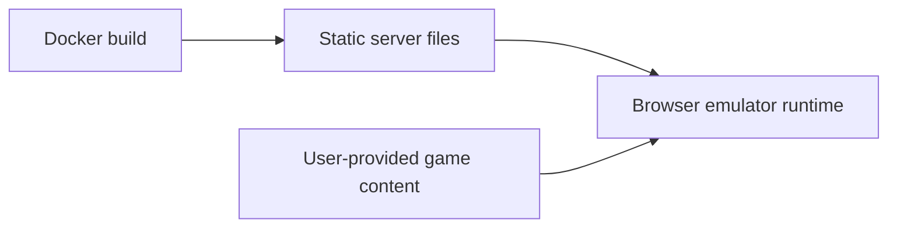

# retroarch-web-games: Packaging an emulator for a static web server

> retroarch-web-games is an archived container setup around a web build of RetroArch. The repository combines browser runtime files with scripts and…

- HTML page: https://antoineboucher.info/CV/blog/projects/notes/retroarch-web-games/
- Language: en
- Translation (fr): https://antoineboucher.info/CV/blog/fr/projects/notes/retroarch-web-games/index.md
- Published: 2026-10-23
- Updated: 2026-10-23
- Author: Antoine Boucher (https://antoineboucher.info/CV/index-en.html)

- Repository: https://github.com/antoinebou12/retroarch-web-games
- License: MIT
- Inspected revision: 71b41f91e252873023336b14d4582aa1ac5e2b44

## Summary

retroarch-web-games is an archived container setup around a web build of RetroArch. The repository combines browser runtime files with scripts and container assembly. Hosting the player and supplying game content are separate concerns.

**Why it exists:** Containerized WebAssembly RetroArch emulator bundle ready to run in any browser with zero installation.

**Best fit:** Zero-friction retro gaming via Docker on desktop, mobile, or smart TVs.

## Use cases

Docker image that self-hosts the RetroArch web player behind nginx, with game folders fetched at build time.

- **Install RetroArch web build** (Self-hoster, Online file sources): setup_retroarch.sh downloads the previous day's emscripten build from buildbot.libretro.com, extracts it into /var/www/html and unpacks the frontend bundle.
- **Download game sets** (Self-hoster, Online file sources): InternetArchive.py (typer, rich, requests) scrapes the listed archive pages for .zip and .7z files in parallel and saves them under downloads/<system name>.
- **Sort games by first letter** (Self-hoster): sort_mkdir.sh moves each file into a 0-9 or A-Z subfolder; the Dockerfile runs it for every Nintendo system folder.
- **Run the container** (Self-hoster): docker-compose up -d builds the image and maps port 8080 to nginx; entrypoint.sh regenerates the .index-xhr file lists before starting nginx.
- **Play in the browser** (Browser player): The player opens http://localhost:8080, picks a core and loads a game in the RetroArch Web Player page shipped with the nightly build (the repository keeps a copy as index.html, not copied by the Dockerfile).
- **Publish multi-arch images** (Self-hoster): .github/workflows/retroarch-web-games.yaml builds with Docker Buildx for amd64, arm64 and arm/v7 and pushes antoinebou12/retroarch-web-games to Docker Hub.

### Scenario: Host a retro game player on a home server

1. Clone the repository and check there is room for an image of about 10 GB, as the README warns.
2. Run docker-compose up -d; the build runs setup_retroarch.sh, InternetArchive.py and sort_mkdir.sh.
3. When the container starts, entrypoint.sh indexes the cores and bundle, then nginx serves the site.
4. Open http://localhost:8080 and load a game from the sorted downloads folders.

## Languages (GitHub Linguist bytes)

| Language | % |
| --- | ---: |
| HTML | 46.67 |
| JavaScript | 23.61 |
| Python | 13.72 |
| Shell | 11.62 |
| Dockerfile | 4.38 |

## Getting started (repository commands, not run here)

### README.md · Warning 

```bash
docker-compose up -d
```


## Features and components

- **Container assembly** — The Dockerfile prepares the web-serving environment and installation material. entrypoint.sh controls container startup, while index.html and libretro.js belong to the browser-facing runtime.
- **Runtime and content** — The browser loads the emulator runtime and its associated assets. Game files must match the expected core and format. Repository download scripts describe content acquisition separately from running the web interface.

## Architecture

Components and connections verified in the repository.

- Docker build → Static server files
- Static server files → Browser emulator runtime
- User-provided game content → Browser emulator runtime



**One path through the code:** Read the Dockerfile alongside entrypoint.sh to separate image-build downloads from runtime serving. An image that builds successfully may still lack a browser-compatible core or the assets needed by a selected game.

## Constraints and checks

This archived setup needs dependency and browser review before reuse. Only use game content you are entitled to use; no game downloads are needed to inspect the architecture.

## Files to read

- [Dockerfile](https://github.com/antoinebou12/retroarch-web-games/blob/master/Dockerfile)
- [entrypoint.sh](https://github.com/antoinebou12/retroarch-web-games/blob/master/entrypoint.sh)
- [index.html](https://github.com/antoinebou12/retroarch-web-games/blob/master/index.html)


