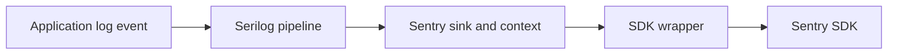

# Serilog.Sinks.SentrySDK: Adapting log events to Sentry

> Serilog.Sinks.SentrySDK bridges a .NET logging pipeline and the Sentry SDK. The application emits structured log events; a sink adapts that information…

- HTML page: https://antoineboucher.info/CV/blog/projects/notes/serilog-sinks-sentrysdk/
- Language: en
- Translation (fr): https://antoineboucher.info/CV/blog/fr/projects/notes/serilog-sinks-sentrysdk/index.md
- Published: 2026-10-23
- Updated: 2026-10-23
- Author: Antoine Boucher (https://antoineboucher.info/CV/index-en.html)
- Repository: https://github.com/antoinebou12/Serilog.Sinks.SentrySDK
- License: MIT
- Inspected revision: d0b5c252b942f61f097feccef10ac2d2b43aad7b

## Summary

Serilog.Sinks.SentrySDK connects a .NET logging pipeline to the Sentry SDK. Its sink converts structured log events for Sentry, so application call sites can keep using Serilog.

**Why it exists:** Production .NET 6+ Serilog sink bridging structured logging and Sentry error telemetry with zero allocation overhead.

**Best fit:** Enterprise .NET microservice error observability and distributed trace correlation.

## Languages (GitHub Linguist bytes)

| Language | % |
| --- | ---: |
| C# | 98.04 |
| PowerShell | 1.96 |

## Getting started (repository commands, not run here)

### README.md · Installation

```bash
dotnet add package Serilog.Sinks.SentrySDK
Install-Package Serilog.Sinks.SentrySDK
```

### README.md · Build, run tests, and coverage (local development)

```bash
dotnet restore src/Serilog.Sinks.SentrySDK/Serilog.Sinks.SentrySDK.csproj
dotnet build src/Serilog.Sinks.SentrySDK/Serilog.Sinks.SentrySDK.csproj -c Release
dotnet build src/Serilog.Sinks.SentrySDK.AspNetCore/Serilog.Sinks.SentrySDK.AspNetCore.csproj -c Release
dotnet test src/Serilog.Sinks.SentrySDK.Tests/Serilog.Sinks.SentrySDK.Tests.csproj
dotnet test src/Serilog.Sinks.SentrySDK.AspNetCore.Tests/Serilog.Sinks.SentrySDK.AspNetCore.Tests.csproj
```

### README.md · Build, run tests, and coverage (local development)

```bash
dotnet test /p:CollectCoverage=true /p:CoverletOutputFormat=cobertura /p:CoverletOutput=./reports/coverage src/Serilog.Sinks.SentrySDK.Tests/Serilog.Sinks.SentrySDK.Tests.csproj
```

### README.md · Code formatting (dotnet format)

```bash
dotnet restore src/Serilog.Sinks.SentrySDK.sln
dotnet format src/Serilog.Sinks.SentrySDK.sln
```

### README.md · Code formatting (dotnet format)

```bash
dotnet format src/Serilog.Sinks.SentrySDK.sln --verify-no-changes
```


## Features and components

- **Sink and SDK boundary** — SentrySink.cs defines an SDK wrapper interface with capture-message, capture-exception and transaction methods. The wrapper delegates to SentrySdk. This boundary gives tests a substitute for the external SDK calls.
- **Application context** — The source tree separates the sink package from ASP.NET Core integration and tests. Request and user factories adapt HTTP context. Logging configuration and request enrichment therefore have different responsibilities.

## Architecture

Components and connections verified in the repository.

- Application log event → Serilog pipeline
- Serilog pipeline → Sentry sink and context
- Sentry sink and context → SDK wrapper
- SDK wrapper → Sentry SDK



**One path through the code:** Follow an exception-bearing log through the sink and compare it with a message-only event. The wrapper exposes separate capture operations, so a useful test checks the chosen operation and its event data, not only that a call occurred.

## Constraints and checks

Request context can contain personal data. Review enrichment and filtering before forwarding it; package presence alone does not establish a privacy policy.

## Files to read

- [src/Serilog.Sinks.SentrySDK/SentrySink.cs](https://github.com/antoinebou12/Serilog.Sinks.SentrySDK/blob/main/src/Serilog.Sinks.SentrySDK/SentrySink.cs)
- [src/Serilog.Sinks.SentrySDK/AspNetCoreSentryRequestFactory.cs](https://github.com/antoinebou12/Serilog.Sinks.SentrySDK/blob/main/src/Serilog.Sinks.SentrySDK/AspNetCoreSentryRequestFactory.cs)
- [src/Serilog.Sinks.SentrySDK/SentrySinkExtensions.cs](https://github.com/antoinebou12/Serilog.Sinks.SentrySDK/blob/main/src/Serilog.Sinks.SentrySDK/SentrySinkExtensions.cs)

