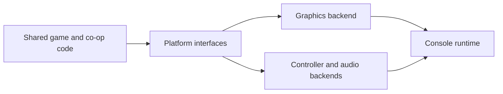

# sm64coopdx-switch-N3DS: Keeping a port behind platform interfaces

> This fork explores Switch and New 3DS targets for sm64coopdx. Shared game and co-op code sit above platform-specific graphics, audio and input. The…

- HTML page: https://antoineboucher.info/CV/blog/projects/notes/sm64coopdx-switch-n3ds/
- Language: en
- Translation (fr): https://antoineboucher.info/CV/blog/fr/projects/notes/sm64coopdx-switch-n3ds/index.md
- Published: 2026-10-23
- Updated: 2026-10-23
- Author: Antoine Boucher (https://antoineboucher.info/CV/index-en.html)

- Repository: https://github.com/antoinebou12/sm64coopdx-switch-N3DS
- Inspected revision: 567fd71a962d44e006461f3085a3a7ca3a063eb4

## Summary

This fork explores Switch and New 3DS targets for sm64coopdx. Shared game and co-op code sit above platform-specific graphics, audio and input. The platform probe is a smaller executable with a narrower purpose than the full game.

**Why it exists:** Low-level C systems port optimizing multi-threaded networking and memory layout for embedded handheld consoles.

**Best fit:** Co-op multiplayer emulation and custom embedded gaming on Switch & N3DS.

## Use cases

Unofficial Nintendo Switch homebrew port of sm64coopdx online co-op, with an early New 3DS target; you supply the ROM.

- **Install with your own ROM** (Switch player): docs/SWITCH_INSTALL.md: extract the release ZIP to the SD card root, add a US ROM as switch/sm64coopdx/baserom.us.z64 matching sm64.us.sha1, and launch sm64coopdx.nro in full application mode.
- **Join a public CoopNet lobby** (Switch player, CoopNet lobby service): The Switch build sends its genuine NRO fingerprint and lists lobbies in the sm64coop-android namespace, as described in docs/switch.md; the client code is under src/pc/network/coopnet.
- **Play over local wireless** (Switch player): src/pc/network/socket/socket_ldn.c adds a local wireless transport and src/pc/djui/djui_panel_ldn_browser.c lists nearby sessions.
- **Enter a lobby password** (Switch player, CoopNet lobby service): Private-lobby passwords use the in-game keypad in src/pc/djui/djui_panel_switch_text_entry.c instead of the native Switch keyboard.
- **Build and package the NRO** (Port developer): In the devkitpro/devkita64 Docker image, make -f Makefile.switch-sdmc SWITCH_COOPNET=1 switch-nro builds the NRO and switch-dist checks the header and hashes and writes the release ZIP; build-switch-game.yml runs ROM-free portability gates in CI.
- **Build the New 3DS target** (Port developer): Makefile.new3ds builds a platform shell and Makefile.new3ds-game the full engine with a Citro3D renderer and NDSP audio; docs/new3ds-port.md says gameplay on hardware is not verified yet.

### Scenario: Play co-op online from a Switch

1. Extract the sm64coopdx Switch release ZIP to the SD card root, creating switch/sm64coopdx/.
2. Copy your own US ROM to switch/sm64coopdx/baserom.us.z64.
3. Hold R while starting a game to open the Homebrew Menu in full application mode, then launch SM64CoopDX.
4. Open the join menu, pick a public CoopNet lobby and type its password on the in-game keypad if it is private.
5. If something fails, read startup.log, coopnet.log and exception.log under switch/sm64coopdx/logs/.

## Languages (GitHub Linguist bytes)

| Language | % |
| --- | ---: |
| C | 82.89 |
| C++ | 10.86 |
| Lua | 4 |
| Python | 1.44 |
| Assembly | 0.49 |
| Shell | 0.13 |
| Pawn | 0.11 |
| Go Template | 0.04 |
| Makefile | 0.03 |
| Dockerfile | 0 |
| Linker Script | 0 |
| PHP | 0 |
| BitBake | 0 |

## Features and components

- **Shared runtime and backends** — src/pc separates controller, audio, graphics, networking and platform code. Porting work can replace a backend while keeping shared game behavior. Build flags and target makefiles determine which implementations are linked.
- **The platform probe** — Makefile.switch-platform compiles a probe with Switch lifecycle, input and crash-log code, then packages an NRO using devkitPro tools. Its source list is deliberately smaller than the full game’s build.

## Architecture

Components and connections verified in the repository.

- Shared game and co-op code → Platform interfaces
- Platform interfaces → Graphics backend
- Platform interfaces → Controller and audio backends
- Graphics backend → Console runtime
- Controller and audio backends → Console runtime

**One path through the code:** Read the probe’s SOURCES list before interpreting a successful build. It exercises selected platform modules; it does not establish that every game subsystem, graphics path or co-op session works on the console.

## Constraints and checks

Full-game testing requires the user’s own legally obtained game assets and actual hardware validation. This fork retains the upstream game-project credit.

## Files to read

- [Makefile.switch-platform](https://github.com/antoinebou12/sm64coopdx-switch-N3DS/blob/main/Makefile.switch-platform)
- [src/pc/platform/switch/switch_platform.c](https://github.com/antoinebou12/sm64coopdx-switch-N3DS/blob/main/src/pc/platform/switch/switch_platform.c)
- [Makefile.new3ds](https://github.com/antoinebou12/sm64coopdx-switch-N3DS/blob/main/Makefile.new3ds)

