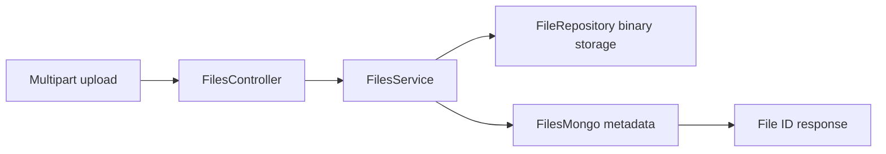

# SpringBootFilesUploader: File bytes and metadata on separate paths

> SpringBootFilesUploader is a Kotlin and Spring backend with a file-upload path that separates binary storage from document metadata. A file identifier…

- HTML page: https://antoineboucher.info/CV/blog/projects/notes/springbootfilesuploader/
- Language: en
- Translation (fr): https://antoineboucher.info/CV/blog/fr/projects/notes/springbootfilesuploader/index.md
- Published: 2026-10-23
- Updated: 2026-10-23
- Author: Antoine Boucher (https://antoineboucher.info/CV/index-en.html)
- Repository: https://github.com/antoinebou12/SpringBootFilesUploader
- License: MIT
- Inspected revision: 3be3bbc6d828edf840ab6edaffee661db671d7db

## Summary

SpringBootFilesUploader is a Kotlin and Spring backend with a file-upload path that separates binary storage from document metadata. A file identifier returned to the client connects those two representations during download.

**Why it exists:** Spring Boot microservice written in Kotlin with streaming multipart file upload and integrity validation.

**Best fit:** High-throughput file ingestion and storage backend.

## Languages (GitHub Linguist bytes)

| Language | % |
| --- | ---: |
| Kotlin | 99.52 |
| Java | 0.31 |
| Dockerfile | 0.17 |

## Features and components

- **HTTP validation** — FilesController accepts a multipart document, checks its filename extension and declares moderator/admin upload roles. The size-check block is commented out. Downloads use a file ID and return stored content type and length.
- **Storage coordination** — FilesService creates a UUID-based path and sends bytes to FileRepository. It then saves a FileModel through FilesMongo. Reads look up the metadata first, then use its path to retrieve the bytes.

## Architecture

Components and connections verified in the repository.

- Multipart upload → FilesController
- FilesController → FilesService
- FilesService → FileRepository binary storage
- FilesService → FilesMongo metadata
- FilesMongo metadata → File ID response

**One path through the code:** Follow addDocument in FilesService: binary storage is written before metadata. If the second write fails, the first can leave an orphaned file. A production version needs cleanup or another explicit consistency strategy.

## Constraints and checks

Role annotations need the corresponding security configuration. Extension checks are not content validation, and buffering document.bytes loads the upload into memory.

## Files to read

- [src/main/kotlin/com/api/project/controller/FilesController.kt](https://github.com/antoinebou12/SpringBootFilesUploader/blob/main/src/main/kotlin/com/api/project/controller/FilesController.kt)
- [src/main/kotlin/com/api/project/service/FilesService.kt](https://github.com/antoinebou12/SpringBootFilesUploader/blob/main/src/main/kotlin/com/api/project/service/FilesService.kt)
- [build.gradle.kts](https://github.com/antoinebou12/SpringBootFilesUploader/blob/main/build.gradle.kts)

